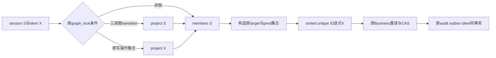

# 共享项目门修订：明确逐点任务锁序

作者、执行者：后端 AI。root 已逐字读原 baf1f9e 与 DB9e0 设计并明确准入本修订的代码候选和 fresh 开发测试；没有授权直接合并或声明正式性能通过。本阶段从 9286c7c1c44c8f9c2ef9557abbbb67825a8bba77 建立独立分支，原设计/原件保持历史不回写。

## 勘误和准入边界

原设计的“只改 project lock 参数、保留多ID batch”没有实现过，也没有 MySQL 成功结果。SQL ORDER BY 不能单独证明 InnoDB 多ID查询按期望全序取锁；root 明确不采用该路线。

修订候选只改 Runtime.locked_scope：

1. 原 graph_lock 条件不变；_PROJECT_LOCK 中项目/图/成员/iteration/assignment 写操作 project X，只有 START/UNBLOCK/REWORK 读图 transition project S，且全程不升级。
2. 原 ids 集合构成不变：target、原依赖前驱、写依赖时 body predecessor，set 去重。所有原 Runtime task-lock 路径一致，按 sorted(ids) 一个个调用 `g.rows("tasks", {"project_id": call.project_id, "id": identifier}, limit=1, lock="update")`。
3. 每条锁查询含唯一 PK scalar id 和原项目 predicate，最多一个合法目标行；不依赖优化器对多ID结果/取锁重排。不改 Rows 全局实现、索引、隔离级别或 Business.check_graph 等写者原逻辑。
4. 仍先锁完全部 Runtime 集合，再返回 None 并执行原 Business。锁查询返回值仍丢弃，Business.task/依赖重读不变；不把锁读替成缓存，不前移版本/角色/状态检查。

## 输入输出、拒绝和线性化

输入仍为原验证/claim 后 Call 与当前 UoW Gateway；输出 None 和原 actor/project/membership 刷新。auth、session→idem→project→members→task→children 的相对顺序、三认证/两UoW、原权限与错误优先、target/pred集合、CAS、成功audit/outbox/idem、拒绝独立审计和ACK不明均不改。缺失/跨项目任务的锁点可以返回空，仍由原 Business 门后检查按原码拒绝，不能在锁循环新增 require。

实际 SQL 失败机会会因增加语句而增加；仍走原 PersistenceError/CommitUncertain 分支，不承诺故障注入第N语句等价，也不自动重试。合法业务/锁集合等价与特定故障时点等价分别记录。

图/成员/iteration/assignment writer 的 project X 与三读者 S 排斥；不同 reader 的 task/pred集合无交集时可并行；交集逐个 PK X 按相同数值全序串行。普通非图迁移只锁自身 target，不再增加其它 Runtime任务锁；前驱 ROLLBACK 目标X与reader前驱X仍互斥。所有 Runtime 点锁完成后才能进业务，不能边取得一部分锁边执行业务。

## 成本和测试计划

令 K=原set唯一ID数量（通常target1+不同前驱D）。原 Runtime task-lock查询1条，现K条，净增K-1；没有前驱且无额外body predecessor时仍1条。SQL账本有非空依赖时需按真实K记录增量；无依赖的既有985账本应不增。不要删认证、前驱锁或安全检查抵消成本。共享门可能降低无交集请求排队，但点锁增加网络/编译成本，净收益必须真实复测；原顺序基线/旧云结果不变。

先冻结 tmp/834 点锁目标并在未改 Runtime 上运行真实开发红样本，再最小改动。测试记录原Gateway实际 scalar参数、项目predicate、limit1、锁顺序/锁集合与认证/idem/成员顺序；覆盖三读图动作、写图、新依赖重复、非图、跨项目/缺失原错误。然后必要真实SQLite HTTP邻接回归（依赖/REWORK容量/UNBLOCK/原错误），不重跑56/35诊断矩阵。DB岗提供真实fresh MySQL PK顺序、交叉/共享前驱、P_S/EXPLAIN；root统一7HTTP+DB6race和全量CI。没有本机未知MySQL、另起CI或云动作。

本阶段只有候选实现准入；源审、fresh开发并发、全量CI、集成、独立验收、400/600秒/270ms零错及规模仍分别待证。正式规模原6316/超1216；将记录实际生产净增与原固定cloc，不能把新增tmp测试排除当精简成果。
