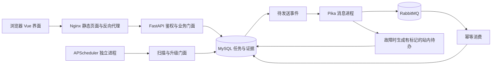

# 架构方案草案

状态：技术设计提案，接口和字段尚未冻结；业务取舍见specs/business-rules.md。目标是前后端分离的单体分层与可审计的多agent研发，而非业务服务拆分。

## 两组候选比较

| 维度 | Vue＋FastAPI＋MySQL＋RabbitMQ＋APScheduler | Vue＋FastAPI＋自部署Supabase PostgreSQL/Auth＋RabbitMQ＋调度 |
| --- | --- | --- |
| 性能 | 直接数据库访问，连接池/事务边界便于测量；尚无本项目实测 | 认证/数据API有现成能力，但调用路径与后台组件需一并测量；不凭平台宣传推定本题P95 |
| 成本 | 单台应用机容纳业务和中间件，功能范围集中；正式压测另临租发压机 | 自部署仍有服务器、安全、备份责任；集成功能可能省认证开发，但本题仍需自定义状态与事件逻辑 |
| 可维护性 | 组件职责显式，适合按本题分工留痕；自行维护鉴权、迁移、恢复 | 控制台和认证集成便利，但增加组件配置和版本联动，不能用通用CRUD绕过业务状态机 |

推荐第一组作为本题技术基线。该选择是结合任务书和本机/云端复现需要的工程判断，不是Supabase不能实现本题的断言。云托管Supabase不作为默认验收环境，以便单机拓扑、独立故障与数据持久化均可复现。

## 模块与数据流

前端只调用带鉴权的业务API；API经过权限入口和服务门面，调用状态机、排期依赖、评审及上线决策，持久层统一负责MySQL事务和参数化查询。四核心表之外按需要增加成员、审计、排期变化、事件、通知及扫描记录。

调度作为同一代码库的独立进程扫描数据库，经门面生成幂等升级事件和待发送记录；消息岗发布到RabbitMQ、消费入站内通知，失败转可追溯待办。API多进程不各自启动一份调度器；模块依赖通过注入传入，不在业务函数里随意构造。

图中均属于同一单机系统、同一业务代码库；独立进程用于持续工作，不是拆为多个业务微服务。浏览器读取站内通知，不能代替后端调度扫描。

任务、依赖、评审、决策四表统一整数主键；状态/布尔集中枚举与最小整型存储；任务版本用于竞争控制，请求幂等标识用于重试，两者分开。成功更新和留痕原子提交，拒绝留痕单独确保可提交。

## 部署与验证

应用机建议x86_64 Ubuntu24.04、8vCPU/16GB/80GB SSD，运行反向代理、前端静态产物、API、MySQL、RabbitMQ和独立调度/消费入口。Docker Compose固定环境，数据库/队列有持久卷与备份恢复说明。此规格不保证达标。

正式发压机建议4vCPU/8GB，同地域私网经过相同反代、鉴权和业务链路访问。与应用机分别监测资源，报告真实并发口径、查询/写入P95、吞吐、失败及原始日志。产品功能、自测、集成与无开发历史的独立验收分开记录。

## 开发治理

各岗Issue提出依赖，分支及阶段commit保留角色/提示词引用；PR由独立审核岗针对准确SHA检查。静态、契约、覆盖率三项门禁须真实执行后才能宣称通过，主干保护以平台配置与失败合并实验证据为准。

当前已创建并克隆公开仓库 HJY147/t44-dev-trace，各岗正在逐项归档。主干已要求 PR、解决讨论及绑定提交的 `reviewer/stage` 检查，并对管理员生效；配置回执见 records/github/protection-response.json。静态、契约、覆盖率流水线尚未实现，产品代码、冻结接口和性能结果尚不存在。后续由责任岗细化并交叉检查设计，再进入各自 worktree 实现。
