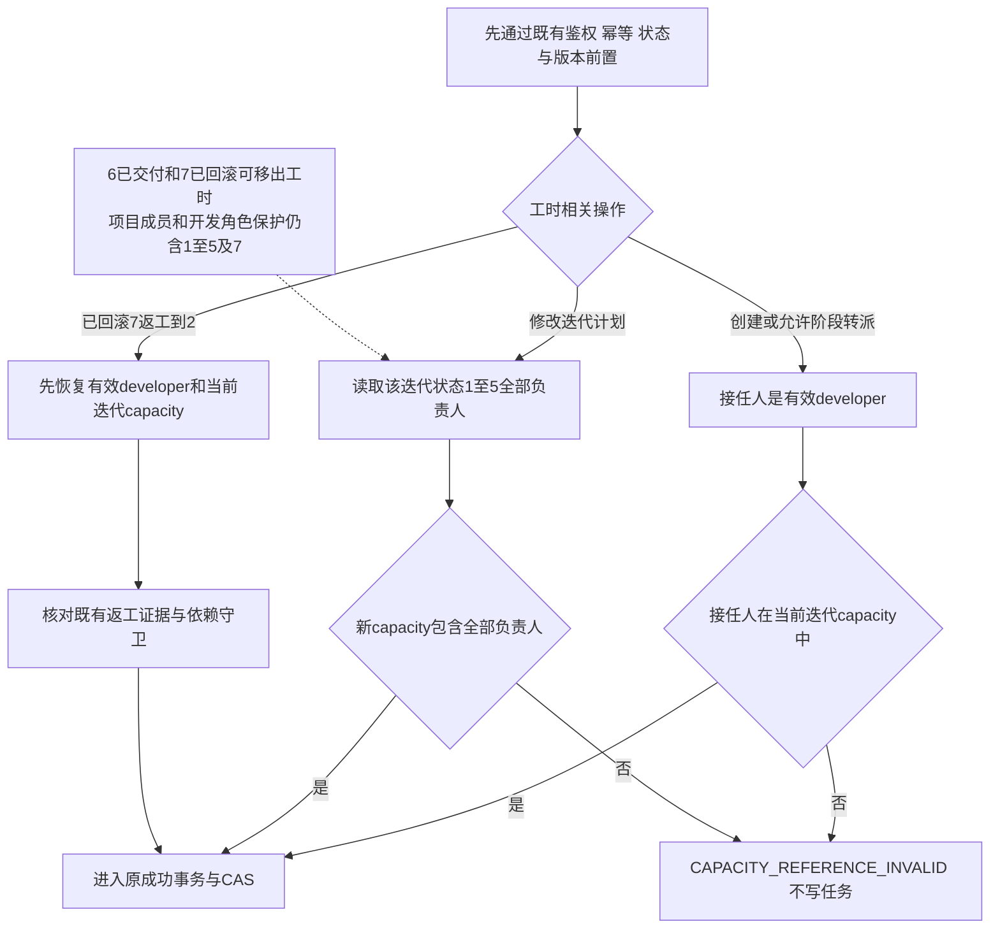
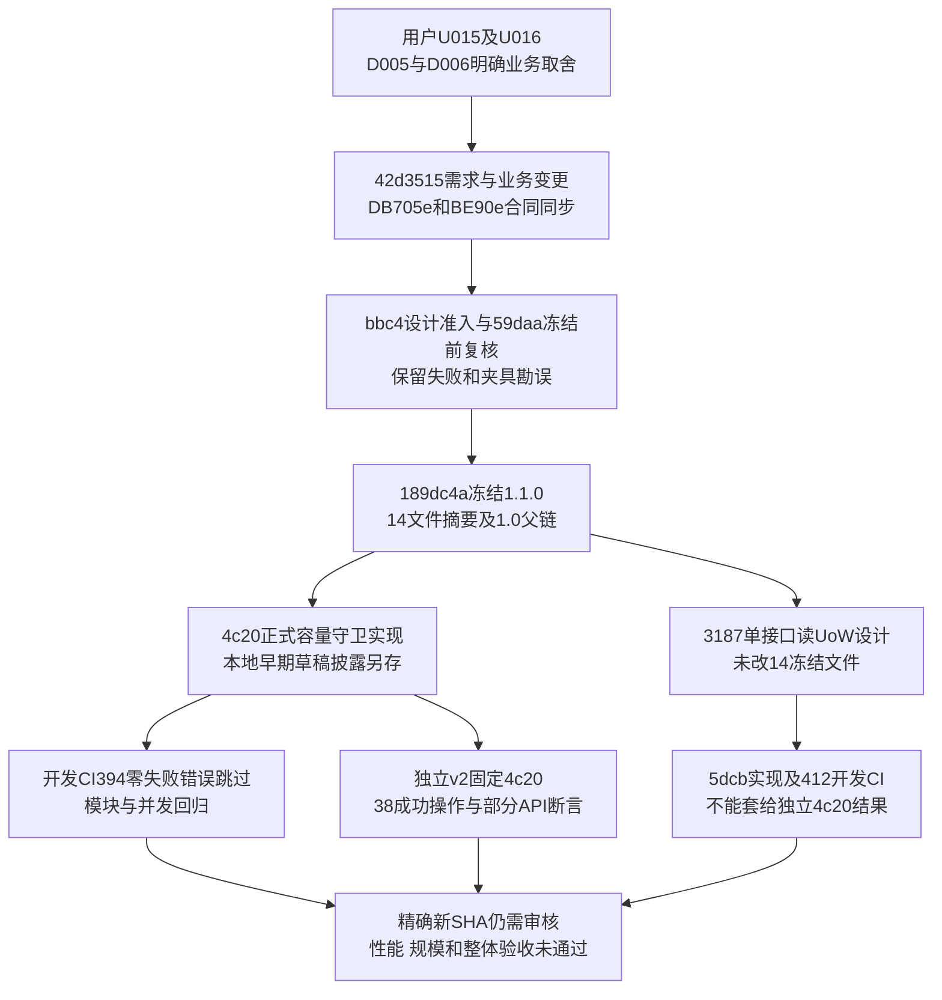
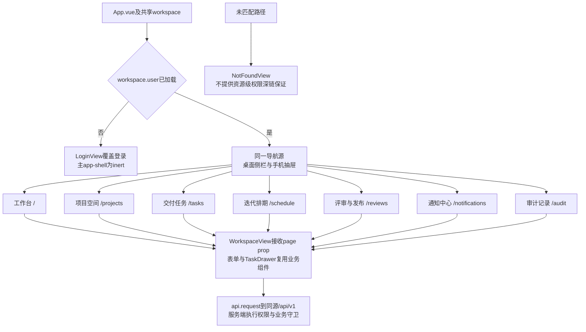

# M5 新增图源与来源边界

Agent-Role documentation；Prompt-Ref ROLE-documentation-M5-REPORTS-v1。内容截止6ba9f94。三图由文档AI按冻结1.1及已提交真实代码补画，不倒填为开发前已存在的图；M3八图原件及manifest不修改、不重渲染。

三图已在root明确授权窗口真实渲染并逐张打开PNG检查，六个SVG/PNG均exit0。启动18:40:14.688629 UTC，CLI完成且新增headless Chrome全部退出18:40:19.449500 UTC，耗时4.76秒；[原始日志与hash清单](diagrams/M5-render-manifest.json)保留。中文/节点箭头/标签完整、无遮挡裁切，属于成图检查，非Word逐页QA。此前两次收到窗口时余时不足，未启动/未补跑，过程记本岗日志。未调用LO/Word或重复marker。

## 1 容量生命周期

[PNG](diagrams/m5-capacity-lifecycle.png) · [可编辑图源](diagrams/m5-capacity-lifecycle.mmd)

D005/D006、冻结capacity-lifecycle-v1.1；services/tasks.py、projects.py和workflow.py。流程图不是新增任务状态，不取代完整错误优先顺序。

## 2 需求变更到冻结实现测试链

[PNG](diagrams/m5-change-to-evidence.png) · [可编辑图源](diagrams/m5-change-to-evidence.mmd)

v1.1冻结清单、容量限定审查、4c20与5dcb发布证据。早期本地草稿的披露不被删除，开发CI不等于独立验收。

## 3 当前真实UI导航

[PNG](diagrams/m5-ui-navigation.png) · [可编辑图源](diagrams/m5-ui-navigation.mmd)

精确75c3468的App.vue、navigation.ts、router.ts、WorkspaceView.vue。是工作区七入口，非资源级权限深链；后端鉴权不由图中登录外观证明。

