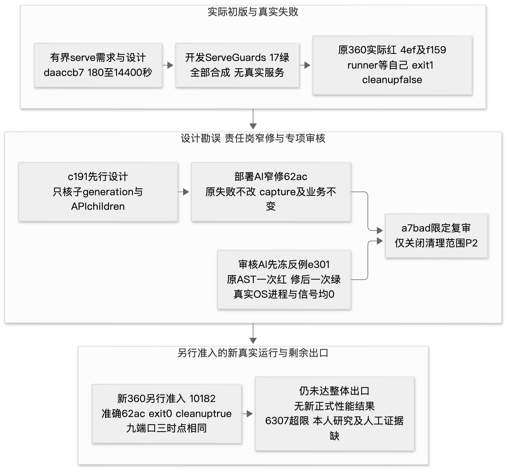

# T44 后发工程证据附录

本附录由AI文档岗整理，主体固定截止1005715ac5ae017a8d57b1af036a3c24c53862af；第7节另列之后明确发表的dcad ready节点。业务应用仍bc5，db87只是未由root整合的候选。本文补公开证据入口，不是学生研究正文或新的验收证书，也不将后发事实写回旧Word已验范围。

## 1 独立白盒和交付物的有限结论

[stage07白盒](../independent-v3/stage07-whitebox.md)及同名JSON明确发表：原4范围2通过、2部分证实，其标记为PARTIAL_NOT_FINAL_ACCEPTANCE，未构成最终验收。190文件只读完整性核验含hash/blob/权限和前后字节，不代表190文件逐行深审。参数化SQL、纯状态决定、门面及注入通过已审范围；独立触发准确bc5的原run40033980420，510BE/89FE、44Python/20TSVue完整分母，行2638/2957=89.21%和364/390=93.33%，分支659/824=79.98%和821/932=88.09%另列，后端排除0。标记162/93/19与510重叠，不加成黑盒整例。

门禁部分证实只包括历史PR13真实failure下拒合并及当前五context配置，不是当前五门禁逐个失败的因果实验。扩展分别只改1配置、0Python模块的有限核验，不把约0.225秒AI自动执行写成人工一人日或已部署启用。独立岗一次取错旧机械目录随后弃证/正确快照重读，以及变量遮蔽错误均是其过程披露，不算产品缺陷或学生发现。

[stage08交付物](../independent-v3/stage08-deliverables.md)原4范围为1通过已审范围、1实测失败、1部分、1未完成。6307有效源超过5100计1207；冻结技术内容存在及一致性不批准全部外链/产品行为。18精确对象及6节hash支持三反馈链六条实际AI提示词版本，不支持人工12改码、3幻觉识别纠正、5上下文映射已完成。学生最终研究正文与完整最终作业包未提供，新增确认应用逻辑缺陷0不等于作业全部通过。

独立渲染核验的是M6四Word的10/6/3/14共33页，原文件hash不改；首次缺字体属其本机配置失败，修私密字体配置后逐页看，并非修改Word。当前技术组合为M7测试8页加M6需规10/设计14/AI规格3，共35页；M8不导Word，不能说独立已核当前35页。M6/M7原QA、manifest及要求/设计/AI规格原稿均保留。

## 2 源包自洽与真实Git来源必须分别验证

9d6原包验证函数接受内存自洽ZIP/manifest对真实commit的虚假来源声明，原拒绝断言实际红，BUNDLE-SOURCE-BINDING-01/P2成立。原[失败报告](../reviews/21-9d6ead5fa3e1494946f2bb8d7ef33c1a97758077.md)不改；add7363先设计、dda3窄修后，[6a32封档限定复审](../reviews/21-dda3df8e15b0b5b655909dda37dc79a87f318924.md)一次绿。新函数取可信同目录selector的完整Git path/blob/mode集合，再核payload。实际反例在成员集合处拒绝，逐blob/mode分支只静态核，不能称都运行覆盖。新命令有明确globals/元数据适配，语义相同不等脚本或ZIP时间戳字节相同。

[新选择器范围收据](../../records/validation/source-selection-independent-log-scope.json)只读Git树元数据，排除agents/testing的4个岗位工作区文件，保留明确发表报告和应用，选3305文件。没有读取排除文件正文，不能据此宣称发现内容泄露。旧archive/manifest不改，本cutoff尚无新的actual bundle，窄修也没有证明旧真实包曾被篡改或已自动重建为最终作业包。

## 3 池保留诊断与两默认候选

[e03/9d1一次ABBA](../../agents/database/pool-retention/result.md)为开发短样本：32并发，每段4秒稳态，8684稳态/10882含预热请求，失败0。A保留5/溢出10、B保留15/溢出0，观察峰15、dispose后open0；B两段没有稳态重建而A有436/427次，支持受限连接churn观察。单次本机ABBA、钩子开销和共享资源没有独立校准，不能算正式400VU×600秒结果、根因或收益百分比。B每worker多10 idle，DB内存/FD、stale及故障频率成本未知。

db87候选只改两个默认常量，标准5+10→15+0峰15不变，但仅size=3时13→3、仅overflow=2时7→17；显式双参数保持，15不是全配置硬cap。标准六池理论峰90，温态保留上界30→90，按需增长不预建；CLI/其他实例另算。调用根/实时鉴权/事务/CAS/audit/outbox原源不变，不能据此保证故障分布或401/403绝不变503。

[精确候选CI回执](../../records/validation/composite-db87-pool-ci.json)的产品push40039282322绑定db87：520BE/89FE、44/20全源、0排除；新增869的10例为真实QueuePool配合合成DBAPI，不是实际MySQL/正式压力。旧930收集0case，不把import当旧负载运行。五官方ZIP与18+33=51个原件的签收/hash验证是公开归档事实，本岗未重下载ZIP。Docker实际checkout为PR merge400a5cac，166相关运行文件等价候选另有证明，不能以API head字段冒checkout；恢复通过没有测池实际连接数。

[2a16有限审核](../reviews/39-db87d30449356f3473b645a5c246dcc6c21d7cbe.md)未发现该两默认差量新增实质阻断，整体不放行；不等root合入、替换bc5演示或正式性能通过。开发suite、审查、候选准入及独立测量各有不同证据出口。

## 4 原生演示的真实失败 窄修与新运行

以下图只画已发生的有界serve链。[原审核](../reviews/37-f1598b91b710ca897cffcc81c52f2e3a79a33cbd.md)读最终fix前先冻反例e301；该冻结是相对审核读取顺序，不冒称早于owner的c191提交。17合成守卫绿、360实跑、内存审核反例与另一次360复验不混为同一次测试。

原4ef唯一360实际exit1/cleanupfalse，verify_stopped把仍须活着返回summary的runner算成应退出子进程。后置PID消失不倒填cleanup成功。c191设计→62ac收窄generation/APIchildren；审核e301冻结反例在旧AST一次红、新AST一次绿，无真实OS进程/信号，[a7bad限定复审](../reviews/37-62ac2f327e7523ffed69a2bd9f98c87ba2372931.md)仅关闭SERVE-CLEANUP-SCOPE-01。

根另准入的新[10182实际360](../../agents/deployment/native-bounded-demo-validation/README.md)准确绑定62ac/控制器SHA08461886…/SUTbc5，外部wait真实exit0、cycletrue、cleanuptrue；九端口前/中/后三时点相同，登记自有PID最终不存在。三观察点不是全程监控；原7端口保护范围不被回填，旧消息只复核不声称新publish。后置rule_hash bytes不能JSON造成提取exit1，转hex只读提取后exit0，是证据提取失败，不是controller再次失败或又跑360。实际脚本副本迁入864/863/862，字节不变，无新执行。

另作历史归属勘误：早期应用run1实现427b097，run2成功才绑定0a6；M7把二者置于同一0a6行下不够准确，本附录补正，旧M7不覆盖。该早期应用轮次也不能与后来4ef失败360、62ac新360混为一轮修复。

## 5 资源观察能力不补造旧运行

usage先RFC db7df7c，再8983实现/861封档，根静态接线审查见[usage回执](../../records/validation/runtime-usage-coordinator-review.json)。15合成守卫绿、旧metadata字节/控制AST保持，本cutoff未实际Docker stats采样。CLI memory不是RSS、PIDs含线程、格式化IO不是速率；不是全程峰值、原子采样或物理同机证明。每服务compose10s加inspect15s，stats另15s，不是总15秒。旧正式运行资源unknown仍unknown。

## 6 新独立性能协议只到冻结和授权

fork-none v4先冻结H，再产生公开元数据M，二者身份不同；迁入项目声明私密字节模式保持不等本岗核过私密payload。[1005715授权](../../records/acceptance/v4-performance-readiness-decision.json)及[公开运行绑定](../../records/acceptance/v4-performance-runtime-binding.json)只准入同一个新H对bc5/db87两源各3入口，在全新hosted环境执行。没有给预期方向、改门槛或复跑旧私密协议的许可；本cutoff尚无新实际性能结果，本岗不等待或自行运行。

旧v3三正式P95 9512.069/3086.148/8272.364ms失败、组失败1021/0/2、两组采样不足及同次资源unknown保持；25/26/F08优先级未决、浏览器6/6、粗故障4/4、3功能/5切点及421未观察组合仍按原公开结论，不因候选CI520而变绿。

## 7 截止后明确发表的4小时ready节点

此节仅据dcad31d32eeeef33e48afe367f8b102c0f845886两份公开白名单收据与一条部署AI原样答复，完整问题/答复见[M8实际问取](../../docs/reports/M8-collection.json)。控制器62ac、应用bc5/92源核对，phase=serving、capability_ready=true；首两新持久scan60.319299秒、首次hold额外TTL300轮换1。公开页面为http://127.0.0.1:5178，API为http://127.0.0.1:18088；计划deadline UTC2026-10-24 03:49:43.904838（北京时间11:49:43.904838）。这是发表时的后台进行中节点，不是本岗再次连接或实时探测。

actual_runner_exit_code=null、cleanup_success=null，未证明14400秒完整结束、最终停机或独立验收，不把ready延伸为4h完成。不读公开收据指向的私密driver、状态或登录说明，不采用其他候选源。

## 8 人与AI归属以及本阶段边界

11固定岗位与每岗必要证据、Issue/commit及绑定SHA的COMMENT仍适用；同一Git账号上的AI互审不是另一个真人批准。U001/U002人的原创组织亮点及原六条AI版本保持，本M8任务/图/运行不新增六版凑数。AI发现、设计和修改不计人工12/5/3，R001原话和R002公开provenance只是素材；R002 raw未读。缺少学生实际访谈/亲写研究与人工操作完成证明时，直接记缺，不把一条部署AI问答冒充学生采访。

文档岗本轮只整理公开文件/hash/链接、一次问题/AI答复及一图实际渲染目视。旧Word/QA/需求/设计/AI规格/冻结不改，无产品测试/服务/CI/负载/Word操作。来源及各自cutoff见[M8清单](../../docs/reports/M8-source-manifest.json)。后续只有root明确发表新结果后才作另一有限增量，当前完成封档。
