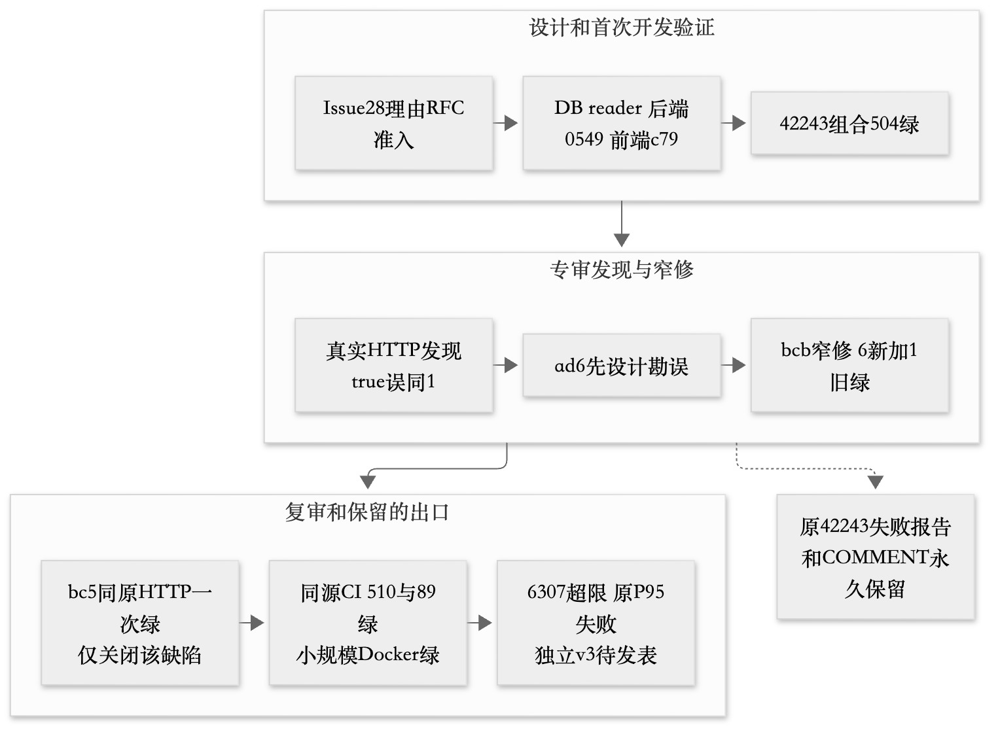

# T44 AI开发过程与研究素材

本轮文档AI更新：产品90b官方CI797/89，Docker实际合成merge56217产品字节等同；独立F05原18/1/11保留，完整验收未成立，尚无有效正式性能结论；P07错过启动窗口未发压。四技术报告和私密Word已刷新，过程见[文档任务原文与实际改进](../../agents/documentation/prompts/ROLE-documentation-FINAL90b-v1.md)及[交付清单](../../docs/reports/FINAL90b-deliverable-manifest.json)。本页以下历史材料按各自截止阅读，AI排版和纠错不能计作学生亲为。

> 本轮版本说明：以下第1至7节保持各原截止；新增第8节及[云复核839补记](cloud839-evidence-addendum.md)记录本轮AI错误与纠正。全部仍为供学生本人手写研究报告取材的第三人称事实，不是研究成品。

这是供学生阅读证据、自行选材和成文的AI整理资料，不是学生署名的最终研究正文。源码固定bc5aef9，过程来源按各自准确提交；既有人的原创输入、人的业务决定、AI设计/代码/审核和synthetic运行数据分别归属。

## 1 需求怎样先被审查

U001提出固定职责、无开发上下文的独立测试及文档主动问取；U002提出每岗阶段commit、独立审核和GitHub提问，原文与AI优化建议分别保存。实际落地是AGENTS/TASK/责任目录、真实Issue/PR与准确SHA，不是十一个真人或OS级文件隔离，也没有无对照的提效百分比。

CONTRACT-v1把业务转成三类接口/错误/事务，但首次C1至C4审核发现决定到评估证据链、全部经理收件人>100、时间输入/存储域及不可达错误等真实问题。v2据反例改设计，经用户D004采用后冻结1.0；1130是设计/Schema断言，不是当时产品HTTP测试。人的采用不记手改，reviewer AI发现不记学生幻觉识别。

D005/D006要求有效接手人先有本迭代工时、回滚可移工时且返工重验。需规→DB/API设计→限定复审→189dc4a新冻结→4c产品与专项验证构成真实链；冻结清单也披露更早guard草稿，不能写“此前从未产生代码草稿”。capacity保护1至5和成员保护1至5加7分清。完整出处见[M6提示词素材](../../docs/prompting/M6-process-checkpoint.md)。

## 2 从需求到概设 详设和实现

| 实际输入/反馈 | 设计推导 | 实际实现与结果 |
| --- | --- | --- |
| U001/U002 | 固定岗、责任目录、独立隔离、阶段版本与审核 | 真实问答/提交/COMMENT；同账号不伪装真人APPROVE |
| CONTRACT-v1→v2 | 输入输出/错误/时间域/证据链先审 | 首次红保留、修订复审及人的冻结后完整业务编码 |
| APPLICATION/INTEGRATION | 冻结契约分配给API/服务/DB/MQ/扫描/前端 | enum稳定码、seed版本、默认通知夹具等真实联调修正 |
| UI001→SESSION-R1 | 清缓存不够，需卸载与异步成功/错误双边界 | 39绿后895真红，7df先设计、9560修、原895三绿 |
| UI003/Issue28 RFC | reason新写同Tx；旧页最多100精确pair保守投影 | DB reader3b7→BE0549→FEc79；不改旧audit或冻结Schema |
| HISTORY-EVIDENCE-01 | Python对象相等不能代表JSON证据同一 | ad6先勘误、bcb窄修、bc5同HTTP一次绿；原42243红永久保留 |

技术概设/详设和函数I/O由AI据规格/源码整理；R001中的未来def/#todo骨架建议不倒填为学生开发前已写。当前[设计报告](design-report.md)和[函数说明](../../docs/reports/M6-function-contracts.md)给出真实签名、前后条件、异常和副作用；图逐步随真实需求/代码更新，不写成全部开发前已画好。

## 3 三条可分析的质量反馈

会话链说明高覆盖率不保证跨组件生命周期正确：旧请求、退出、新登录与卸载回调组合才触发缺陷。S2保留当前403/409恢复，同时让旧身份错误变SESSION_CHANGED并阻止旧refresh，原反例而非新宽松替代案证明修复。

预检链说明局部目标全绿仍可能漏旧调用者。A优化保留实时鉴权/原SELECT并减少UoW；17+8目标从结构红到25绿后，扩查988/974出现两个AttributeError。随后补authorize/claim薄包装，先勘误预算“净省1”为实际+6，精确CI437和专项审核限定关闭，没有把短诊断当性能通过。

理由链最清楚地连接设计、联调、绿后红与窄修：Issue28准入→DB bounded pair→BE18目标/FE89及42项目浏览器→42243组合504绿→HTTP专审发现坏历史EvidenceRefs true被当1→ad6先设计→bcb六新+一旧绿→bc5原HTTP一次绿。原红报告与COMMENT5634370911不改，5634448127仅关闭该缺陷；当前510/89并不能替代独立验收、规模和正式性能。

root三路合并审核历史时KeyError及误stage被diff gate阻止是协作工具流程失败，修正后原失败/窄关闭字节保持；文档岗M5暂存空行检查编排错误、网络恢复、M6首次误认native设计已在基线也如实保留。这些不能统称产品bug或学生亲自识别的幻觉。

## 4 真实提示词数量与亮点

原任务书要求演进≥6版，没有要求必须同一族或全由学生输入。本轮已核C1/C2契约、S1/S2会话、A1/A2预检三反馈链的六条实际AI派工，有实质反馈/产物，数量证据成立；C/S/A是本轮审计索引而非伪造历史名称。旧M4/M5“单族不足即总量不足”过严，当前勘误而不改历史。未执行的U001-O1/U002-O1或proposed模板不计。

U001/U002可以作为学生原创亮点：用独立实例隔离验收；让每岗本人阶段提交和准确SHA审核，有具体跨岗Issue问答。原文位置、AI优化建议和修改说明见records/prompts；可以分析沟通成本、共享文件系统约束及绿后红，不编造提效实验或说“完全杜绝作弊”。

## 5 人与AI以及仍需本人完成的内容

| 事项 | 公开证据归属 | 当前缺口 |
| --- | --- | --- |
| U001/U002、D001/D004/D005/D006 | 用户原创指令/业务采用 | 不等于本人写实现或独立识别AI错误 |
| R001反思 | 本人观点原文及provenance | 不是已亲写骨架、打断点或改码的证据 |
| R002课程建议 | 已提供，公开仅provenance/SHA | 原文私密，不由AI读取/润写/公开 |
| 六实际提示词版本 | AI派工与真实反馈 | 不计学生输入六版，不直接判AC09全部通过 |
| 人工12修改/3幻觉/5映射 | 当前未获实际完成证据 | 需要本人真实before/after、判断和验证；不补造数量 |
| 研究正文与课程建议组织 | 本人最终写作责任 | AI素材/空白模板不是本人研究成品；指导练习尚未执行 |

[指导M6](../../docs/guidance/M6-learner-guide.md)和[真实两岗问答](../../docs/guidance/M6-actual-qa.md)提供练习，不把作业建议记已执行。最终由本人选择确实理解/参与的案例，用自己的话解释人的需求责任、代码I/O与证据局限，阅读AI调试可写观察反思，不能改成亲历手改。

## 6 测试和交付出口

M7增补[夜间AI过程索引](../../docs/prompting/M7-night-process-evidence.md)：中性stdout协议先设计再修、native有限周期成功后专审仍发现首次超时被rc0掩盖、窄修后只关闭该P2、并行记录冲突原失败保留。新实现/审核/运行均AI执行，不新增学生人工12/3/5或自动增加六版数量。该提示词索引固定其自身6ec cutoff的stage04状态，后发表stage05/06正式结果以当前[测试报告](test-results-report.md)为准，不改其历史。

最新6ec应用包字节等价bc5，开发510/89全源与Docker小规模恢复通过；独立v2历史仍NOT_ACCEPTED_INCOMPLETE，v3已发表功能25/26、浏览器6/6、粗故障4/4及正式0/3。F08优先级未决、3功能/5切点能力、421错误响应组合及白盒/交付物后续范围保留。6307超1207，v1/v3正式P95失败；同次资源unknown不由新工具补造，根因未知不推定瓶颈。M6四技术Word33页的排版完成与软件验收分开，M7只增补测试Word、三稿复用M6hash，不含学生研究正文。见[提交对照](submission-map.md)。

## 7 M8后发工程事实入口

新增[工程附录](M8-engineering-annex.md)主体固定1005715，另列dcad的4h ready节点。stage07/08有限核验、包源码绑定反例/窄修、DB短ABBA及未合候选CI、native失败与新360、usage观察及v4新协议授权分别有准确来源，不提升为整体通过。该附录还纠正早期应用run1为427b097/run2为0a6的归属，保留M7旧稿。当前技术Word仍35页、独立核验针对旧33页；M8不改Word或旧QA/需规/设计/AI规格，学生研究正文与真实12/5/3仍待本人完成。

## 8 云复核中的AI质量问题与实际纠正

[云过程记录](../../records/coordination/cloud-evidence-and-isolation-20261024.md)明确：总协调AI在841冻结执行后误把开发候选/CI状态附进中性协调信息，违反隔离规则；随后停止841新语义分析，另建无开发历史fork-none839，只交原权威、精确冻结工具、认证请求与中性资源。不能记成学生犯错/发现，不能说从未发生上下文污染，也不能声称共享文件系统有OS级不可达保证。

839公开复核确认0完整600秒组；任务短窗1个502、流转P95 3645.763385ms，校验预热2个502后中止。1396计划、30251次oracle通过和9个触及case不等完整后置条件通过，现有证据完整case为0。哈希完整、入口0、资源采集0错误、实际释放等分别证明自己的范围。资源高CPU/重传与错误只有伴随关系，不编造根因。

这次材料可支持本人思考“怎样审需求和保证AI质量”：权威是否支持断言、设计是否明示事务/接口、执行是否足够、原始证据是否可重检、协调者是否遵守信息边界。文档不代写本人的观点，不将AI修复计作人工修改、幻觉识别或本人测试；不增加提示词历史数量。详见[完整事实与追踪](cloud839-evidence-addendum.md)。

## P07 AI调度时间错误素材

P07原adapter准备成功、defaultfalse，但总协调AI汇集现场元数据过晚，资源回执和独立审查均晚于原S加20秒。独立决定BLOCKED_EXPIRED_START_WINDOW，未授准、未发压、无性能结果。此为AI过程素材，学生可自行核读分析，不能冒充学生亲历或充抵人工配额。P05/P06准备工具错误、原始失败与P07时间门均保留。后续建议先完成现场证据并预留独立准入时间，不通过平移旧窗口或覆盖guard解决。准确时点与证据见[测试报告P07节](test-results-report.md)。
