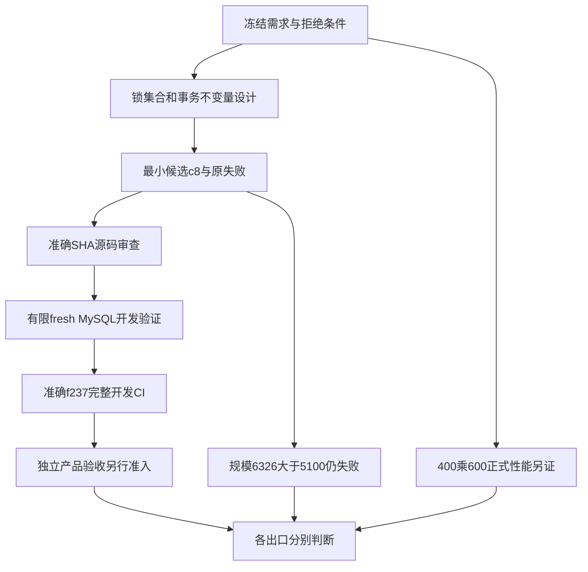

# 2026-10-25自主续作：需求、设计与质量证据补记

本页由AI文档岗整理，供技术报告追溯与学生本人选材；**不是学生手写研究报告或最终验收证书**。基线为ade5e4c，采集范围最晚07:55 UTC，实际固定截止见[资料清单](../../docs/reports/autonomous-20261025-sources.json)及[问取记录](../../docs/reports/autonomous-20261025-collection.json)。后发结果须另建补记，不倒填旧报告。

本轮产品候选为`c8cea7e82805de5283ce67501769fa9a4efc1047`；开发查询账本修订为test-only `5f55e09a75043343e376ecc7d96cc2ed98862b30`。完整开发CI在精确`f237956ea23ecebd85d5e0c43fe20574adbb5139`上通过，应用字节同c8。代码规模仍6326行，超5100上限1226行；正式性能和独立产品验收没有被这次CI代替。

## 1. 从需规到设计，再到可检查的实现

本轮没有改变已冻结的业务输入、输出或拒绝条件。需规要求并发更新只能一次生效、缺有效人力或未完成依赖不能迁移；这些约束先转为锁集合、锁顺序、事务与重读不变量，才形成最小代码候选。设计变化有独立勘误和代价说明，不能只在成品报告里补一句“已优化”。

| 需规/验收依据 | 概设与详设如何落实 | 此轮实现及对应验证 | 限制/状态 |
| --- | --- | --- | --- |
| FR-01/AC-01：输入、输出、错误先冻结 | API统一入口、契约校验，业务与错误优先级保持 | c8只改Runtime两锁节点；完整CI含契约179项、全量后端562项 | 不是所有权威错误分支的独立逐条验收证明 |
| FR-02/AC-02：字段/DDL先评审 | 保持原Schema、Rows、迁移、隔离级别；工具不擅改生产池 | DB observer仅显式engine；fresh三个独立MySQL服务和命名库；权限readiness先于锁case | 新工具检查不等重新评审全DDL；native与CI MySQL小版本分列 |
| FR-03：八段式、十项有证据 | 设计、源码、数据权限、状态、事务、故障、证据及门禁分项审 | reviewer精确审c8及812/6738两次工作流，结论绑定SHA | 仅源码/执行准入；审核岗没有重跑32个目标或代独立验收 |
| FR-04/AC-04：依赖、人力、排期 | START/UNBLOCK/REWORK项目S；图、成员、容量等writer仍X；门后members重读 | 原target/pred去重集合全部按数值序逐PK取X，锁全体后原Business重读；32项SQLite开发目标；fresh HTTP含前驱/容量/角色竞争 | 显式任务取锁顺序不等所有FK/secondary/外部writer全域无死锁；角色场景是降级，非active=0撤销race |
| FR-05、FR-06/AC-05/06：上线/状态闭环与同版本冲突 | 状态机、审批引用、CAS、成功事务、独立拒审计保持 | c8不改Workflow/合同/DDL；必要邻接覆盖交付/回滚/返工；fresh同版本两请求一次成功一次冲突 | 不能由有限竞争场景声称完整故障矩阵已过 |
| FR-07/AC-07：调度/MQ/消费幂等 | consumer使用新broker/vhost；scheduler需实际项目scope，不猜未来ID | native启动API四worker、consumer和新Rabbit；单项目scope替换门面已交付 | 已发表部署报告时scheduler未启动，故障控制尚未执行；TLS401仅连通 |
| FR-08：门面、注入、审核和三类门禁 | 产品、开发工具和执行编排分层；版本变更后重新审受影响面 | 首工作流准备失败→修fresh-user setup→第二轮真实开发验证；完整CI四job成功 | 不发main/global/合并或正式验收通行证 |
| 非功能：400并发10分钟/三P95≤270ms/≥1000次每分钟/零业务失败 | 顺序CPU/SQL测量先定位候选，再单独正式复测；原始证据、发压端资源需保留 | run40169575755仅56个顺序TestClient请求；本轮锁工作流非压力组 | 没有新完整正式组；不能把顺序中位数写成P95或旧502根因 |
| N07：有效源代码3500–5100 | 固定cloc和应用根口径，测试/配置分列，不搬业务逃计数 | 原基线6316；c8 Runtime276→286，合计6326；规模专题的净33原型未落产品 | **FAIL，超1226**；不能预支原型节省或擅自豁免seed/migrations |

图为本次质量链的导航，不是已经全部通过的流程图；本轮没有重新导出Word或验证图的Word版式。

## 2. 各部分的验证分别说明

| 部分 | 这轮实际证据 | 应怎样计数 |
| --- | --- | --- |
| 后端候选 | 先缺reason的9个setup errors；修夹具后原Runtime9个结构红；c8结构/404共11绿及另21邻接绿 | 32个此源唯一SQLite开发目标；setup error不冒锁断言失败 |
| 数据库诊断工具 | observer同6检查两轮；point probe同8检查，最后仅格式与已测源AST同 | 各自原集合，不把重复运行累计为新产品测试；DB岗未执行MySQL，root另编排 |
| 真实开发并发 | run40172242303：6 baseline低层、6 candidate低层、7 HTTP；86个HTTP响应 | 19个有限开发场景；不称19个独立产品验收用例 |
| 开发全量后端 | run40172571738：coverage JUnit562/0失败/0错误/0跳过；行2642/2961=89.23%，分支665/830=80.12% | 契约179、集成93、故障19是重叠选择，不与562相加 |
| 前端 | 同run前端89/89，零失败/待执行 | 本轮没有前端产品修改、新浏览器验收或UI设计结果；绿色不替代新UI体验观察 |
| 消息与调度 | 无本轮产品源码修改；完整后端CI复用既有测试。新consumer真实启动；新scope/fault门面已交付 | 部署工具可用/进程启动不等本轮独立MQ故障与调度全后置通过 |
| 部署工具 | 10个broker与最终14个application合成guard；原12应用检查被14替代，不重复累计 | 工具边界检查；严格CA/IP的401只支持连通和鉴权入口 |
| 审核 | 准确字节/AST/22件seal及原红绿XML等只读核对 | 审核岗零新产品执行；源审通过范围不扩成实测 |
| 提示词与文档 | 提示词岗43项资料核对；本岗另43项源码/元数据核对 | 两组资料检查各自标明，不称产品测试或学生手测 |

来源28件的逐文件SHA、Git blob、发表提交和URL见资料清单。本岗还核11份官方ZIP的大小/摘要，但没有解包重判其原始执行，也没有运行任何产品、CI、服务或负载。

## 3. 原失败怎样保留、怎样修正

| 发生的问题 | 归属与处理 | 保留的判断边界 |
| --- | --- | --- |
| 合成输入缺reason，9次setup error | AI后端修夹具输入，契约与断言不改，再取得真正结构红 | 不是学生发现的幻觉，也不是9个锁竞争失败 |
| CPU端点与wall端点区间不齐 | AI工具分别修计时端点，保留旧件，有限样本另跑 | 不是产品提速；inclusive阶段不能相加为CPU份额 |
| 首fresh run40171891410的REVOKE报1141 | AI协调准备脚本错误；三job迁移后停，case0。6738显式fresh新用户、精确库CRUD与三张P_S表SELECT后复审运行 | 未观察旧SHOW GRANTS，不杜撰厂商精确grant根因；原812/nonce01及红run保持 |
| 点锁后旧查询账本3、实际4 | AI后端仅迁移tasks精确3/4/3，依赖0/1/2和Counter完全相等保持；原1红2绿、相关5绿保存 | 不用>=或宽上限，不删断言；test-only不冒产品修复 |
| native OpenSSL默认配置路径不存在 | AI部署给该子进程显式私有配置，以fresh目录重准备 | 原失败回执保持；不是业务故障或学生手工Debug |
| 规模原型三文件反增11 | AI审查淘汰该组合，两文件潜在净33继续候选 | 原型未落生产，实际节省0；不能把重构愿望记成达标 |

## 4. 当前出口与运行边界

- **开发CI：** [40172571738](https://github.com/HJY147/t44-dev-trace/actions/runs/40172571738)四job成功；[40172242303](https://github.com/HJY147/t44-dev-trace/actions/runs/40172242303)为有限锁/HTTP开发验证。准确源、重叠计数和原红件均保留。
- **独立产品与正式性能：** 本阶段派工给文档岗的中性状态为独立SUT0、控制器未准入；文档岗未打开其任何目录或联系测试岗，不据设计/工具自检预填之后成绩。400×600、三接口P95/零错、数据规模/资源和完整后置仍须独立证据。
- **代码规模：** c8为6326/5100，超1226，固定口径失败。教师原文没有逐名规定seed/migrations豁免；项目当前口径的更改必须另有真实决定，不能自行移文件或改分母。
- **运行/费用：** 已发表native报告是候选环境运行中；source archive是实际54件运行子集，不冒全仓checkout，native image_digest为null。应用08:46:30、broker08:47、总08:50是计划边界，本截止尚未后验，不写成已停机/已回收或最终账单零元。
- **正式材料：** 本轮没有重导旧35页Word、修改旧冻结或重封提交包。本人研究正文、人工12/3/5真实映射及最终完整作业仍不能由AI记录自动补齐。

## 5. Prompt、人的判断与本人自写入口

U001多岗位、无开发历史独立测试和模块报告；U002 GitHub阶段commit/互审，是用户给出的组织约束亮点。U023/U024把三小时自主推进、已授权用途与100元累计预算继续明确。它们的原文、provenance与优化稿分开，O1仅proposed，本轮新增已使用演进版本为0。

后续AI派工将“优化性能”具体化为准确源、锁集合/输入输出、先设计、保存真红、最小改动、明确SQL成本和限定验证。可以展示这条实际链，但不能把AI互审、AI改码或工具Debug归为用户亲手操作。提示词岗资料封在07:36:05，其“full CI待证”保持当时事实；本页另据之后已发表root记录补充准确f237结果，不回写提示词岗cutoff。

学生可阅读[自写模板](student-study-template.md)、本页与本轮提示词素材，再自己组织文字：哪些需求必须由人确定？为何模块I/O与拒绝条件先于函数补全？为什么同样“通过”仍需分清工具检查、SQLite、MySQL、完整CI与独立验收？规模失败时如何作诚实的架构取舍？这些问题是AI引导，答案和手写研究正文仍由本人完成。

本页实际询问五个开发/审核/提示词岗位；是否回复、AI原话和证据均见collection，不把send_message无错误当作真人访谈或已答复。
