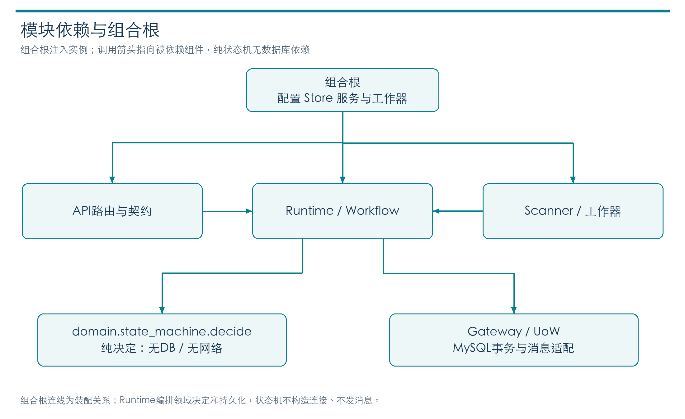
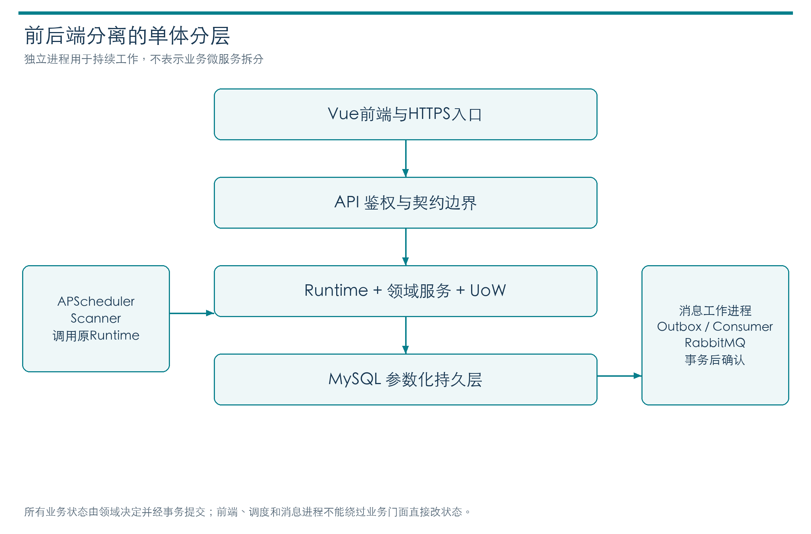
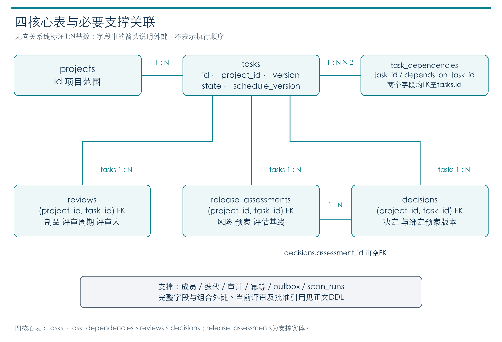
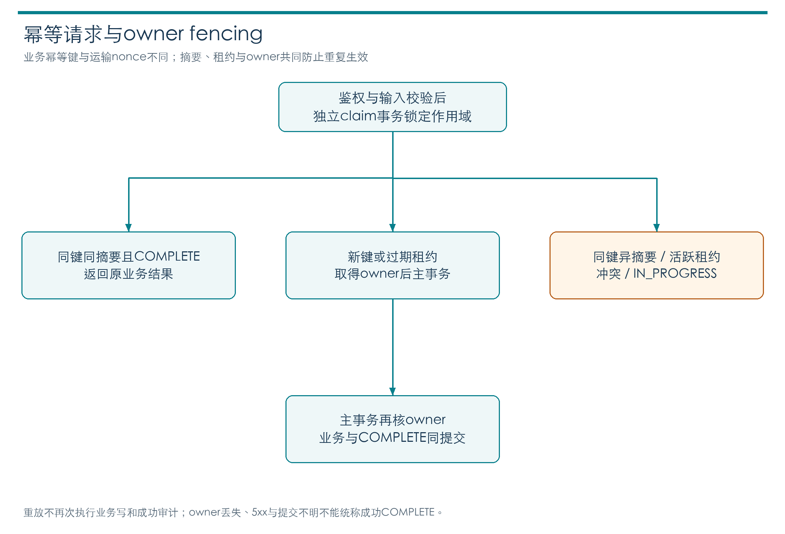
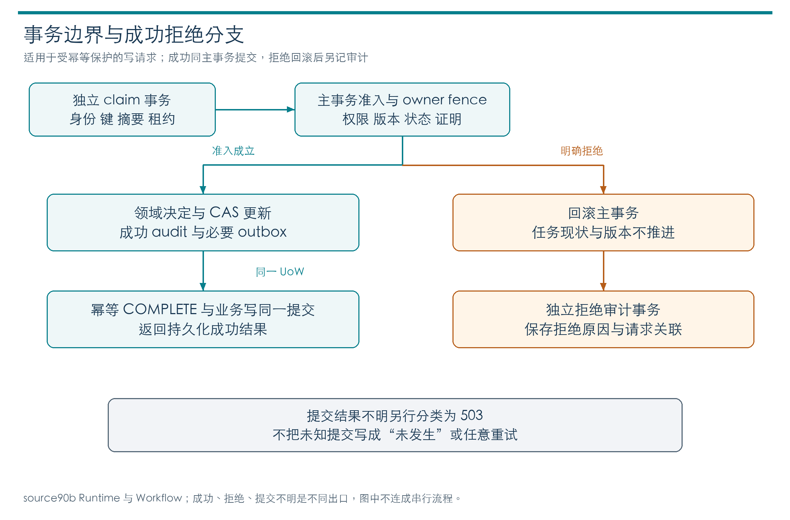
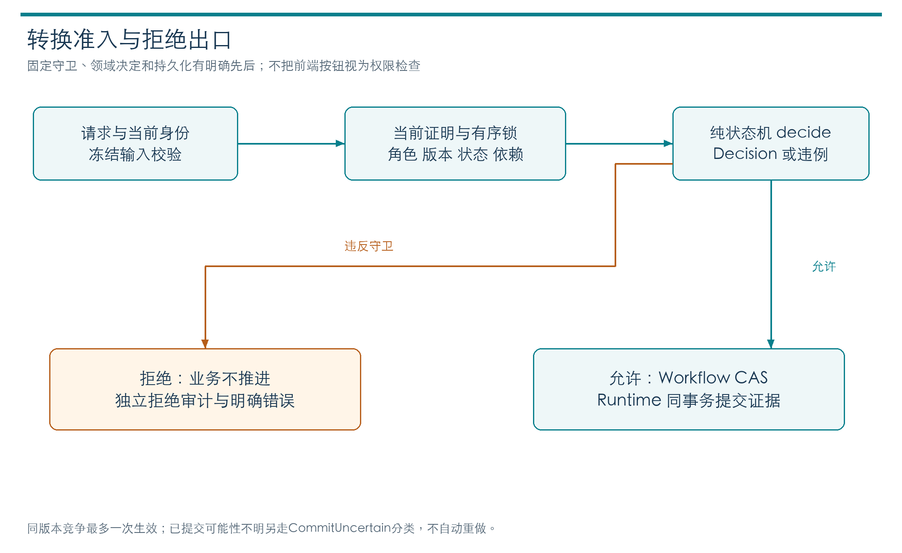
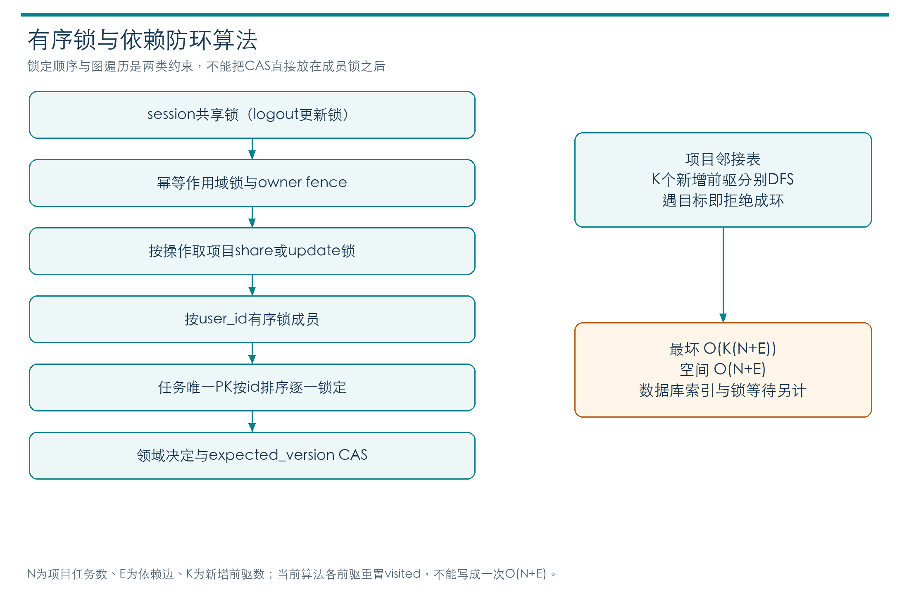
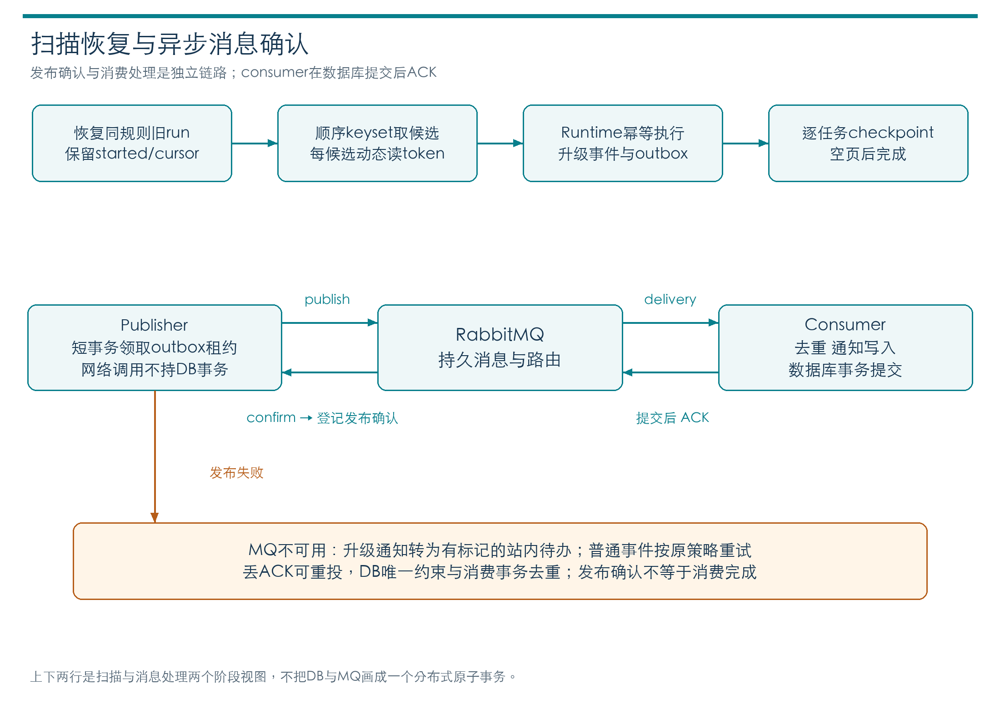
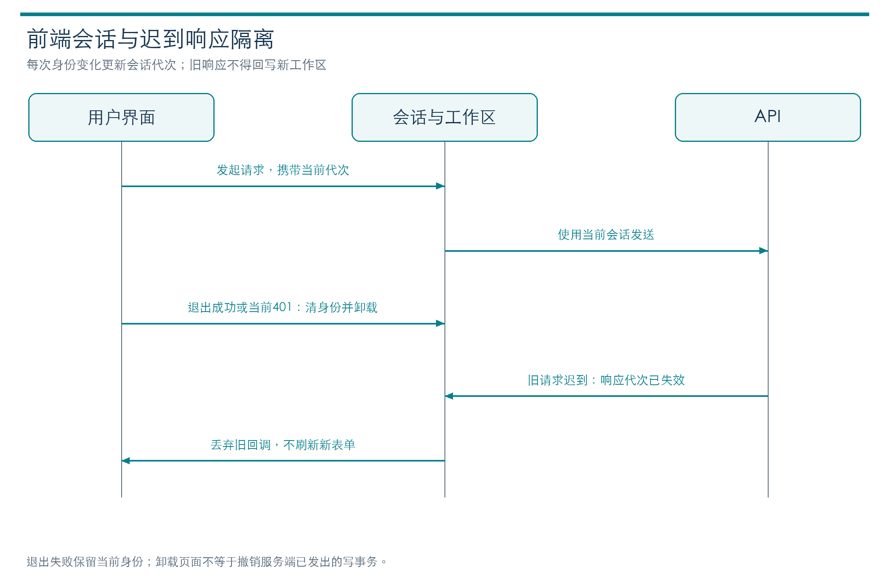
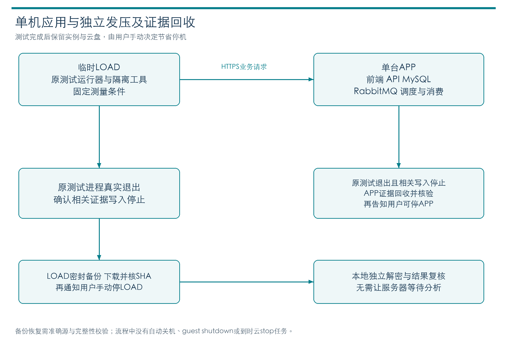

# T44 概要设计与详细设计报告

本系统以单体分层和显式事务实现研发交付记录，浏览器、API、数据库、消息与扫描进程各有明确责任。当前实现源90b734f65ce6ee9f5c217e885bc7ea4857e32b48遵守v1.2冻结的38操作、130 Schema和18业务表226列。本报告说明模块协作、存储、一致性和关键函数输入输出；开发检查、实际运行和独立验收分别列证，用户采用的主要核心口径为62文件5038行；辅助3文件780行（CLI147、迁移307、seed326）单列。原固定cloc全量65文件5818行，较5100超718，原require-range仍失败；用户采用核心口径不等老师批准全部文件排除。

## 1 设计依据和架构



浏览器仅访问API；API、scheduler和consumer虽分进程运行，仍共享单体领域与持久化规则。scheduler通过注入门面可靠受理升级，consumer使用数据库权威事件创建通知。RabbitMQ承载事件投递而非业务最终状态；服务启动配置、数据库连接工厂和token provider由组合层注入，不在纯状态机中创建。图中数据库是状态与证据权威，组件间协作不能把broker确认当数据库提交。




API是组合根而非领域判定器：路由把HTTP输入转为Call，经冻结contracts验证后调用注入的Runtime。Runtime安排鉴权、幂等、锁和UoW；Business与domain返回业务结果或Decision，不自行建立连接或commit。Rows只接受活动UoW的gateway，避免业务层旁路事务。前端将服务器错误反馈给用户，不拥有最终状态写权限。


[需求规格](requirements-report.md)、[后端设计](../../specs/backend-design.md)、[持久契约](../../specs/database/persistence-contract.md)及[v1.2冻结](../../records/spec-freezes/v1.2.json)是实现依据。Vue3、TypeScript、Element Plus负责交互，FastAPI与同步Python服务负责编排，SQLAlchemy/PyMySQL访问MySQL，RabbitMQ承担异步投递，APScheduler驱动扫描。该方案让单个业务操作可以在一个UoW内提交，避免为课程规模引入分布式业务事务；未测量的技术性能优劣不作结论。


| 模块 | 责任和主要输出 | 不能代替的职责 | 关联需求 |
| --- | --- | --- | --- |
| Vue工作区 | 当前身份和项目数据、表单及真实错误解释 | 最终权限、版本及状态准入 | FR01及FR04至06 |
| API和contracts | 解析HTTP为Call、冻结结构校验、Envelope | 完整业务校验或数据库提交 | FR01 |
| Runtime | 鉴权、幂等、锁序、事务、审计及快照 | 人的业务选择 | FR01及FR06 |
| Business和domain | 业务对象、排期、评审和纯状态Decision | 自行建立连接或旁路commit | FR03至06 |
| Rows和UoW | 白名单参数化SQL、锁、CAS和关闭失败Session | 发布批准、评审判断 | FR02及FR06 |
| scanner和消息 | 持久续扫、outbox、通知幂等及降级 | 本人已读/处理、端到端交付证明 | FR07 |
| 部署工具 | 明确源镜像、环境生命周期、备份和隔离恢复 | 产品发布决定或独立验收 | FR08及NFR03 |

业务模块经门面注入通知与升级组件。生产存储只有活动UoW的gateway，不建立替代内存数据库。辅助原型、开发夹具和独立验收分别存放，不能混入产品实现或测试计数。

## 2 数据模型与存储



项目到任务是一对多，task_dependencies以task和depends_on_task两个外键引用同一tasks域，并限制同项目、非自身和无环。任务关联多条不可变reviews、release_assessments和decisions，任务上当前批准/评估引用还带版本与周期，不能只按最新时间猜有效结果。task.version、schedule_version、delivery_cycle和review_cycle对应不同失效原因，决定与审计保留历史而不覆盖旧记录。完整基数与约束以18表DDL及字段索引为准，本图只展示六类核心联系。


### 2.1 核心关系与版本


四核心表是tasks、task_dependencies、reviews、decisions；项目、成员、迭代、上线评估、审计、幂等、outbox、升级与通知支撑其完整生命周期。ER图展示主要业务关系而非替代全部18表DDL。migration版本表另计，不能将业务18表与恢复19表的口径混同。

| 版本字段 | 变化时机 | 不变边界 |
| --- | --- | --- |
| task.version | 每个成功任务关联写增加 | 幂等重放不增加 |
| schedule_version | 改期和回滚后返工增加 | 普通阻塞不增加 |
| delivery_cycle | 回滚返工增加 | 与评审轮次分开 |
| review_cycle | 评审拒绝后增加、返工重置 | 旧轮评审不可充新批准 |

状态、枚举和错误映射集中定义。UTC时间经Schema、语义与持久入口检查后存DATETIME(6)，仅允许合法UTC域及六位小数，连接采用UTC、严格SQL模式及READ COMMITTED。工时用四分之一小时整数，避免浮点截断。决定和评审历史不可变，成员软撤销且保留引用。

### 2.2 迁移及原生目录检查

迁移要求显式库名、受控MySQL版本、空库准入、锁、marker与checksum；失败后保留partial状态并拒绝冒充成功。当前CHECK解析使用锁定sqlglot30.25.0的MySQL AST，保留完整词法、单表达式及节点白名单，拒绝未知结构与注释，不运行优化器。只规范化不影响语义的标识符大小写/引号、括号和合法字符集引导，字符串、参数及逻辑算术树仍保留。

列签名整体比较类型、长度、unsigned、fsp、nullable和default，内部CLI标签合并为column_definition不改变HTTP错误码或结果字段。Index/FK直接expected元组仅适用于完整hash绑定Frozen v1；四条原生目录SQL及_catalog_defects函数AST保持原样。SQLite与语法树等价关系不能替代真实MySQL返回CHECK形式的验证，当前准确源797项开发CI原件已核；SQLite局部等价不能替代真实依赖或独立验收。

## 3 事务和并发设计



业务幂等唯一scope由actor_kind、actor_id、operation_id和key组成，另比较请求hash。相同scope同参数可复用已完成快照，异参冲突必须拒绝；租约续取和owner fencing防止旧执行者在新owner取得控制后提交。材料生成的nonce只绑定运输材料，不是业务幂等key。当前实现仍为先锁读再插入的原路径；唯一约束优先插入候选已因真实MySQL READ COMMITTED并发反例被拒绝，不在本图宣称已采用。




幂等claim先在独立事务创建或取得租约并提交；随后主事务重新核owner、权限和锁范围，业务变更、成功audit、outbox及幂等COMPLETE结果共同提交。拒绝路径先回滚业务再由独立事务留下拒绝审计；不能画成所有拒绝都与成功主事务一起提交。提交结果不确定时503不保证未写，调用者须保留同一幂等scope调查或重放，不能改key盲目再执行。




domain状态判断产生允许/拒绝Decision，Runtime在已经核实的角色、任务版本与证据上下文中执行CAS。BLOCK只接受1/2/4/5并保存blocked_from_state；UNBLOCK回确切原态。开发态由developer且本人owner操作，评审态允许reviewer或manager，其余责任态由manager；不能笼统说经理可解除所有开发阻塞。回滚7到返工2需新周期、人力和依赖重新有效。非法动作与并发失败不得遗留半次业务写。


Runtime先作当前身份校验及短事务claim。已完成的同键同内容请求只返回原业务快照与原response_request_id，但新请求仍须有当前项目访问权；同键异内容或租约竞争依原错误拒绝。当前owner进入主事务后再次锁定会话、幂等及业务范围，Business完成守卫和CAS，成功业务、审计、outbox及COMPLETE快照同一次提交。

业务拒绝退出并关闭原UoW后，使用独立事务记录拒绝审计和约定错误快照；拒绝审计自身失败返回依赖错误，不能声称已留痕。SQL驱动异常不直出。提交结果不明与普通业务拒绝分开，返回TRANSACTION_UNCERTAIN后应查询原幂等键，不盲目以新键重做。

锁序为session、幂等、必要的project、按user_id升序的membership、按task.id升序的任务，最后评审/评估等子记录。依赖编辑和开始/解除至开发/返工先锁项目，依赖图读写与任务CAS同事务；成员、人力与任务激活按统一次序串行。普通单任务操作无需全部项目串行，但不能拿task后反锁project或逆向锁另一任务。

## 4 服务门面和函数输入输出



锁次序为session、幂等scope、必要项目锁、按user_id有序成员、按主键有序任务与关联对象。项目锁模式依操作选择share或update，不是每次transition都FOR UPDATE。start/unblock/rework涉及依赖图范围，取得任务锁后重新检查版本、前驱与当前人力，CAS与计划差异、审计、outbox同主事务提交。前驱逐项读取产生O(D)数据库往返与O(DlogD)排序，不可笼统称常数成本。


当前完整源码hash与函数签名见[当前来源和函数索引](../../docs/reports/FINAL-20261029-source-index.json)，外部38操作及Schema/错误索引见[接口附表](../../docs/reports/FINAL-20261029-interfaces.md)。下表列出跨模块使用时必须遵守的约定，不用函数名清单代替输入输出。

| 函数或门面 | 输入和前置条件 | 输出 | 异常及副作用 |
| --- | --- | --- | --- |
| API endpoint | 路径/query/body、当前Token、写幂等键 | Call或冻结错误Envelope | 先结构校验，不自行判业务批准 |
| Runtime.prepare | Call及validate回调 | 可执行或已重放的上下文 | 鉴权/claim在原UoW，保留原调用者兼容 |
| Runtime.execute | Call、结构校验、来源标记 | 成功data或约定错误 | 编排业务事务、独立拒绝审计及失败关闭 |
| Business.dispatch | 活动gateway和已授权Call | 操作data，最终由finalize封装 | 保留原path/query过滤和父task归属 |
| Business.row_model | g、schema名、可信row、可选related映射 | 原冻结DTO | 缺related时沿原单行读取；不接用户任意表名 |
| common.page | g、白名单table/where/query、serializer，可选predicates和prepare | items/page/page_size/total | 先读当前页，prepare只为该页构造serializer，count保原条件 |
| contracts.violations | schema对象和候选值 | 前100项path/rule/message | 仅冻结对象身份复用validator；动态schema保持原完整构造/late-ref异常 |
| Workflow.transitionTask | 锁定任务、动作、expected_version、证据 | CAS后任务及必要决定 | D008只细化批准引用失配分支；拒绝无半写 |
| domain.decide | 纯Transition及角色/依赖/评审快照 | Decision | 不执行SQL或提交，领域码经服务映射 |
| project_reasons | g、project_id、已授权审计页 | 当前响应副本的保守理由投影 | 每页≤100pairs一次批读；不改旧审计/排序/总数 |
| RowsGateway | 白名单表/列、typed keys、谓词/锁 | 物化行、count或CAS结果 | 参数化，失败Session不可复用 |
| UoW | 显式连接工厂与上下文 | 活动gateway及提交/回滚边界 | 关闭必须确定；业务层不越过它commit |
| check_schema和migrate | 受控engine及明确expected_database | 结构缺陷或迁移报告 | 错库/目录不符/partial拒绝，不自动修改未知库 |
| 通知批写 | 已锁outbox及冻结收件人快照 | 去重后的站内通知 | 单事务批插，缺收件人等失败全部回滚，不清已读处理字段 |
| scanner/facade | cutoff、run游标、规则和scoped主体 | 可靠升级Call及持久推进 | 结果确定后推进；不能将202等同已送达 |

### 4.1 分页批量关系读取

九集合由_COLLECTIONS声明表和DTO。listProjects先按当前主体有效成员范围限定项目；Member只取active成员；子任务集合先调用call.task核对父任务归属。过滤字段只取明确白名单，其他输入不会被展开成任意where。

page先按原sort/id、offset和limit读取本页rows，再调用prepare(rows)。Member收集该页唯一user_id批读users，Dependency收集depends_on_task_id批读tasks，然后以ID映射构建serializer。空页不新增关联查询；其他DTO继续原serializer。row_model派生Member.roles/active、Dependency.satisfied、任务与迭代plan及AuditEvent前后值，与冻结形状一致。开发夹具中20成员页SELECT22→3、23依赖页23→4，仅证明该夹具的查询次数，不能当真实MySQL或正式性能提升。

### 4.2 契约校验器复用

缓存项保存id(schema)到原schema强引用与原validator，并再次用is判断身份，只对冻结SPEC中预先锁定对象复用。保留强引用避免对象回收后id复用命中错误schema。冻结对象错误迭代在前100项停止；动态schema仍沿原validator构造和完整错误迭代再切片，保留任意根/嵌套$id及迟发引用异常，不使用已否决的evolve方案。候选schema_version与成功meta.contract_version不同，不因缓存统一改值。

188项新差分及原305项SQLiteHTTP/顺序/领域自测通过；集合N+1、错误上限和身份问题的原红证据保持。本机ABBA仅为开发CPU观察，Task1.080x、body1.243x、envelope1.041x及极端无效EvidenceRefs样本不能外推云上吞吐、400并发或正式P95。

### 4.3 评估和历史理由

发布先核任务及评估归属、请求版本等更早条件。原批准引用不匹配且评估基线同时失效时，D008先提示更新评估；批准引用匹配时原领域守卫顺序不变。代码评审、评估独立审核及经理决定均保留，不允许自审。

新计划修改和返工reason在原CAS、schedule_changes、审计、outbox及幂等主事务写入。旧审计只在同页、同项目、task/to_version唯一配对且actor、微秒时间、完整五项Plan、证据严格一致时投影响应副本；旧iteration或歧义不猜。bool与整数不同，数组顺序和原文保留。


## 5 消息与扫描算法



Scanner.tick先顺序恢复同rule_hash且心跳陈旧的既有scan，再创建新run；恢复保留原started_at，固定cutoff/高水位和持久last_task_id。每候选重新调用token provider，结果确定才checkpoint，单靠heartbeat不能证明完整扫描成功。outbox在短事务claim，事务外publish；consumer验证三字段消息并核数据库事件，DB持久通知后ACK。丢ACK允许重投，靠唯一键及锁消除重复业务效果，不能标为传输exactly-once。


扫描run在开始固定cutoff和高水位，以keyset和持久last_task_id续扫。单任务短事务内按规则/计划版本/级别去重，生成升级及收件人快照；已交付不再作为当前超期任务。失败保留可恢复游标，重启不得跳过未确定结果。若本次遍历N任务、每页B条，遍历本身为O(N)，页面内存O(B)；具体SQL成本还受谓词、索引和锁影响，不能据渐进式直接保证P95。

outbox先短事务claim，再在事务外publish。消费者验证三字段消息与数据库权威事件，锁outbox、插入通知、提交后ACK。fallback和consumer都先锁同一outbox再按收件人顺序写，唯一键(event_id,recipient_id)防重复，原通知read/handled不覆盖。批量INSERT保留去重、顺序和回滚边界；一次executemany观察不等正式吞吐证明。publisher ACK仅表示broker确认，不能替代消费者持久化或用户处理。

## 6 前端交互与会话



服务端读取真实会话摘要、scope、expiry和revoked，并在项目有效成员范围内核具体操作权限。前端clearSession增加上下文序号并卸载shell和浮层；fetch成功、JSON解析之后以及失败catch都检查token/context。旧响应不得写入新身份的字典、项目或通知，也不能触发新会话表单刷新。退出失败保留当前身份，已发出的写请求可能仍在服务端完成。


导航包括工作台、项目空间、交付任务、迭代排期、评审与发布、通知中心、审计记录。任务抽屉展示详情、依赖、评审、评估、决定、升级和变更记录；表单依冻结Schema构造意图，错误说明按HTTP/code/operation映射，不从局部分页猜负责人。0、null及空串语义分开。

App在无用户时卸载整个shell与浮层。clearSession先增加上下文序号再清身份、项目、字典和通知；request在fetch及JSON解析后的成功/失败路径重验token，旧响应转为SESSION_CHANGED。工作区、表单、登录和抽屉同时检查active、卸载及当前token，防旧catch触发新会话刷新。当前401清空，当前403/409继续原恢复流程；退出503或网络失败保留当前身份。


最终前端只合并七组相同CSS声明。254组selector/media声明序列一致，十二组开发夹具PNG字节相同；五宽度六十状态无页面错误/横溢出。完整computed-style探针严格比较失败且保留，不能以PNG相同宣称其也通过。组件89项/typecheck/build与真实后端E2E、独立浏览器验收分别记录。

## 7 部署备份与恢复



运行必须绑定实际源码、镜像/config及资源，而不是只记录构建标签。应用数据备份与独立测试密封证据是两条链：前者保护配置/数据库/消息卷，后者保护原始测量与身份回执。p13已完成密封下载且75文件hash通过，内部raw prefix仍比footer短，因此两种完整性结论不可混用。本轮两VM已由用户确认关闭；新稿不设置自动关机，测试和证据回收后由用户手动停机。


运行镜像须绑定准确产品Git字节、锁文件及完整运行时文件集；镜像构建成功不等已加载或部署。20261029免费双镜像Actions40869531724已成功，部署岗后续已核官方artifact完整ZIP及六原件，该构建阶段profile曾为actual_loaded=false、root_approved=false；后续p13现场已另核原七容器身份，两个时点不能混为一个状态。镜像构建时点与后续现场部署时点分别登记；当前设计使用非root镜像与独立source-aware包装，沿准确锁/文件集计算，不复用旧镜像身份。

备份先停所有应用数据卷使用者，再将APP配置和数据流式CMS公钥加密，私钥只在本地受控目录。完整下载并解密SHA一致后才给总协调永久释放依据，隔离恢复需要单独实证；历史此项的未验证范围按当时记录保留；当前新增p13测试证据密封不替代应用数据恢复演练。费用、VM最终删除和资源核对归总协调，不由报告推定已完成。

## 8 设计验证和变更记录

| 设计部分 | 开发证据和检验目的 | 尚未由此证明 |
| --- | --- | --- |
| schema及分页 | 新188差分、原305 HTTP/领域、N+1红绿 | 该局部未证全量；真实MySQL性能与独立验收另证 |
| CHECK和通知批写 | DB239含18新owner、196表达式/38416等价关系、批写回滚 | CI覆盖外目录变体及云负载结果 |
| UI及样式 | 89组件、typecheck/build、60状态/12PNG相同 | 云业务E2E、完整computed-style通过 |
| 事务/MQ/扫描 | 原模块和真实依赖，准确源797项CI原件已核 | 全故障切点、真实人日、正式P95 |
| 运行镜像和备份 | 本地5项真实Git/加密流验证及镜像构建 | 云已部署、APP已备份、删除后恢复 |

本表反向关联需求FR01至08，完整对应见[双向追踪](../../docs/reports/FINAL-20261029-traceability.json)与[测试报告](test-results-report.md)。当前源码及冻结hash由本岗静态核对，不把静态检查、AI审核COMMENT或Word版式QA记为产品通过。

历史M6/M7设计、当时33/35页及M8至M10附录均以原Git和manifest保留；本版以当前结构重写，不覆盖私密旧Word。需求变更由人选择，AI负责当前设计实现和复核；范围、性能及学生研究材料缺口仍列当前提交导航。


## 9 当前包结构与组合入口

当前生产包为backend/t44。api.py将同步FastAPI路由、结构校验、Runtime和业务门面连接起来；__main__组合运行角色及凭据provider。domain/models.py与state_machine.py存放稳定编码及纯状态判断；services内项目、任务、评审和Workflow使用注入gateway完成业务，persistence提供Rows与UoW，scheduling和messaging执行扫描/投递进程。它们是同一业务实现的责任分层，不建立各自不一致的状态解释。

数据库连接与会话生命周期由组合根及持久层管理；领域层不构造engine、HTTP客户端或MQ连接。Runtime.execute接收Call与校验器，返回status、body、replay和original_request_id供HTTP层包装；这个四元组不是对外Envelope，重放业务结果也不要求整个HTTP字节与旧响应完全相同。当前meta的request_id、server_time与replayed仍按当前响应生成。

Call携带operation、request_id、token、path/query/body、幂等key、主体及项目上下文等。token只在受控调用链内使用，不进入公开示例。配置、密钥和数据操作必须有明确本项目作用域；初始化账号存合法Argon2id摘要，不能将普通明文口令送到持久层冒充摘要。

## 10 七态九动作及主体细化

| 动作 | 原态与结果 | 主要当前证据 |
|---|---|---|
| start | 1到2 | developer且owner本人、工时与全部前驱已交付 |
| block | 1/2/4/5到3 | 原阶段授权、原因、责任环节及blocked_from_state |
| unblock | 3到来源1/2/4/5 | 对应原阶段权限、解除依据、必要依赖与人力 |
| submit_review | 2到4 | owner、当前artifact revision与提交证据 |
| approve_review | 4到5 | 本轮通过评审、禁止owner自审、模板与证据完整 |
| reject_review | 4到2 | 本轮不通过评审及理由、评审周期推进 |
| deliver | 5到6 | 经理、当前评估和独立批准及发布依据 |
| rollback | 6到7 | 经理、交付绑定预案/版本及回滚依据 |
| rework | 7到2 | 新计划、有效developer与当前工时、前驱满足、新周期 |

BLOCK/UNBLOCK在开发阶段要求developer且本人owner，评审阶段允许reviewer或manager，其余阶段为manager。相同账户可以具有多个项目角色，但角色存在不消除owner限制或独立性要求。评估创建人与复核人必须不同；D008仅在DELIVER原批准引用失配分支内作基线错误的有限顺序选择。

## 11 会话与输入安全设计

当前会话为高熵不透明Token；数据库只保存摘要、session_id、过期、撤销及scope，不保存可恢复Token原文。Runtime在操作中按当前主体和项目成员关系复验；登出撤销、过期、服务scope不符或跨项目读取不能因前端仍显示按钮而被接受。service主体按项目白名单和操作scope执行，不能借服务身份代替经理发布/回滚。

所有查询通过表/列白名单和参数化条件进入gateway。参数化阻止SQL拼接，但不代替归属和角色验证；合法类型的另项目任务ID仍须拒绝。Schema的required、枚举、长度和UtcTime与领域检查承担不同职责。UTC DATETIME(6)保留微秒，日期比较不靠容易越界的planned_end加24小时运算；非法精度和无效日期不能静默截断。

## 12 事务与幂等故障分支

请求先经历当前身份和输入校验。对于需幂等的写操作，Runtime.prepare在独立claim事务中共享锁会话、锁定唯一scope，必要时SAVEPOINT插入新租约，然后提交。GET不创建claim。相同scope同hash且COMPLETE时返回已完成业务快照；不同hash拒绝，活动租约拒绝IN_PROGRESS，过期接管更换owner_token并由围栏保护旧owner。

主事务按会话、claim owner、必要项目图锁、有序成员与有序任务锁次序运行。任务版本检查与CAS后，成功业务、audit、outbox及幂等完成快照同一次主事务提交。拒绝先回滚业务，再在独立事务写失败audit；只有仍有claim所有权且满足当前状态等条件时才能完成可重放错误，不能把全部4xx/5xx统称COMPLETE。CommitUncertain返回503并保留已提交可能性，同一scope调查/重放优于另造key重发。

成功结果保存实际完成请求的response_request_id，重放original_request_id由其溯源；重新接管后的完成者可以不同于最早认领者。审计中的理由和前后值保持原文，旧记录投影响应不能回写历史。数据库提交与MQ publish不构成分布式原子事务，可靠性由outbox、租约、重投及幂等消费共同建立。

## 13 扫描和消息伪代码与成本

```text
tick:
  顺序恢复同rule_hash且心跳陈旧的旧scan（最多100）
  再创建新run，固定cutoff与高水位
  循环按last_task_id作keyset分页
    每个候选读取当前token provider并通过Runtime执行业务
    结果已确定才保存checkpoint
  空页时完成，保留原started_at用于恢复来源
```

C个候选、页大小P至少产生ceil(C/P)+1页查询与C次checkpoint，并包含每候选业务事务。keyset减少offset跳过，不表示索引扫描行恒等于C；索引不覆盖state/planned_end/id时实际扫描行可能更多。恢复旧UUID不重置started_at，每次token provider调用可读取当前凭据文件；heartbeat增长只证明进度，不能替代完整成功。

```text
publisher: 短事务claim outbox与租约 → 事务外publish → broker confirm后持久confirm
consumer: 校验消息 → 数据库权威事件/锁outbox → 幂等写通知并提交 → ACK
失败: DB未提交则NACK/requeue；非法消息reject；MQ不可用按事件类型fallback或retry
```

单轮batch B的发布/消费循环是O(B)，R个收件人通知写入另有O(R)。网络、索引、锁、重投和日志持久化影响真实耗时。丢失ACK允许重投，数据库(event_id,recipient_id)唯一约束防重复业务通知，不声称网络传输exactly-once。已读和已处理字段不会被重复消费覆盖。

## 14 依赖图与锁定成本

新增K个前驱时，当前算法构建项目邻接表，对每个新增前驱各自重置visited并作迭代DFS，遇目标即拒绝。项目N节点、E边，最坏Python遍历O(K(N+E))，内存O(N+E)；完整项目边读取还产生O(E)结果传输，不能用一次共享visited的O(N+E)描述现行实现。

任务转换对D个前驱作O(D)状态检查，取行和有序锁定含O(DlogD)排序及D次数据库往返。CAS虽作用一行，仍有索引、锁、日志和提交成本。重复查找与同事务已锁行复用尚未纳入本报告的90b产品基线，不能在设计图中画成已消除所有往返；任何优化仍须保留最新权限、版本、依赖和错误次序。

## 15 存储对象与约束设计索引

字段以冻结DDL为准，最小类型、空值和约束逐表审核；下表提取实际列声明用于查找，不代替完整外键/CHECK与字段语义。迁移表不混计为业务表。


### 用户

物理表名：`users`。

| 字段 | 存储声明 |
|---|---|
| id | INT UNSIGNED NOT NULL AUTO_INCREMENT |
| username | VARCHAR(64) CHARACTER SET ascii COLLATE ascii_bin NOT NULL |
| display_name | VARCHAR(100) NOT NULL |
| password_hash | VARCHAR(255) CHARACTER SET ascii COLLATE ascii_bin NOT NULL |
| active | TINYINT UNSIGNED NOT NULL DEFAULT 1 |
| created_at | DATETIME(6) NOT NULL |
| updated_at | DATETIME(6) NOT NULL |


### 服务主体

物理表名：`service_accounts`。

| 字段 | 存储声明 |
|---|---|
| id | INT UNSIGNED NOT NULL AUTO_INCREMENT |
| name | VARCHAR(64) CHARACTER SET ascii COLLATE ascii_bin NOT NULL |
| active | TINYINT UNSIGNED NOT NULL DEFAULT 1 |
| created_at | DATETIME(6) NOT NULL |


### 认证会话

物理表名：`auth_sessions`。

| 字段 | 存储声明 |
|---|---|
| id | INT UNSIGNED NOT NULL AUTO_INCREMENT |
| actor_kind | TINYINT UNSIGNED NOT NULL |
| user_id | INT UNSIGNED NULL |
| service_account_id | INT UNSIGNED NULL |
| token_hash | BINARY(32) NOT NULL |
| project_ids | JSON NOT NULL |
| scopes | JSON NOT NULL |
| expires_at | DATETIME(6) NOT NULL |
| revoked_at | DATETIME(6) NULL |
| created_at | DATETIME(6) NOT NULL |


### 项目

物理表名：`projects`。

| 字段 | 存储声明 |
|---|---|
| id | INT UNSIGNED NOT NULL AUTO_INCREMENT |
| name | VARCHAR(100) NOT NULL |
| description | VARCHAR(2000) NOT NULL |
| version | INT UNSIGNED NOT NULL DEFAULT 1 |
| created_by | INT UNSIGNED NOT NULL |
| created_at | DATETIME(6) NOT NULL |
| updated_at | DATETIME(6) NOT NULL |


### 项目成员

物理表名：`project_members`。

| 字段 | 存储声明 |
|---|---|
| id | INT UNSIGNED NOT NULL AUTO_INCREMENT |
| project_id | INT UNSIGNED NOT NULL |
| user_id | INT UNSIGNED NOT NULL |
| roles_mask | TINYINT UNSIGNED NOT NULL |
| active | TINYINT UNSIGNED NOT NULL DEFAULT 1 |
| version | INT UNSIGNED NOT NULL DEFAULT 1 |
| created_at | DATETIME(6) NOT NULL |
| updated_at | DATETIME(6) NOT NULL |


### 迭代

物理表名：`iterations`。

| 字段 | 存储声明 |
|---|---|
| id | INT UNSIGNED NOT NULL AUTO_INCREMENT |
| project_id | INT UNSIGNED NOT NULL |
| name | VARCHAR(100) NOT NULL |
| planned_start | DATETIME(6) NOT NULL |
| planned_end | DATETIME(6) NOT NULL |
| capacity | JSON NOT NULL |
| buffer_quarters | SMALLINT UNSIGNED NOT NULL |
| delay_contingency | VARCHAR(2000) NOT NULL |
| version | INT UNSIGNED NOT NULL DEFAULT 1 |
| plan_version | INT UNSIGNED NOT NULL DEFAULT 1 |
| created_at | DATETIME(6) NOT NULL |
| updated_at | DATETIME(6) NOT NULL |


### 任务

物理表名：`tasks`。

| 字段 | 存储声明 |
|---|---|
| id | INT UNSIGNED NOT NULL AUTO_INCREMENT |
| project_id | INT UNSIGNED NOT NULL |
| iteration_id | INT UNSIGNED NOT NULL |
| title | VARCHAR(200) NOT NULL |
| description | VARCHAR(4000) NOT NULL |
| owner_id | INT UNSIGNED NOT NULL |
| state | TINYINT UNSIGNED NOT NULL DEFAULT 1 |
| version | INT UNSIGNED NOT NULL DEFAULT 1 |
| schedule_version | INT UNSIGNED NOT NULL DEFAULT 1 |
| delivery_cycle | INT UNSIGNED NOT NULL DEFAULT 1 |
| review_cycle | INT UNSIGNED NOT NULL DEFAULT 1 |
| planned_start | DATETIME(6) NOT NULL |
| planned_end | DATETIME(6) NOT NULL |
| buffer_quarters | SMALLINT UNSIGNED NOT NULL |
| delay_contingency | VARCHAR(2000) NOT NULL |
| blocked_from_state | TINYINT UNSIGNED NULL |
| block_reason | VARCHAR(2000) NULL |
| responsibility_stage | TINYINT UNSIGNED NULL |
| artifact_revision | CHAR(40) CHARACTER SET ascii COLLATE ascii_bin NULL |
| latest_review_id | INT UNSIGNED NULL |
| approved_review_id | INT UNSIGNED NULL |
| approved_assessment_id | INT UNSIGNED NULL |
| approved_assessment_version | INT UNSIGNED NULL |
| escalation_count | INT UNSIGNED NOT NULL DEFAULT 0 |
| created_at | DATETIME(6) NOT NULL |
| updated_at | DATETIME(6) NOT NULL |


### 任务依赖

物理表名：`task_dependencies`。

| 字段 | 存储声明 |
|---|---|
| id | INT UNSIGNED NOT NULL AUTO_INCREMENT |
| project_id | INT UNSIGNED NOT NULL |
| task_id | INT UNSIGNED NOT NULL |
| depends_on_task_id | INT UNSIGNED NOT NULL |
| created_by | INT UNSIGNED NOT NULL |
| created_at | DATETIME(6) NOT NULL |


### 评审

物理表名：`reviews`。

| 字段 | 存储声明 |
|---|---|
| id | INT UNSIGNED NOT NULL AUTO_INCREMENT |
| project_id | INT UNSIGNED NOT NULL |
| task_id | INT UNSIGNED NOT NULL |
| version | INT UNSIGNED NOT NULL DEFAULT 1 |
| delivery_cycle | INT UNSIGNED NOT NULL |
| review_cycle | INT UNSIGNED NOT NULL |
| template_version | INT UNSIGNED NOT NULL |
| template_hash | BINARY(32) NOT NULL |
| artifact_revision | CHAR(40) CHARACTER SET ascii COLLATE ascii_bin NOT NULL |
| sections | JSON NOT NULL |
| checklist | JSON NOT NULL |
| verdict | TINYINT UNSIGNED NOT NULL |
| reviewer_id | INT UNSIGNED NOT NULL |
| created_at | DATETIME(6) NOT NULL |


### 上线评估

物理表名：`release_assessments`。

| 字段 | 存储声明 |
|---|---|
| id | INT UNSIGNED NOT NULL AUTO_INCREMENT |
| project_id | INT UNSIGNED NOT NULL |
| task_id | INT UNSIGNED NOT NULL |
| version | INT UNSIGNED NOT NULL DEFAULT 1 |
| schedule_version | INT UNSIGNED NOT NULL |
| delivery_cycle | INT UNSIGNED NOT NULL |
| status | TINYINT UNSIGNED NOT NULL DEFAULT 1 |
| risks | JSON NOT NULL |
| rollback_plan_version | INT UNSIGNED NOT NULL |
| rollback_plan | JSON NOT NULL |
| created_by | INT UNSIGNED NOT NULL |
| reviewed_by | INT UNSIGNED NULL |
| reviewed_at | DATETIME(6) NULL |
| review_reason | VARCHAR(2000) NULL |
| review_evidence | JSON NOT NULL |
| created_at | DATETIME(6) NOT NULL |


### 决定

物理表名：`decisions`。

| 字段 | 存储声明 |
|---|---|
| id | INT UNSIGNED NOT NULL AUTO_INCREMENT |
| project_id | INT UNSIGNED NOT NULL |
| task_id | INT UNSIGNED NOT NULL |
| type | TINYINT UNSIGNED NOT NULL |
| decided_by | INT UNSIGNED NOT NULL |
| delivery_cycle | INT UNSIGNED NOT NULL |
| reason | VARCHAR(2000) NOT NULL |
| impact | VARCHAR(3000) NULL |
| target_version | VARCHAR(128) NULL |
| assessment_id | INT UNSIGNED NULL |
| rollback_plan_version | INT UNSIGNED NULL |
| evidence | JSON NOT NULL |
| decided_at | DATETIME(6) NOT NULL |


### 排期变更

物理表名：`schedule_changes`。

| 字段 | 存储声明 |
|---|---|
| id | INT UNSIGNED NOT NULL AUTO_INCREMENT |
| project_id | INT UNSIGNED NOT NULL |
| task_id | INT UNSIGNED NULL |
| iteration_id | INT UNSIGNED NULL |
| from_version | INT UNSIGNED NOT NULL |
| to_version | INT UNSIGNED NOT NULL |
| before_plan | JSON NOT NULL |
| after_plan | JSON NOT NULL |
| reason | VARCHAR(2000) NOT NULL |
| evidence | JSON NOT NULL |
| changed_by | INT UNSIGNED NOT NULL |
| changed_at | DATETIME(6) NOT NULL |


### 审计事件

物理表名：`audit_events`。

| 字段 | 存储声明 |
|---|---|
| id | INT UNSIGNED NOT NULL AUTO_INCREMENT |
| project_id | INT UNSIGNED NULL |
| task_id | INT UNSIGNED NULL |
| attempted_project_id | INT UNSIGNED NULL |
| attempted_task_id | INT UNSIGNED NULL |
| actor_kind | TINYINT UNSIGNED NOT NULL |
| actor_id | INT UNSIGNED NULL |
| request_id | VARCHAR(128) CHARACTER SET ascii COLLATE ascii_bin NOT NULL |
| operation_id | VARCHAR(100) CHARACTER SET ascii COLLATE ascii_bin NOT NULL |
| outcome | TINYINT UNSIGNED NOT NULL |
| reason_code | TINYINT UNSIGNED NULL |
| expected_version | INT UNSIGNED NULL |
| observed_version | INT UNSIGNED NULL |
| before_values | JSON NOT NULL |
| after_values | JSON NOT NULL |
| evidence | JSON NOT NULL |
| created_at | DATETIME(6) NOT NULL |


### 幂等请求

物理表名：`idempotency_requests`。

| 字段 | 存储声明 |
|---|---|
| id | INT UNSIGNED NOT NULL AUTO_INCREMENT |
| actor_kind | TINYINT UNSIGNED NOT NULL |
| actor_id | INT UNSIGNED NOT NULL |
| operation_id | VARCHAR(100) CHARACTER SET ascii COLLATE ascii_bin NOT NULL |
| idempotency_key | VARCHAR(128) CHARACTER SET ascii COLLATE ascii_bin NOT NULL |
| request_hash | BINARY(32) NOT NULL |
| status | TINYINT UNSIGNED NOT NULL |
| owner_token | BINARY(16) NOT NULL |
| lease_until | DATETIME(6) NOT NULL |
| response_status | SMALLINT UNSIGNED NULL |
| response_body | JSON NULL |
| response_request_id | VARCHAR(128) CHARACTER SET ascii COLLATE ascii_bin NULL |
| created_at | DATETIME(6) NOT NULL |
| completed_at | DATETIME(6) NULL |


### 待投递事件

物理表名：`outbox_events`。

| 字段 | 存储声明 |
|---|---|
| id | INT UNSIGNED NOT NULL AUTO_INCREMENT |
| event_type | TINYINT UNSIGNED NOT NULL |
| schema_version | TINYINT UNSIGNED NOT NULL DEFAULT 1 |
| project_id | INT UNSIGNED NOT NULL |
| task_id | INT UNSIGNED NULL |
| payload | JSON NOT NULL |
| recipients | JSON NOT NULL |
| status | TINYINT UNSIGNED NOT NULL DEFAULT 1 |
| attempts | SMALLINT UNSIGNED NOT NULL DEFAULT 0 |
| next_attempt_at | DATETIME(6) NOT NULL |
| lease_token | BINARY(16) NULL |
| lease_until | DATETIME(6) NULL |
| confirmed_at | DATETIME(6) NULL |
| fallback_at | DATETIME(6) NULL |
| last_error_code | VARCHAR(64) CHARACTER SET ascii COLLATE ascii_bin NULL |
| created_at | DATETIME(6) NOT NULL |
| updated_at | DATETIME(6) NOT NULL |


### 升级事件

物理表名：`escalation_events`。

| 字段 | 存储声明 |
|---|---|
| id | INT UNSIGNED NOT NULL AUTO_INCREMENT |
| project_id | INT UNSIGNED NOT NULL |
| task_id | INT UNSIGNED NOT NULL |
| schedule_version | INT UNSIGNED NOT NULL |
| level | TINYINT UNSIGNED NOT NULL |
| rule_version | INT UNSIGNED NOT NULL |
| rule_snapshot | JSON NOT NULL |
| rule_hash | BINARY(32) NOT NULL |
| scan_run_id | INT UNSIGNED NOT NULL |
| planned_end | DATETIME(6) NOT NULL |
| observed_at | DATETIME(6) NOT NULL |
| event_id | INT UNSIGNED NOT NULL |


### 通知

物理表名：`notifications`。

| 字段 | 存储声明 |
|---|---|
| id | INT UNSIGNED NOT NULL AUTO_INCREMENT |
| project_id | INT UNSIGNED NOT NULL |
| task_id | INT UNSIGNED NOT NULL |
| event_id | INT UNSIGNED NOT NULL |
| recipient_id | INT UNSIGNED NOT NULL |
| version | INT UNSIGNED NOT NULL DEFAULT 1 |
| level | TINYINT UNSIGNED NOT NULL |
| title | VARCHAR(200) NOT NULL |
| message | VARCHAR(2000) NOT NULL |
| fallback | TINYINT UNSIGNED NOT NULL |
| read_at | DATETIME(6) NULL |
| handled_at | DATETIME(6) NULL |
| handling_note | VARCHAR(2000) NULL |
| handling_evidence | JSON NOT NULL |
| created_at | DATETIME(6) NOT NULL |


### 扫描运行

物理表名：`scan_runs`。

| 字段 | 存储声明 |
|---|---|
| id | INT UNSIGNED NOT NULL AUTO_INCREMENT |
| run_key | BINARY(16) NOT NULL |
| rule_version | INT UNSIGNED NOT NULL |
| rule_snapshot | JSON NOT NULL |
| rule_hash | BINARY(32) NOT NULL |
| cutoff_at | DATETIME(6) NOT NULL |
| status | TINYINT UNSIGNED NOT NULL |
| last_task_id | INT UNSIGNED NOT NULL DEFAULT 0 |
| scanned_count | INT UNSIGNED NOT NULL DEFAULT 0 |
| created_count | INT UNSIGNED NOT NULL DEFAULT 0 |
| duplicate_count | INT UNSIGNED NOT NULL DEFAULT 0 |
| started_at | DATETIME(6) NOT NULL |
| heartbeat_at | DATETIME(6) NOT NULL |
| finished_at | DATETIME(6) NULL |
| error_code | VARCHAR(64) CHARACTER SET ascii COLLATE ascii_bin NULL |


## 16 当前实现取舍和验证反馈

本轮仍为同步FastAPI与SQLAlchemy/PyMySQL、MySQL、RabbitMQ、APScheduler的单体分层实现。前端、API、consumer和scheduler可分进程部署，但不把业务拆成服务集群。Python方案与Java Spring方案的性能/成本/维护维度比较见architecture.md；框架选择不是实测速度结论，事务和角色边界比语言口号更关键。

当前已采用分页关系批读、冻结契约validator复用、保守历史理由投影与通知原子批写；它们须保留读集、错误优先级和回滚语义。2026-10-31的INSERT-first幂等claim候选实际实现后，在真实MySQL 8.4 READ COMMITTED、16并发同key验证中发生11个1213死锁，已拒绝采用；原90b基线对照无该死锁。第二候选a59a90a1仅在同一main UoW局部复用已X锁target row，原claim保持不变；候选阶段原140项与4项负向检查及Ruff通过；数据库岗在542b5784发布真实READ COMMITTED开发正确性通过，其native脚本只验证隔离事务层，不等HTTP或性能。完整CI曾因两项旧SELECT预算不符而失败，原失败保留；DB owner批准13acb43a只更新相应预算后重跑，本文此截止仍待完整CI、集成和性能验证。局部SQL计数减少不等性能结果，两候选均不是当前已部署基线，也未证明P95改善。全局移除pool rollback方案曾被真实反例否决，不作为建议。

当前开发CI797/89通过且行覆盖90.23%/93.33%；p13独立NP，四P95约1011–1096ms，原raw prefix完整性和后置断言不足。不得把吞吐达标或400核心窗完整当整体验收。数据库盘PL1为用户控制台报告，guest只核MySQL卷到唯一40G盘映射；环境变更不能写成产品源码已修复。

当前四技术历史Word与来源manifest有效，本文作为2026-10-31新需求/设计扩充版另行导出，不覆盖旧稿。所有设计的实现位置、开发验证与独立证据分别追踪，未验证边界继续明示；最终代码规模5818与核心5038+辅助780口径争议保留。

## 17 阶段验证与AI协作资料

本阶段先按真实需求整理WHAT，再按准确实现解释HOW，由技术审核检查状态、权限、事务和证据边界；首批图因箭头语义和图文重复未被接受，重新绘制为上下文、用例、实体关系、状态、事务及消息链路等不同视图。每阶段的检查作用于本阶段产物，不把图文检查或开发CI当独立性能通过。

真实角色提示词与本次变更理由见[文档岗过程记录](../../agents/documentation/current-req-design/PROMPT.md)和[DRAFT变更记录](../../agents/documentation/current-req-design/DRAFT_CHANGELOG.PUBLIC.json)；项目规格父链见[冻结清单](../../records/spec-freezes/)，十一岗职责见[岗位约定](../../docs/collaboration/team.md)。这些过程资料供学生本人研究分析取证，不能自动计为本人修改、本人识别幻觉或本人观点。
