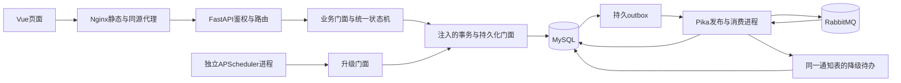

# T44 设计报告（阶段工作稿 v0.1）

> **工作稿、非最终验收。** 设计依据为已采用业务规则、待人审技术提案和准确版本的已发布模块资料；不表示接口冻结、MySQL迁移、产品集成或生产部署完成。姓名/学号待提供。

Agent-Role: documentation
Prompt-Ref: ROLE-documentation-REPORTS-DRAFT-v1

## 1. 设计依据与状态

需求范围见[需求工作稿](requirements-report.md)，权威来源与哈希见[M1来源清单](../../docs/reports/M1-source-manifest.json)。[业务规则v1](../../specs/business-rules.md)经用户采用；字段与错误码[Q002](../../records/prompts/Q002-field-errors.md)仍pending。[C1–C4技术复审](../reviews/design-v2-bc0cd349fcf854f48f4179e1f131e5c2dd8a7e68.md)绑定`bc0cd349fcf854f48f4179e1f131e5c2dd8a7e68`，通过的是技术设计，不是迁移、HTTP或合并放行。

[后端设计](../../specs/backend-design.md)、[OpenAPI](../../specs/contracts/openapi.json)、[字段字典](../../specs/database/field-dictionary.md)、[DDL](../../specs/database/schema.sql)、[持久契约](../../specs/database/persistence-contract.md)构成当前交叉设计；下述未实现算法均为这些文档的归纳伪码，不能当作运行结果。

## 2. 两组方案及选择

| 维度 | 方案A：Vue/FastAPI/MySQL/RabbitMQ/APScheduler | 方案B：Vue/FastAPI/自部署Supabase PostgreSQL/Auth/RabbitMQ/调度 |
| --- | --- | --- |
| 性能可验证性 | 业务到参数化仓储/事务路径直接，可在固定单机测量；无本项目性能结果 | 认证/数据API有可复用能力，附加调用和组件须一起测量；无本项目对比实测 |
| 成本 | 自建鉴权与迁移，组件职责集中，单应用机加独立发压机建议 | 自部署仍承担服务器/备份/安全，可能节约部分认证功能开发，不能据此给出已测成本优势 |
| 维护 | 与本题分工、CAS/独立拒绝审计及故障注入对应明确 | 组件配置与版本协同增多；通用CRUD不能绕过状态机和人类批准 |
| 范围与决策 | 当前技术基线采用A，具体版本和行为仍须按契约审核/冻结 | 保留为比较候选；不宣称Supabase无法实现本题 |

比较来自[architecture.md](../../architecture.md)的工程判断，没有外推平台营销指标或编造价格。建议应用机8vCPU/16GB/80GB SSD、独立发压机4vCPU/8GB只用于规划，未租赁、未测量，也不保证270ms或400并发达标。

## 3. 总体结构、门面与DI



独立进程仍属于单机、同一代码库的单体分层系统，不拆成业务微服务。浏览器不连MQ、不承担升级定时器；API多worker不各启动扫描器。后续组合根`backend/t44/api.py`拟创建并注入门面和连接能力，业务模块不内部随意构造数据库/MQ连接；目录责任见[实现布局](../../docs/collaboration/implementation-layout.md)。

| 模块/计划入口 | 输入与输出 | 边界/目前证据 |
| --- | --- | --- |
| Vue前端 | 冻结API输入、权威结果、错误和字典；输出输入表单与安全反馈 | [PR14已发布](https://github.com/HJY147/t44-dev-trace/pull/14)七页工程基础；尚无业务请求/Token/CRUD |
| API/认证 | 凭据或Token、项目/操作与请求体；输出统一Envelope | API/CLI入口和会话实际实现尚未收尾；不能用纯domain替代 |
| Workflow/Review/Release门面 | typed命令、版本、角色和证据；输出不可变决定/提交结果 | 纯领域`decide(position, command, GuardContext)`据即时答复已写，无IO；事务门面未实现 |
| 持久化门面 | 已校验主体/命令、UoW、锁、CAS；输出已提交快照或异常分类 | 数据库已发布4ae865b8dc554813c04aacbb3a5033aa2745c799 / [PR17](https://github.com/HJY147/t44-dev-trace/pull/17)，Engine/UoW/CoreGateway基础及18项SQLite/mock通过，无18表ORM/业务仓储/实库证明 |
| Escalation/Notification门面 | 有效规则/版本、稳定事件、收件人；输出可靠受理/重复/通知状态 | 事件/扫描/消费者仍为设计，后续消息岗和调度岗实现确认 |
| Compose/运维/CI | 明确环境、入口/锁依赖/测试；输出运行配置和检查原始产物 | [PR15已发布](https://github.com/HJY147/t44-dev-trace/pull/15)配置/工具；应用集成和恢复未执行 |

计划技术栈为Python3.12、同步FastAPI/SQLAlchemy2/PyMySQL、Pika、APScheduler、MySQL8.4、RabbitMQ、Node24/pnpm11.25.0。这里只记录项目约定，不意味着所有入口已存在或已经运行。认证/AuthFacade、WorkflowFacade、ReviewFacade、ReleaseFacade、EscalationFacade、NotificationFacade、UnitOfWorkFactory和IndependentAuditWriter等以协议注入；数据库及消息的具体适配由各责任岗实现。

## 4. 状态机与证据版本

| action | 合法迁移 | 主要守卫 |
| --- | --- | --- |
| start | 待受理→开发中 | 负责人且developer；前驱全部已交付 |
| block | 待受理/开发中/待评审/待上线→阻塞 | 原阶段合格角色；原因、责任环节、证据；保存原状态 |
| unblock | 阻塞→阻塞前状态 | 解除依据与原阶段角色；回开发重查依赖，不接受任意target_state |
| submit_review | 开发中→待评审 | 负责人developer，固定审核对象SHA及证据 |
| approve_review | 待评审→待上线 | 非owner的reviewer/经理；最新本轮通过评审、八段/十项/证据 |
| reject_review | 待评审→开发中 | 合格评审角色、拒绝依据；开启新评审轮次 |
| deliver | 待上线→已交付 | 经理；当前代码评审与当前排期/交付轮次的风险预案批准 |
| rollback | 已交付→已回滚 | 经理；原因/影响/目标版本/当次已审预案和拍板证据 |
| rework | 已回滚→开发中 | 经理返工决定、新计划、依赖全交付、新交付轮次 |

其他边均拒绝；API无通用直接修改state入口。D002规定负责人/依赖只在待受理及从待受理阻塞时可编辑；D003细化角色及最低非自审守卫。这两项是AI总协调技术选择，不冒充用户原文。系统能核账号关系，不能从SHA自动证明真实作者或证据内容真实性。

| 版本/引用 | 变化规则 | 防止的错误 |
| --- | --- | --- |
| task.version | 任务关联成功写CAS后+1；重放/重复升级不增 | 并发覆盖与副作用重复 |
| schedule_version | 改期/返工递增并保留完整before/after | 同排期重复升级、旧计划批准继续生效 |
| delivery_cycle | 返工递增 | 复用上次交付/回滚的批准 |
| review_cycle | 评审拒绝+1；返工重置1 | 使用旧评审轮次通过本轮任务 |
| review.version及对象SHA | 不可变评审，匹配当前提交对象/轮次/模板 | 别的版本证据替代当前审核 |
| assessment.version/排期/交付轮次 | 预案文档不可变；一次审定，重新提交新ID | 改期后沿用旧上线评估 |

阻塞/解除仅改变任务版本，普通改期不撤销同轮代码评审但撤销旧上线批准；返工/评审退回重新建立有效证据基线。通知read/handled只改notification.version，不改任务状态或解除阻塞。

## 5. 数据结构与约束

18表226列为当前技术提案，不是已迁移数据库。四核心表与辅助表分工如下，完整字段类型/默认/CHECK/FK/索引不在本稿重复展开，直接引用字典与DDL。

| 表组 | 内容与关键约束 | 必须由业务层实现的部分 |
| --- | --- | --- |
| tasks（核心） | 统一INT UNSIGNED主键、TINYINT状态/责任环节、四计数、阻塞字段成组、同项目FK、扫描索引 | 合法边、角色、证据、CAS和批准失效 |
| task_dependencies（核心） | 同项目两端FK、边唯一、自边CHECK、反向索引 | project锁下查环、开始/回开发/返工前驱守卫 |
| reviews（核心） | 不可变版本、对象SHA、轮次、八段/清单JSON和模板hash | 有效模板精确覆盖、必需项证据、非自审 |
| decisions（核心） | 交付/回滚/返工类型与载荷、任务/轮次/类型唯一 | 经理资格、当前已审预案及实际拍板记录 |
| users/service_accounts/auth_sessions | 分离用户/服务主体、摘要会话、过期/撤销 | Argon2id解析、撤销与写请求锁序；不存明文Token |
| projects/project_members/iterations | 项目图锁锚、成员/角色、容量/计划 | 参与范围、最后经理、活动负责人及容量语义 |
| release_assessments/schedule_changes | 风险预案与批准版本、不可变计划差异 | 当前排期/交付基线有效性 |
| audit_events/idempotency_requests | 脱敏成功/拒绝，scope唯一、owner租约、完成快照和response_request_id | 独立拒绝事务、恢复者token检查和重放溯源 |
| outbox_events/escalation_events/notifications/scan_runs | 稳定事件、唯一升级键/消费键、游标/规则快照/心跳 | 最高级匹配、confirm与fallback竞争、续扫恢复 |

ID、状态/布尔最小整型及错误码均仍待Q002人的取舍。时间域技术修复统一UTC Z、1000–9999年、最多6位微秒；持久入口再次校验，不静默截断。每连接UTC、严格SQL模式、READ COMMITTED是持久设计约定，不代表已在MySQL验证。DDL不能替代领域状态机、图环检查或权限。应用启动不偷偷create_all，迁移必须另行审查/授权且不靠关闭FK/CHECK绕过错误。

## 6. 成功、拒绝与幂等事务（设计伪码）

```text
authenticate_and_check_project()
validate_schema_and_safe_selectors()
claim_or_read_idempotency(actor_kind, actor_id, operation_id, key, request_hash)
if COMPLETE and same_hash: return saved_data_with_new_meta()
if same_key_different_hash: reject_and_independently_audit(409)
if PROCESSING_by_other_owner: reject(409, Retry-After)

begin main UoW
  protect_session_and_recheck_revocation()
  lock_own_idempotency_and_check_owner_token()
  acquire_required_project_then_members_then_tasks_in_fixed_order()
  recheck_live_membership_role_version_state_evidence()
  CAS task WHERE project_id AND id AND version = expected_version
  write_business_rows_and_success_audit()
  if new_escalation: write_event_outbox_and_increment_count_once()
  write_COMPLETE_snapshot_and_response_request_id()
commit once

on business_rejection:
  rollback_and_close_main_session()
  begin independent UoW
    verify_idempotency_owner_if_claimed()
    write_rejection_audit_and_error_snapshot_with_response_request_id()
    do_not_modify_task_or_success_outbox()
  commit
on rejection_audit_failure:
  return 503 AUDIT_UNAVAILABLE, audit_id = null; retain recoverable PROCESSING
on commit_confirmation_lost:
  return 503 TRANSACTION_UNCERTAIN; recover/query using original key
```

成功任务/子记录/审计/outbox/幂等完成必须同事务。拒绝先释放失败Session再由独立Session提交；SAVEPOINT不能冒充独立拒绝提交。数据库不可用时不能声称审计已持久化；脱敏运维日志也不是数据库审计成功。

同键同内容优先重放，再检查旧版本；快照不含口令/Token，当前meta.request_id/server_time重新生成，original_request_id来自C1新增的response_request_id。相同key异内容拒绝。不同key持同一expected_version竞争只有一次CAS成功。过期owner恢复须锁行等待旧主事务结束、CAS换token；租约到期不能让两个worker同时提交。重放返回历史快照，前端随后GET最新状态。

### 6.1 锁序、图并发及失败恢复

固定序为会话保护→自身幂等行→需要时project→成员按ID→任务按ID→子记录。任何路径取得成员/task后不能再补拿project。依赖变更、开始、解除回开发、返工先锁项目图锚，再锁前驱检查已交付；普通单任务写不无谓串行整个项目。并发A→B/B→A必须在同一project锁下串行DFS，数据库边唯一/自边CHECK不负责判环。

MySQL死锁/锁超时只有限重试完整事务，保留原key/hash；提交结果不明不能直接用新key重做。图DFS为O(V+E)，前驱资格检查O(D)，若应用内额外排序锁ID需O(D log D)；实际SQL计划、锁等待和死锁恢复尚未测量。本轮数据库通用UoW接口确认不等于这套业务锁序/CAS已经实现。

## 7. 扫描、outbox与降级（设计伪码）

```text
start_or_resume_scan_run(fixed_utc_cutoff, rule_version, rule_snapshot_hash)
for each keyset_page(nonterminal_tasks):
  for task in page:
    elapsed_us = integer_microseconds(cutoff - task.planned_end_utc)
    level = highest_matching_rule(elapsed_us)  # 阻塞不暂停，首次不补低档
    if no_match: continue
    call_escalation_facade(task.version, schedule_version, level, scan_run_id)
      revalidate_current_state_plan_rules_and_complete_recipients()
      UNIQUE(task_id, schedule_version, level)
      if existing: return created=false without count/version increment
      atomically write event + outbox + success audit + task count/version
  persist_cursor_only_after_result_is_known()

publisher:
  short_transaction_claim_outbox_with_lease()
  publish_persistent_message_outside_business_transaction()
  on mandatory_route_and_confirm_ACK: short_transaction_mark_confirmed()
  on failure_or_ambiguous_timeout: fallback_transaction()

fallback_transaction:
  lock same outbox
  insert only missing UNIQUE(event_id, recipient_id) notices marked fallback
  retain existing read_at/handled_at/evidence
  mark fallback_terminal only if all inserts commit

consumer:
  validate event/schema against authoritative DB event; lock same outbox
  if fallback_terminal: verify complete existing notices; ACK after commit
  else insert missing notices; commit; then ACK
```

60秒与24小时三级是已采用v1；规则数组可版本化扩展。临期`0≤end−now≤24h`、超期`0<now−end<24h`、严重`now−end≥24h`。用整数时间差比较，不能构造年9999末的`end+24h`造成溢出。rule_version不进入同排期同级去重键；改期保留旧记录并开启新schedule_version。收件人包含负责人/全部有效经理且去重，不静默截断100人。

MQ confirm只证明代理确认，不证明DB标记或消费者提交。fallback与consumer锁同一outbox，通知唯一键保证同事件/接收人一次持久记录；不能声称MQ恰好一次投递。fallback为终态，同事件恢复不再提醒，新事件正常投递。confirmed但未完成收件人时如何超时补待办仍须消息/调度配置确认。

设遍历任务N、规则L、生成事件K、历史事件E、各事件收件人数R_i：直接规则匹配扫描O(NL)，唯一索引查询常规树索引成本O(K log(E+1))，收件人展开O(ΣR_i)，分页内存O(B+R_max)。固定v1三档可将L视常量；不能据索引宣称整次扫描O(1)，也不能据复杂度推定P95。索引选择、规则边界和批次重启仍需实库/故障验证。

## 8. 前端、部署与真实CI

前端基础最终`f261cbf0ea94537ed9f0a1600770c93ee8109237`：Vue3/TS/Element Plus、七页路由、未连接/空/加载/失败反馈，403停止操作、409只发刷新意图，没有模拟业务成功。安装/类型/5项模块测试/构建和1440×1000、390×844 headless基础检查通过；零API请求不等于业务端到端通过。[已发布报告](https://github.com/HJY147/t44-dev-trace/blob/f261cbf0ea94537ed9f0a1600770c93ee8109237/reports/modules/frontend.md)明确未联调及无全量覆盖率。

部署最终`72e3275202273a60af3acc37b7a319f10eea99a7`：Compose含MySQL/RabbitMQ、4worker API、独立消息/调度、Nginx静态/同源代理和持久卷；宿主默认仅loopback8080。镜像资源白名单不复制原始sources。运维生成私有凭据、备份及新隔离目标恢复计划，拒绝活库/已有目标卷，不提供drop/reset。实际镜像/启动/迁移/备份恢复未由本机执行；[已发布报告](https://github.com/HJY147/t44-dev-trace/blob/72e3275202273a60af3acc37b7a319f10eea99a7/reports/modules/deployment.md)有11部署安全+6CI守卫模块检查，不是产品验收。

| 门禁 | 实现和证据 | 当前结论 |
| --- | --- | --- |
| reviewer/stage | 绑定确切SHA的审核COMMENT/status，总协调配置保护 | C1–C4技术复审通过但Q002待审，未发布本轮success |
| static | Ruff/配置/工作流等真实命令及原始产物 | 配置层有通过；缺完整应用时产品入口失败，不能整体通过 |
| contracts | 真实contract marker、Schema及实现一致性，拒绝空/跳过占位 | 设计Schema检查不是HTTP；产品检查尚未通过 |
| coverage | 完整生产源码逐文件计入，每语言行覆盖率≥80%，无隐藏文件/空测试 | 没有全项目覆盖率；分支/函数报告不额外改作业门槛 |
| frontend | 冻结锁、类型、真实测试、构建 | 前端基础本地已通过；不能将不同SHA、未集成分支结果冒充最终主干通过 |

main严格要求上述五项并约束管理员，见[保护v2回执](../../records/github/protection-v2-response.json)。[真实Actions run39912067161](https://github.com/HJY147/t44-dev-trace/actions/runs/39912067161)绑定部署实现`3857b2e55fcb7fe99b38fa2d85b086662b762f6c`，四job实际因缺应用/测试/前端manifest失败；Compose/Nginx语法及服务初始化有成功步骤。这个独立目标树的失败不能写成后来所有PR的结果，也不能改写为产品通过。当前PR14/15均draft/open，精确head见[M1 GitHub快照](../../docs/reports/M1-github-snapshot.json)。

## 9. 已有验证、限制和实现顺序

| 层次 | 证据 | 没有证明的内容 |
| --- | --- | --- |
| 设计 | v2复审1130项Schema/注解检查、38操作，18表226列对齐 | 1130不是产品HTTP用例，未执行MySQL/调度/MQ |
| 纯domain正式基础 | 后端最终0bb4549c1b6e4fb7247dc58dd8a5fa675161d614 / [PR16](https://github.com/HJY147/t44-dev-trace/pull/16)，106项domain单测、Ruff/format/Bandit通过，仅domain含分支约98%；81为保留的早期快照 | 非API/事务/权限撤销/CAS/全项目覆盖率，不取代最终交接 |
| 通用持久正式基础 | 最终4ae865b8dc554813c04aacbb3a5033aa2745c799：Engine/池/Session-UoW/CoreGateway及18项SQLite/mock测试、Ruff通过 | 无18表ORM/仓储、MySQL约束/迁移/业务并发 |
| 独立验收 | 只读[公开初始化报告](../modules/testing.md)与[交接](../../records/handoffs/testing.json) | 尚无产品执行或验收结论；不读私有用例/日志或联系测试 |

后续先取得Q002真实选择和冻结技术版本，再由责任岗完成API/事务/持久/消息/扫描及真实客户端，合并到明确集成快照；然后运行MySQL约束/并发、HTTP契约、安全/撤销、MQ模糊确认/fallback、扫描续扫与恢复，最后开展400并发10分钟及独立验收。新增配置规则需真实diff和人日证据。任何新head都要重新绑定审核，不能拿本设计复审替代未来代码验收。

提交材料对照见[submission-map.md](submission-map.md)。本轮亲读《作业提交注意事项.docx》并核对四组要求；测试结果最终稿未完成，[专门AI规格说明独立阶段稿](ai-spec-guide.md)已形成，最终版待冻结/补证，个人意见未提供。三份报告继续保留工作稿、非最终验收状态。
