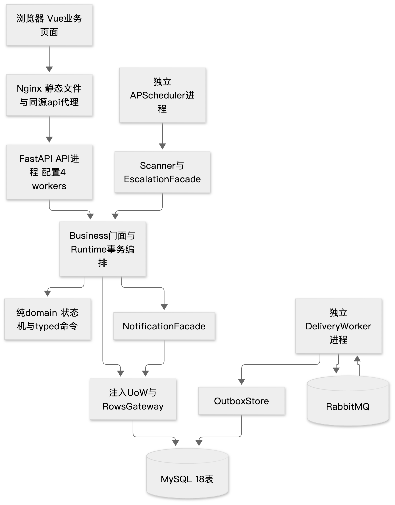
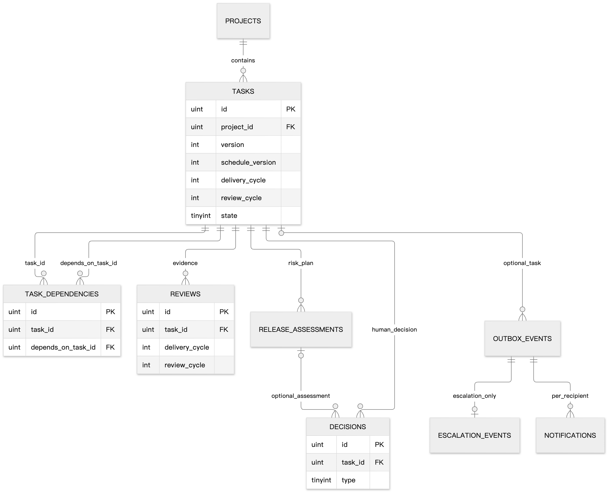
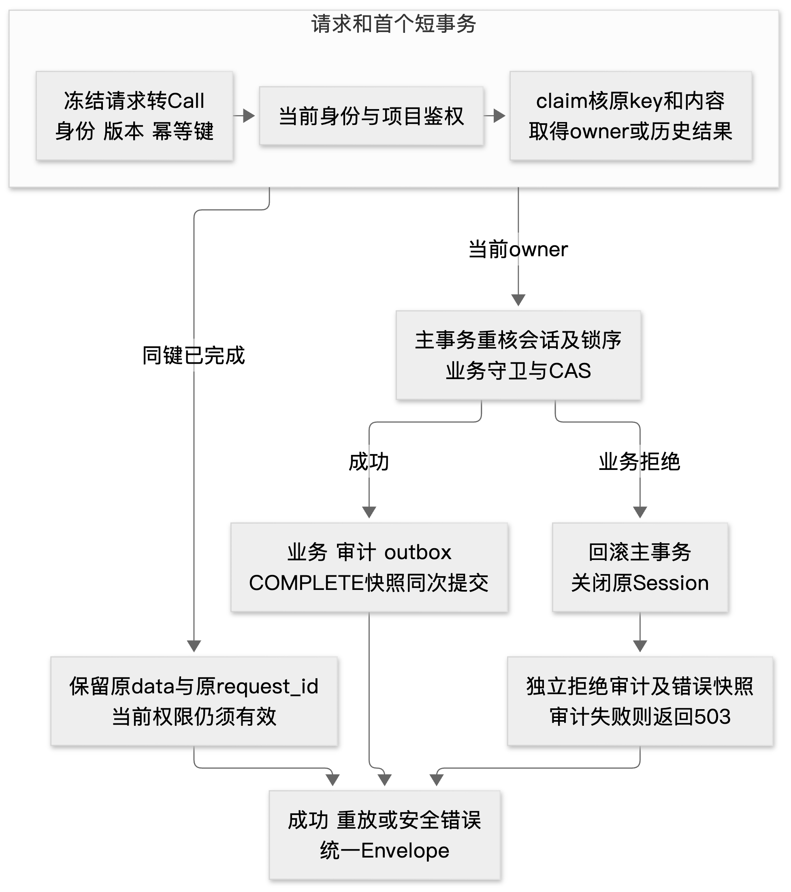
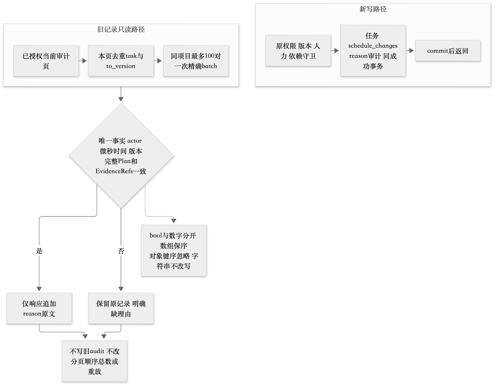
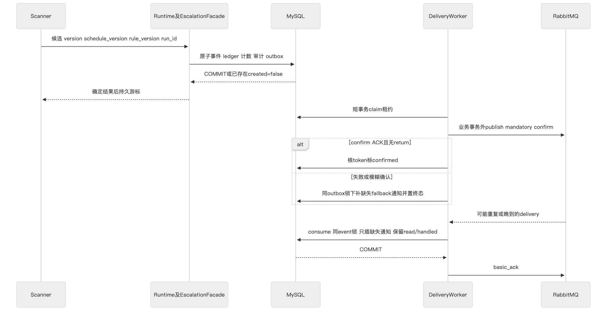
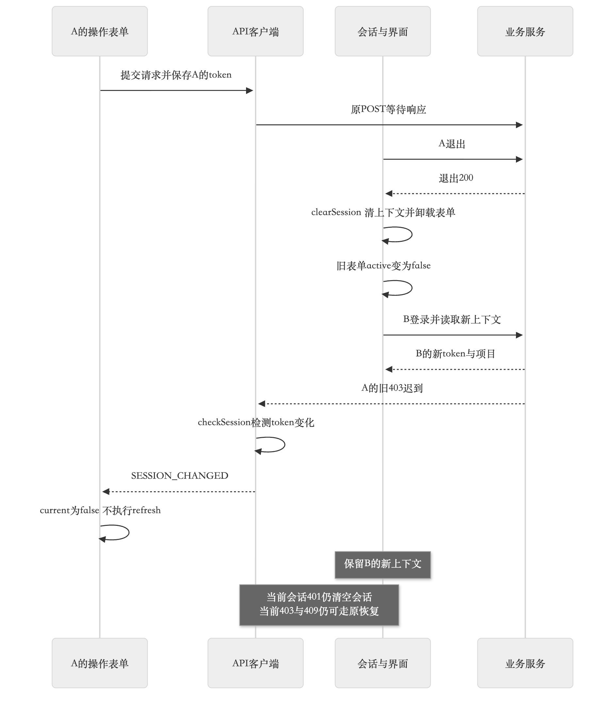

# T44 概要设计与详细设计报告

本系统以单体分层和显式事务实现研发交付记录，浏览器、API、数据库、消息与扫描进程各有明确责任。当前实现源90b734f65ce6ee9f5c217e885bc7ea4857e32b48遵守v1.2冻结的38操作、130 Schema和18业务表226列。本报告说明模块协作、存储、一致性和关键函数输入输出；开发检查、实际运行和独立验收分别列证，用户采用的主要核心口径为62文件5038行；辅助3文件780行（CLI147、迁移307、seed326）单列。原固定cloc全量65文件5818行，较5100超718，原require-range仍失败；用户采用核心口径不等老师批准全部文件排除。

## 1 设计依据和架构

[需求规格](requirements-report.md)、[后端设计](../../specs/backend-design.md)、[持久契约](../../specs/database/persistence-contract.md)及[v1.2冻结](../../records/spec-freezes/v1.2.json)是实现依据。Vue3、TypeScript、Element Plus负责交互，FastAPI与同步Python服务负责编排，SQLAlchemy/PyMySQL访问MySQL，RabbitMQ承担异步投递，APScheduler驱动扫描。该方案让单个业务操作可以在一个UoW内提交，避免为课程规模引入分布式业务事务；未测量的技术性能优劣不作结论。

| 模块 | 责任和主要输出 | 不能代替的职责 | 关联需求 |
| --- | --- | --- | --- |
| Vue工作区 | 当前身份和项目数据、表单及真实错误解释 | 最终权限、版本及状态准入 | FR01及FR04至06 |
| API和contracts | 解析HTTP为Call、冻结结构校验、Envelope | 完整业务校验或数据库提交 | FR01 |
| Runtime | 鉴权、幂等、锁序、事务、审计及快照 | 人的业务选择 | FR01及FR06 |
| Business和domain | 业务对象、排期、评审和纯状态Decision | 自行建立连接或旁路commit | FR03至06 |
| Rows和UoW | 白名单参数化SQL、锁、CAS和关闭失败Session | 发布批准、评审判断 | FR02及FR06 |
| scanner和消息 | 持久续扫、outbox、通知幂等及降级 | 本人已读/处理、端到端交付证明 | FR07 |
| 部署工具 | 明确源镜像、环境生命周期、备份和隔离恢复 | 产品发布决定或独立验收 | FR08及NFR03 |

业务模块经门面注入通知与升级组件。生产存储只有活动UoW的gateway，不建立替代内存数据库。辅助原型、开发夹具和独立验收分别存放，不能混入产品实现或测试计数。

## 2 数据模型与存储

### 2.1 核心关系与版本

四核心表是tasks、task_dependencies、reviews、decisions；项目、成员、迭代、上线评估、审计、幂等、outbox、升级与通知支撑其完整生命周期。ER图展示主要业务关系而非替代全部18表DDL。migration版本表另计，不能将业务18表与恢复19表的口径混同。

| 版本字段 | 变化时机 | 不变边界 |
| --- | --- | --- |
| task.version | 每个成功任务关联写增加 | 幂等重放不增加 |
| schedule_version | 改期和回滚后返工增加 | 普通阻塞不增加 |
| delivery_cycle | 回滚返工增加 | 与评审轮次分开 |
| review_cycle | 评审拒绝后增加、返工重置 | 旧轮评审不可充新批准 |

状态、枚举和错误映射集中定义。UTC时间经Schema、语义与持久入口检查后存DATETIME(6)，仅允许合法UTC域及六位小数，连接采用UTC、严格SQL模式及READ COMMITTED。工时用四分之一小时整数，避免浮点截断。决定和评审历史不可变，成员软撤销且保留引用。

### 2.2 迁移及原生目录检查

迁移要求显式库名、受控MySQL版本、空库准入、锁、marker与checksum；失败后保留partial状态并拒绝冒充成功。当前CHECK解析使用锁定sqlglot30.25.0的MySQL AST，保留完整词法、单表达式及节点白名单，拒绝未知结构与注释，不运行优化器。只规范化不影响语义的标识符大小写/引号、括号和合法字符集引导，字符串、参数及逻辑算术树仍保留。

列签名整体比较类型、长度、unsigned、fsp、nullable和default，内部CLI标签合并为column_definition不改变HTTP错误码或结果字段。Index/FK直接expected元组仅适用于完整hash绑定Frozen v1；四条原生目录SQL及_catalog_defects函数AST保持原样。SQLite与语法树等价关系不能替代真实MySQL返回CHECK形式的验证，当前准确源797项开发CI原件已核；SQLite局部等价不能替代真实依赖或独立验收。

## 3 事务和并发设计

Runtime先作当前身份校验及短事务claim。已完成的同键同内容请求只返回原业务快照与原response_request_id，但新请求仍须有当前项目访问权；同键异内容或租约竞争依原错误拒绝。当前owner进入主事务后再次锁定会话、幂等及业务范围，Business完成守卫和CAS，成功业务、审计、outbox及COMPLETE快照同一次提交。

业务拒绝退出并关闭原UoW后，使用独立事务记录拒绝审计和约定错误快照；拒绝审计自身失败返回依赖错误，不能声称已留痕。SQL驱动异常不直出。提交结果不明与普通业务拒绝分开，返回TRANSACTION_UNCERTAIN后应查询原幂等键，不盲目以新键重做。

锁序为session、幂等、必要的project、按user_id升序的membership、按task.id升序的任务，最后评审/评估等子记录。依赖编辑和开始/解除至开发/返工先锁项目，依赖图读写与任务CAS同事务；成员、人力与任务激活按统一次序串行。普通单任务操作无需全部项目串行，但不能拿task后反锁project或逆向锁另一任务。

## 4 服务门面和函数输入输出

当前完整源码hash与函数签名见[当前来源和函数索引](../../docs/reports/FINAL-20261029-source-index.json)，外部38操作及Schema/错误索引见[接口附表](../../docs/reports/FINAL-20261029-interfaces.md)。下表列出跨模块使用时必须遵守的约定，不用函数名清单代替输入输出。

| 函数或门面 | 输入和前置条件 | 输出 | 异常及副作用 |
| --- | --- | --- | --- |
| API endpoint | 路径/query/body、当前Token、写幂等键 | Call或冻结错误Envelope | 先结构校验，不自行判业务批准 |
| Runtime.prepare | Call及validate回调 | 可执行或已重放的上下文 | 鉴权/claim在原UoW，保留原调用者兼容 |
| Runtime.execute | Call、结构校验、来源标记 | 成功data或约定错误 | 编排业务事务、独立拒绝审计及失败关闭 |
| Business.dispatch | 活动gateway和已授权Call | 操作data，最终由finalize封装 | 保留原path/query过滤和父task归属 |
| Business.row_model | g、schema名、可信row、可选related映射 | 原冻结DTO | 缺related时沿原单行读取；不接用户任意表名 |
| common.page | g、白名单table/where/query、serializer，可选predicates和prepare | items/page/page_size/total | 先读当前页，prepare只为该页构造serializer，count保原条件 |
| contracts.violations | schema对象和候选值 | 前100项path/rule/message | 仅冻结对象身份复用validator；动态schema保持原完整构造/late-ref异常 |
| Workflow.transitionTask | 锁定任务、动作、expected_version、证据 | CAS后任务及必要决定 | D008只细化批准引用失配分支；拒绝无半写 |
| domain.decide | 纯Transition及角色/依赖/评审快照 | Decision | 不执行SQL或提交，领域码经服务映射 |
| project_reasons | g、project_id、已授权审计页 | 当前响应副本的保守理由投影 | 每页≤100pairs一次批读；不改旧审计/排序/总数 |
| RowsGateway | 白名单表/列、typed keys、谓词/锁 | 物化行、count或CAS结果 | 参数化，失败Session不可复用 |
| UoW | 显式连接工厂与上下文 | 活动gateway及提交/回滚边界 | 关闭必须确定；业务层不越过它commit |
| check_schema和migrate | 受控engine及明确expected_database | 结构缺陷或迁移报告 | 错库/目录不符/partial拒绝，不自动修改未知库 |
| 通知批写 | 已锁outbox及冻结收件人快照 | 去重后的站内通知 | 单事务批插，缺收件人等失败全部回滚，不清已读处理字段 |
| scanner/facade | cutoff、run游标、规则和scoped主体 | 可靠升级Call及持久推进 | 结果确定后推进；不能将202等同已送达 |

### 4.1 分页批量关系读取

九集合由_COLLECTIONS声明表和DTO。listProjects先按当前主体有效成员范围限定项目；Member只取active成员；子任务集合先调用call.task核对父任务归属。过滤字段只取明确白名单，其他输入不会被展开成任意where。

page先按原sort/id、offset和limit读取本页rows，再调用prepare(rows)。Member收集该页唯一user_id批读users，Dependency收集depends_on_task_id批读tasks，然后以ID映射构建serializer。空页不新增关联查询；其他DTO继续原serializer。row_model派生Member.roles/active、Dependency.satisfied、任务与迭代plan及AuditEvent前后值，与冻结形状一致。开发夹具中20成员页SELECT22→3、23依赖页23→4，仅证明该夹具的查询次数，不能当真实MySQL或正式性能提升。

### 4.2 契约校验器复用

缓存项保存id(schema)到原schema强引用与原validator，并再次用is判断身份，只对冻结SPEC中预先锁定对象复用。保留强引用避免对象回收后id复用命中错误schema。冻结对象错误迭代在前100项停止；动态schema仍沿原validator构造和完整错误迭代再切片，保留任意根/嵌套$id及迟发引用异常，不使用已否决的evolve方案。候选schema_version与成功meta.contract_version不同，不因缓存统一改值。

188项新差分及原305项SQLiteHTTP/顺序/领域自测通过；集合N+1、错误上限和身份问题的原红证据保持。本机ABBA仅为开发CPU观察，Task1.080x、body1.243x、envelope1.041x及极端无效EvidenceRefs样本不能外推云上吞吐、400并发或正式P95。

### 4.3 评估和历史理由

发布先核任务及评估归属、请求版本等更早条件。原批准引用不匹配且评估基线同时失效时，D008先提示更新评估；批准引用匹配时原领域守卫顺序不变。代码评审、评估独立审核及经理决定均保留，不允许自审。

新计划修改和返工reason在原CAS、schedule_changes、审计、outbox及幂等主事务写入。旧审计只在同页、同项目、task/to_version唯一配对且actor、微秒时间、完整五项Plan、证据严格一致时投影响应副本；旧iteration或歧义不猜。bool与整数不同，数组顺序和原文保留。

## 5 消息与扫描算法

扫描run在开始固定cutoff和高水位，以keyset和持久last_task_id续扫。单任务短事务内按规则/计划版本/级别去重，生成升级及收件人快照；已交付不再作为当前超期任务。失败保留可恢复游标，重启不得跳过未确定结果。若本次遍历N任务、每页B条，遍历本身为O(N)，页面内存O(B)；具体SQL成本还受谓词、索引和锁影响，不能据渐进式直接保证P95。

outbox先短事务claim，再在事务外publish。消费者验证三字段消息与数据库权威事件，锁outbox、插入通知、提交后ACK。fallback和consumer都先锁同一outbox再按收件人顺序写，唯一键(event_id,recipient_id)防重复，原通知read/handled不覆盖。批量INSERT保留去重、顺序和回滚边界；一次executemany观察不等正式吞吐证明。publisher ACK仅表示broker确认，不能替代消费者持久化或用户处理。

## 6 前端交互与会话

导航包括工作台、项目空间、交付任务、迭代排期、评审与发布、通知中心、审计记录。任务抽屉展示详情、依赖、评审、评估、决定、升级和变更记录；表单依冻结Schema构造意图，错误说明按HTTP/code/operation映射，不从局部分页猜负责人。0、null及空串语义分开。

App在无用户时卸载整个shell与浮层。clearSession先增加上下文序号再清身份、项目、字典和通知；request在fetch及JSON解析后的成功/失败路径重验token，旧响应转为SESSION_CHANGED。工作区、表单、登录和抽屉同时检查active、卸载及当前token，防旧catch触发新会话刷新。当前401清空，当前403/409继续原恢复流程；退出503或网络失败保留当前身份。

最终前端只合并七组相同CSS声明。254组selector/media声明序列一致，十二组开发夹具PNG字节相同；五宽度六十状态无页面错误/横溢出。完整computed-style探针严格比较失败且保留，不能以PNG相同宣称其也通过。组件89项/typecheck/build与真实后端E2E、独立浏览器验收分别记录。

## 7 部署备份与恢复

运行镜像须绑定准确产品Git字节、锁文件及完整运行时文件集；镜像构建成功不等已加载或部署。20261029免费双镜像Actions40869531724已成功，部署岗后续已核官方artifact完整ZIP及六原件，但profile仍actual_loaded=false、root_approved=false，不能写成已部署。当前设计使用非root镜像与独立source-aware包装，沿准确锁/文件集计算，不复用旧镜像身份。

备份先停所有应用数据卷使用者，再将APP配置和数据流式CMS公钥加密，私钥只在本地受控目录。完整下载并解密SHA一致后才给总协调永久释放依据，隔离恢复需要单独实证；本次尚未实际备份或恢复。费用、VM最终删除和资源核对归总协调，不由报告推定已完成。

## 8 设计验证和变更记录

| 设计部分 | 开发证据和检验目的 | 尚未由此证明 |
| --- | --- | --- |
| schema及分页 | 新188差分、原305 HTTP/领域、N+1红绿 | 该局部未证全量；真实MySQL性能与独立验收另证 |
| CHECK和通知批写 | DB239含18新owner、196表达式/38416等价关系、批写回滚 | CI覆盖外目录变体及云负载结果 |
| UI及样式 | 89组件、typecheck/build、60状态/12PNG相同 | 云业务E2E、完整computed-style通过 |
| 事务/MQ/扫描 | 原模块和真实依赖，准确源797项CI原件已核 | 全故障切点、真实人日、正式P95 |
| 运行镜像和备份 | 本地5项真实Git/加密流验证及镜像构建 | 云已部署、APP已备份、删除后恢复 |

本表反向关联需求FR01至08，完整对应见[双向追踪](../../docs/reports/FINAL-20261029-traceability.json)与[测试报告](test-results-report.md)。当前源码及冻结hash由本岗静态核对，不把静态检查、AI审核COMMENT或Word版式QA记为产品通过。

历史M6/M7设计、当时33/35页及M8至M10附录均以原Git和manifest保留；本版以当前结构重写，不覆盖私密旧Word。需求变更由人选择，AI负责当前设计实现和复核；范围、性能及学生研究材料缺口仍列当前提交导航。

## 本轮证据边界

用户采用的主要核心口径为62文件5038行；辅助3文件780行（CLI147、迁移307、seed326）单列。原固定cloc全量65文件5818行，较5100超718，原require-range仍失败；用户采用核心口径不等老师批准全部文件排除。 原命令、逐文件结果和分组见[本轮计数](../../docs/reports/FINAL90b-source-count.json)及[原文件集分组](../../docs/reports/FINAL90b-core-runtime-groups.json)。

准确产品90b的官方Actions40928297882后端797、前端89零失败错误跳过；后端行2485/2754、分支719/852，前端行364/390。Docker40928465279实际checkout是PR合成merge56217f14568c7cd5ac6e83aaf4d890883e755ef9，已核产品文件字节与90b相同；不称纯90b checkout或正式验收。详见[官方CI核证](../reviews/90b734f6-ci-evidence.md)。

独立F05原18 PASS、1 FAIL、11 UNEXECUTED保留；唯一FAIL为非法page的400严格工具断言与冻结422类型校验优先级缺乏无歧义依据。实际422拒绝并持久审计，暂不确认为产品缺陷，也不改成PASS。38操作被观察不等全成功路径，479错误分支未观察，完整黑盒验收未成立。[明确发表报告](../../docs/reports/FINAL90b-public/753_F05_REPORT.PUBLIC.md)和[裁决](../../docs/reports/FINAL90b-public/753_F05_VERDICT.PUBLIC.json)为本轮独立资料入口。

P06正式性能结果待回填。当前没有可报告的新正式P95、吞吐或400并发达标结论；待具名PUBLIC报告到达后按准确源、有效发压、三类目标、完整稳态与恢复边界填写，旧失败保留。
