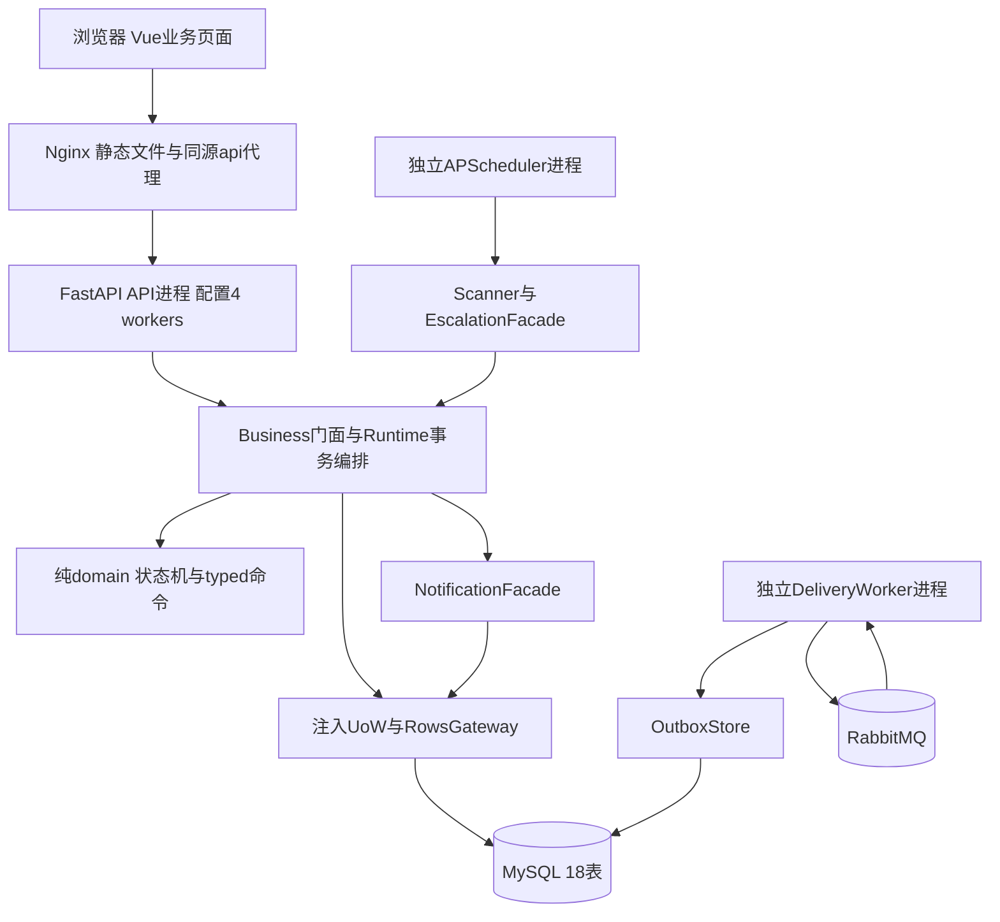
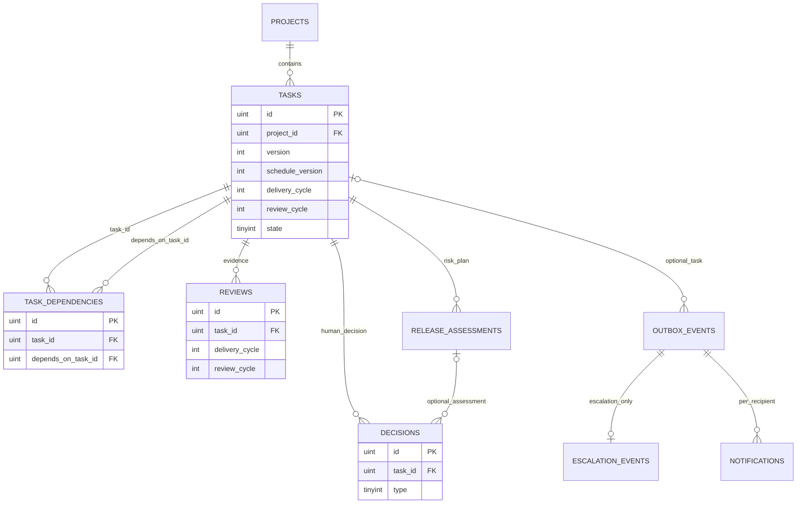
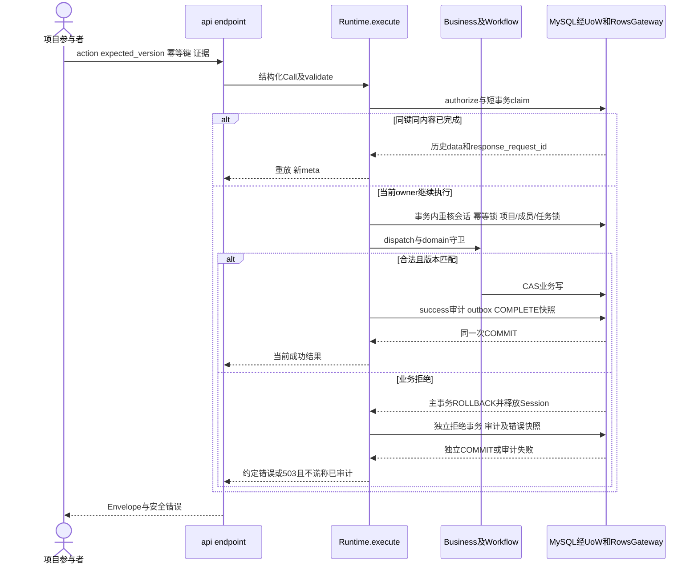
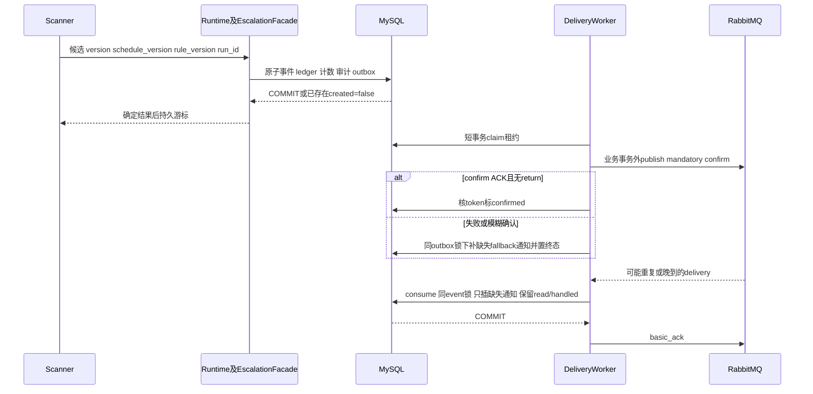

# T44概要设计与详细设计报告

版本：M5概要/详细设计工作稿 v0.5。**未通过最终验收。** 生产内容固定6ba9f94，冻结1.1.0/14文件；后端5dcb、前端75。M0–M4原提交与失败、八旧图和M4私密Word/QA保留；新图和函数I/O是据当前规格/代码持续补充，不倒填开发前全部成稿。公开无个人封面值，日期空。

Agent-Role: documentation
Prompt-Ref: ROLE-documentation-M5-REPORTS-v1

M3 Editor: coordinator_agent；Prompt-Ref: ROOT-documentation-M3-DIAGRAMS-v1。

## 1 设计依据与演进

需求见[SRS](requirements-report.md)。早期规范在717cd65被判C1–C4不通过，修复后bc0cd34限定技术复审通过；用户D004采用后，`ae60dc37fdaefecaca33e734a354add6ba9ebe29`冻结1.0.0并派完整实现。M1仍待Q002的历史commit不改写；当前不再把Q002列为待采用。冻结只证明设计准入，不证明软件测试/性能/独立验收通过。

本报告分“概要设计：模块/进程/边界”和“详细设计：数据/函数/协议/时序/异常”，再给模块测试与联调修复。当前1.1的14冻结文件只读，1.0父链11项历史保留，真实结果、历史路径和后续tmp迁移见[M2收集](../../docs/reports/M2-collection.md)。

## 2 概要设计

### 2.1 候选方案和选择

| 维度 | A Vue+FastAPI+MySQL+RabbitMQ+APScheduler | B Vue+FastAPI+自部署Supabase PostgreSQL/Auth+MQ/调度 |
| --- | --- | --- |
| 性能可验证性 | 直接SQL/事务/锁路径可测；当前采用 | 多组件调用和自定义状态/通知仍需测，无本项目对比结果 |
| 成本 | 自建鉴权/运维，单应用机加独立发压端规划 | 可复用认证能力，但自部署仍承担服务器/备份/安全；没有实测成本优势数据 |
| 可维护性 | 对应责任岗和门面边界明确，故障注入可定位 | 组件/版本联动更多，通用CRUD仍不能绕过状态机 |
| 取舍 | 任务书单机/单体及项目技术基线采用A | 保留比较，不宣称B不能实现；不使用平台宣传替代测量 |

[独立architecture.md](../../docs/architecture.md)补齐两组候选比较的时间、性能/成本/可维护性依据及Java/Spring补充候选；本节为概要摘要。

8vCPU/16GB应用机等规格仍是规划，不是已购/已压测或达标保证。项目不拆业务微服务，不做多地域，不因多进程改变单体分层定位。

### 2.2 模块、进程和部署边界



当前组合根`api.create_app`装配Runtime/Business，默认接消息与升级门面；API多worker不各自启动扫描器。`python -m t44.messaging`和`python -m t44.scheduling`独立运行，Compose配置不是已完整部署成功的证明；部署私密服务身份/共享锁和真实镜像构建仍按部署岗本轮证据核对。

| 模块 | 真实入口/职责 | 不越过的边界 |
| --- | --- | --- |
| frontend | src/api.ts、workspace.ts及业务组件；同源请求/错误/版本/幂等交互 | 不自行判权、决定状态出口或运行升级定时器 |
| API/Runtime/Business | api.create_app、Runtime.execute、Business.dispatch | 鉴权/Schema/幂等/事务/统一错误收口；不直接创建表或改他岗模型 |
| domain | domain.state_machine.decide及typed commands/models | 纯决策无IO，可信TransitionContext由业务加载，内部Enum不等于数据库码 |
| persistence | Engine/UoW/RowsGateway、migrate/check_schema、OutboxStore/ScanStore、seed_demo | 参数化/锁/CAS/原子能力，业务合法边和证据语义由服务负责 |
| messaging | NotificationFacade、DeliveryWorker、PikaBroker | 通知列表/已读/处理、confirm/消费/fallback，不另建通知系统 |
| scheduling | EscalationFacade、Scanner.run/tick、build_scheduler | 版本化规则/最高级/扫描续扫；不绕Runtime直接改任务状态 |
| deployment/CI | compose.yaml、Dockerfiles、ops.py、product.yml和ci脚本 | 明确目标运维与真实检查，不伪造产品通过、不修改验收条件 |

依赖从组合根注入工厂/门面；数据库连接、消息连接不在领域函数内部随意构造，broker网络IO在业务事务外；5dcb单只读分支持连接跨本地校验CPU的代价须另测。具体签名与源文件在[M2追踪](../../docs/reports/M2-traceability.md)。

### 2.3 当前UI信息架构和设计到实现

真实导航源navigation.ts定义七个入口：`/`、`/projects`、`/tasks`、`/schedule`、`/reviews`、`/notifications`、`/audit`，router映射到同一WorkspaceView及page prop。App通过workspace.user控制登录覆盖和app-shell inert；这不是服务端授权保证，也没有据此新增资源级权限深链。图源见[M5 UI导航](../../docs/reports/M5-diagrams.md#3-当前真实ui导航)。

[D007](../../records/decisions/D007-visual-direction.md)来自U017/U018。设计326先提交DESIGN、可点击三场景合成原型、来源/Apache许可及8原型图，协调者实看4样本后才导入840。使用固定OpenDesign e03d/0.25.1的官方本地技能/模板，不是桌面App、MCP或外部模型；具体色值/间距是AI设计选择，不冒记用户逐项采用。后端契约/权限/七态/通知双计数保持。详见[设计](../../docs/ui/warm-glass/DESIGN.md)、[来源](../../docs/ui/warm-glass/sources.json)、[许可说明](../../docs/ui/warm-glass/NOTICE.md)。

## 3 详细设计

### 3.1 状态与稳定编码

SRS状态图完整列出七状态九动作及阻塞原态返回。`services/codes.py`显式映射API/持久状态1..7、动作1..9、角色/责任环节及41个审计错误；不得依赖Enum声明顺序。`Workflow.transitionTask`把冻结码转换为typed命令，调用`domain.decide`，再在当前UoW持久化结果。

| 版本/证据 | 写入与失效规则 |
| --- | --- |
| task.version | 每任务关联成功写CAS+1；同键重放/业务重复升级不增 |
| schedule_version | 改期/返工+1；升级唯一键与上线评估绑定它 |
| delivery_cycle | 返工+1，旧交付/回滚批准不用于新轮 |
| review_cycle | 评审拒绝+1；返工重置1，旧评审保留但无效 |
| review对象SHA/模板 | 评审不可变、匹配当前对象及轮次；最低非owner守卫不证明真实作者 |
| assessment.version/排期/交付轮次 | 文档不可变、一次审定；改期撤销旧预案批准，不撤销同轮代码评审 |
| notification.version | 已读/处理CAS，只改通知，不改变task.state |

### 3.2 核心ER和存储约束



图选择核心及通知关联，不声称只存在这些表；完整18表226列及FK/CHECK/索引见冻结字典/DDL。`UNIQUE(task_id,schedule_version,level)`约束业务升级一次；`UNIQUE(event_id,recipient_id)`约束通知记录一次；outbox与escalation可选1:1，普通变更事件没有升级ledger。项目、成员和迭代变更的outbox不必关联task；决定的assessment引用也可空，例如返工。

真实MySQL8.4已迁移/重复校验18表，并有Rows/约束/并发局部结果；SQLite玩具表仅覆盖通用生命周期，不能替代MySQL证据。列级CHECK/FK不负责合法状态边、图环、角色或证据真实性。`cli migrate --database`有明确目标；不在启动时create_all偷迁移。

### 3.3 成功、拒绝与幂等时序



`Runtime.execute/claim/complete/rejection/locked_scope`是实际入口。成功业务行、成功审计、应发事件、幂等COMPLETE及response_request_id同事务；拒绝先释放失败UoW，再独立提交拒绝记录和快照，不写task/成功outbox。提交确认丢失保留503 TRANSACTION_UNCERTAIN，沿原key恢复；cleanup rollback不能证明服务器未提交。C1修复的response_request_id是最终完成者来源，重放meta不复用旧凭据或把历史task快照当最新版本。

### 3.4 并发与依赖图锁

实际锁序为会话→自身幂等行→需要时project→成员按ID→任务按ID→子记录；`locked_scope`为依赖/开始/解除/返工等图一致性操作先锁project并锁前驱。图变更在同一项目锚下串行DFS，拒绝并发A→B/B→A形成环；任务更新带expected_version条件，仅一不同请求成功。不能在先拿task后再补拿project造成反序。

| 风险 | 机制 | 必须验证 |
| --- | --- | --- |
| 同版本不同键竞争 | task CAS和同事务证据 | 真MySQL多连接一次成功、拒绝不改现状 |
| 同键重放/异参/过期owner | scope唯一、hash、行锁/owner token、完成快照 | 不能租约到期即并行提交，提交不确定用原键恢复 |
| 项目成员撤销与在途写 | 会话/成员锁序与事务重核 | 权限过期不被长缓存绕过 |
| 并发加边与开始 | project锁、前驱按序、DFS | 自边/跨项目/环、依赖回滚后的开始/返工守卫 |
| 拒绝审计故障 | 独立UoW，503/audit_id=null | 不因主事务回滚丢拒绝，也不在存储不可用时声称已持久化 |

DFS为O(V+E)，检查D个前驱为O(D)，若应用另排序锁ID为O(D log D)；实际SQL计划/锁等待不能由复杂度代替。Runtime遇到数据库死锁/锁等待超时返回约定503，不在服务内部自动重跑完整事务；调用者须保留原key和内容再请求。Scanner只对版本或排期版本冲突重读候选并最多尝试三次，这不等于对任意数据库故障自动重试。

### 3.5 扫描、outbox与降级

`Scanner.run/tick`加载真实版本化规则和原文hash，固定UTC cutoff限定本轮候选并keyset分页；每个候选请求取得当时clock，`EscalationFacade.create`经Runtime在锁内重验任务/排期/规则并按该时刻只选当前最高档。cutoff不是整轮所有事件共用的级别判定时刻。20任务、重扫、改期与CLI退出后续扫已有调度模块证据；不是400并发性能结论。



`OutboxStore.confirm/consume/fallback/recover_confirmed`与`DeliveryWorker.cycle`对应图中入口。consumer/fallback共用outbox锁及通知唯一键；confirmed长期缺收件人会补待办，公平性修复避免完整事件挡住后续缺失项。普通business.changed失败重试，不伪造无收件人待办。confirm不是用户已收到；fallback终态同事件恢复不二提醒，新事件正常走MQ。

扫描伪码：

```text
持久start或resume run，记录cutoff和规则原文hash
for keyset_page(候选范围由cutoff限定):
  candidate_clock = 当前UTC时刻
  elapsed_us = 整数微秒(candidate_clock - planned_end)
  level = 最高匹配规则  # 不构造end+24h，不截断完整收件人
  Runtime执行版本重验和UNIQUE(task,schedule_version,level)
  新建则事件/outbox/计数/version/审计/幂等同提交；重复不再增加
  仅在结果确定后推进持久cursor
```

N任务、L规则、K事件、历史E、收件人R_i时，直接匹配O(NL)，索引去重通常O(K log(E+1))，展开O(ΣR_i)，分页内存O(B+R_max)；v1三档可视L常量。不能把整次扫描写O(1)。阻塞不暂停；rule_version不加入硬去重键绕过同排期同级一次规则。

### 3.6 1.1人力守卫和单接口只读事务

`Tasks.capacity_owner(g,c,identifier,iteration_id)`读取当前迭代并要求负责人存在capacity；创建/允许阶段转派和Workflow返工调用它。Projects.changeIteration读取该迭代状态1–5的**全部**任务负责人集合，要求新capacity全包含；同一project锁协调与创建/转派/返工竞争。项目成员保护仍含7，不与工时规则混同。缺失抛CAPACITY_REFERENCE_INVALID，原鉴权/状态/版本/OWNER先后不改，拒绝不更新计划/任务/轮次/差异。

5dcb仅给validateContractPayload增加单自有UoW：普通RC authenticate→原validate→fresh now过期复核→原dispatch→退出with→wire/status。其它17只读、全部写/claim/锁/CAS/outbox字节不由此优化；成功不写task/audit/outbox/idem。三类成功账本实测4/5/5 SELECT及各一次acquire，COM_PING、初始化SET、提交/rollback不在此账本，不能换算总网络往返或正式P95收益。

每个新请求重新查询会话/主体/成员/项目；四表各自语句快照，不是原子授权快照。已鉴权在途读允许完成，撤销提交后的新请求必须401/403；不增加session/member S锁。合法输入后才以fresh now复核到期，保证到复核点而非发送瞬间；输入非法仍保留原错误先后。异常先退出/关闭原UoW，再用原独立拒绝审计；审计不可用明确503，提交不确定不谎称确定回滚。

### 3.7 组件和函数I/O

[M5函数契约](../../docs/reports/M5-function-contracts.md)及[源码索引](../../docs/reports/M5-function-sources.json)锁完整6ba SHA，列真实签名、输入输出、调用者、前后置、异常、事务与副作用；旧M3/M4索引不改。核心链仍为FE request→API Call→Runtime→Business/Workflow→纯domain Decision→Rows/UoW；通知和扫描通过各自门面注入。

FieldEditor75输入仍schema/Json modelValue/name/path/errors，输出update:modelValue；运行时显式props的modelValue type:null保留JSON原类型及TypeScript PropType，取消Boolean-before-String对空串的true强转。initial()本来正确，未改默认业务值/Schema/API；组件回归同时检查纯初始化、真实控件和OperationForm，以跨边界输入输出核对定位问题。

## 4 各模块测试与集成证据

当前逐模块映射和真实边界见[M5追踪矩阵](../../docs/reports/M5-traceability.md)与[测试技术报告](test-results-report.md)：6ba后发同源组合CI412后端/30前端、零失败错误跳过，全43Python行88.7883%、19前端310/334行92.81%；840历史27和75当轮定向14/20HTTP/4图分时保留。独立API固定4c20，仅所列子集，不是完整通过。下表保留M2历史收件，不能当M5当前统一分母。

### M2历史模块快照

| 模块 | 已发布/实际收件范围 | 不能推出 |
| --- | --- | --- |
| frontend | 21交互测试、19源文件行92.21%；真实MySQL浏览器七态/改期/评审/评估/审计与1440/390 | 后续b485有真实通知read/handle；独立UI补充未发布，非性能结论 |
| backend | 纯domain106、实际HTTP/局部MySQL、TCP烟测；新收件报告全t44第二轮314通过/3本机Rabbit跳过、行87.78% | ec82已正式交接；265d89b四job CI成功另列，均非独立验收/性能 |
| database | 18表迁移/Rows/约束/Outbox/Scan/seed；SQLite/mock与真MySQL分批记载 | synthetic 40项目/6000任务等不是人类评审事实；不是压测 |
| messaging | 本岗28通过/3本地Rabbit未跑，11真MySQL；早期精确SHA上3真Rabbit托管CI通过 | 早期run不代表最新全产品CI；消费记录唯一不等于MQ网络恰一次 |
| scheduler | 最终107通过，其中22真MySQL/ASGI/CLI；20超期/重复/进程退出续扫 | 无本机Rabbit网络/400并发/独立验收结论 |
| deployment | 历史11安全+6守卫，当前23本岗guard/config及Ruff/actionlint；cfeda正式交接：31f4dff的Docker39932723829成功，旧run39932416571失败保留 | 托管Linux synthetic构建/启动/隔离恢复已证；非性能/独立验收或异机队列灾备 |

每模块的入口、命令/原始结果、未跑项与FR对应见[M2追踪矩阵](../../docs/reports/M2-traceability.md)；不要相加不同版本测试数伪造一个全局总数。测试已由5e07887迁至tmp/999_递减路径；当前入口见映射，旧日志原命令不改写。

## 5 已发生的联调修复与尚缺结果

- 稳定码：实际错误/状态/动作/角色映射摆脱Enum顺序，反向映射和重排回归留证；不是新增v1枚举语义。
- seed规则：全量初测312通过/2失败/3跳过定位旧rule_version字段；数据库e06ac3b修复适配冻结规则metadata，二轮314通过/0失败/3跳过已由ec82最终交接确认，不抹掉初失败。
- 通知依赖：门面由缺失变为默认实现后，旧503故障用例需显式移除依赖；保留故障503并验证正常200，不把新功能当失败或降低断言。
- confirmed恢复/claim公平性：数据库先留真实失败、同例修复后复测，避免只轮到完整事件而饿死缺失通知；不以发布确认当消费成功。

main要求reviewer/stage/static/contracts/coverage/frontend；准确新head需重审，旧设计复审不放行新代码。正式400并发10分钟/P95/吞吐、有效LOC3500–5100（当前仍需压缩核算）、托管Docker/隔离库恢复已补准确证据；独立验收与正式性能均按最终结果补齐。本稿和学生研究材料都不代替这些结论。

M2新CI证据：265d89bd004de626a025d7efe7102fe68b5b2dd3的[run39931640641](https://github.com/HJY147/t44-dev-trace/actions/runs/39931640641)四job static/contracts/coverage/frontend成功；归档[JUnit汇总](../../records/ci/39931640641/junit-summary.json)显示覆盖率整套317通过、0失败/0错误/0跳过，whole Python行2399/2724=88.07%，前端行308/334=92.21%，见[M2回执](../../docs/reports/M2-ci-snapshot.json)。这是准确SHA的托管MySQL/Rabbit证据，不代表独立验收、400并发性能、其他版本Docker或代码规模通过。

后续部署实收：准确应用SHA`31f4dff935973162544951fe0660ce208edb7007`的[Docker run39932723829](https://github.com/HJY147/t44-dev-trace/actions/runs/39932723829)成功；[公开原始结果](https://github.com/HJY147/t44-dev-trace/blob/cfeda743ec2118b0824313cf63c8526880bc79f1/agents/deployment/integration-validation/run-39932723829/result.json)显示真实构建/完整Compose、4个API worker、独立MQ/扫描、HTTP/SPA/双层JSON413、0600只读凭据/共享flock/轮换撤销、停写备份和新隔离库19表行数/checksum一致、18业务表226列复核、源重启HTTP200。旧run39932416571失败保留。这是托管Linux小规模synthetic联调，不是40项目正式压测、云部署、异机队列灾备或独立验收。

## M4历史截止快照 原文保留

当前汇总截止集成2e0481f，完整结果见[测试结果技术报告](test-results-report.md)。指定0448fec开发CI335通过/零跳过，Python43文件2493/2818行88.47%、分支77.73%，前端24通过/307至333行92.19%；同SHA完整容器恢复通过。独立v1针对e8ceefe整体未通过，900结果340/183/328/49（183含歧义，非183bug），三个400VU/600秒P95为3035/1908/5506ms，均超270；吞吐和稳态零失败通过。C-P4仅在7c27限定关闭，5886超限786仍failure。IAT01开发修复已合，其他缺陷进行中，不是独立复测通过。

八图沿用M3已渲染资产，图源代码不改；M3 manifest的整篇源文件hash属于当时快照，本轮新增文字另存M4源hash，不能将当时hash误当当前整篇一致。当前Word为截止技术审阅稿，不是最终验收或学生研究成品。

## M5工程状态

当前6051行/超951不合3500–5100，性能无新正式通过；原400VU/600秒P95失败仍保留。DB scan-run去重候选净增1、DDL AST原型46/1且无净减行收益均未准入生产，不能算已节省。5dcb限定审查、840/75后收到的限定公告不放行整个产品。M4 Word排版通过与软件通过分开，本轮M5不导出。需求审查→设计→实现→debug的真实prompt与人机归属见[M5过程材料](../../docs/reports/M5-process-evidence.md)，本人研究正文不由AI代写。

M5收件后的同源组合结果另见测试报告第10节：6ba准确组合CI后端412、前端30/310至334行92.81%、分支87.97%及同源Docker恢复通过；840/75各阶段原本未跑的项目仍保留当时状态。独立4c后续UI公告有P2 DOM清理失败，修复/复测不在本cutoff；正式性能和6051超951未达标。
