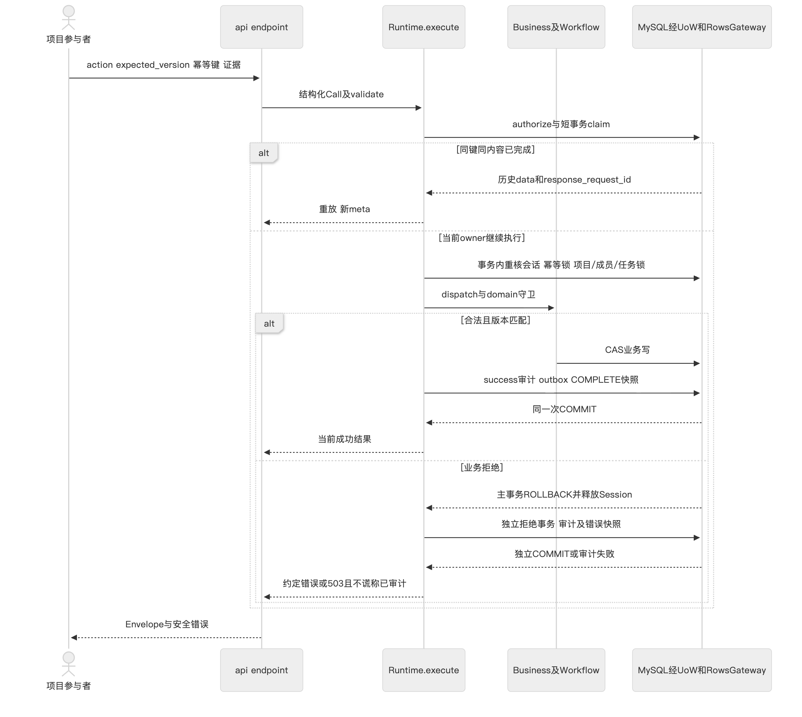

# T44概要设计与详细设计报告

本报告说明固定bc5aef9c62393134582affb7a690acb33ac2b833的模块边界、数据和事务，以及会话生命周期、历史理由投影的关键实现。方案按1.1冻结规则实现，已有准确SHA开发和专项审核证据；有效代码规模、正式性能、完整独立验收仍未达最终出口。设计与证据由AI整理，学生研究正文另行本人完成。

## 1 依据和概要设计

依据[1.1冻结清单](../../records/spec-freezes/v1.1.json)、[需求报告](requirements-report.md)、[后端设计](../../specs/backend-design.md)和Issue28理由RFC。38操作和130 Schema保持，新增history内部实现没有改冻结OpenAPI/DDL。M6文档设计a7eef3a先于本稿，旧M4/M5由历史索引绑定，不把新代码回填旧稿。

### 1.1 技术和进程选择

采用Vue3、TypeScript、Element Plus的浏览器前端，Python FastAPI分层单体、MySQL8、RabbitMQ、APScheduler及Docker Compose。业务规模与作业要求适合一个后端服务的明确事务边界；没有业务微服务、集群或在线LLM依赖。候选栈及选择的历史依据在[architecture](../../docs/architecture.md)，没有测量的性能优劣不写成结论。

| 模块 | 输入与输出 | 事务或进程责任 | 对应验证 |
| --- | --- | --- | --- |
| Vue工作空间 | 用户动作/冻结Schema→API意图、中文记录 | DOM/局部状态；token与卸载双边界，不能判断最终业务准入 | 982/983/895、当前89用例及开发浏览器 |
| API/Runtime | HTTP→Call→Envelope/错误 | 结构/鉴权/幂等/锁/CAS；统一成功提交及独立拒绝审计 | 986 HTTP、985 MySQL、同源510 |
| Business/domain | Call、行快照→业务data或Decision | 纯状态机不做SQL；服务经活动gateway工作，不自行commit | 994、986、985 |
| Rows/UoW | 白名单/typed keys→物化行 | 参数化、一事务Session、失败毒化/关闭；不解释业务批准 | 988/989/993、bounded pairs验证 |
| 通知worker | outbox claim/三字段MQ包→inbox/ACK | publish在事务外；DB提交后ACK，重试/隔离/fallback | 976至980真实MQ/进程及Docker |
| 扫描器 | cutoff/run游标/当前规则→升级Call | 持久续扫与任务短事务，按结果确定后推进游标 | 973/974/990/991、Docker扫描completed2 |
| 部署工具 | 明确项目库/受控配置→生命周期回执 | 迁移/停写备份/隔离恢复，不代替业务发布决定 | 托管Docker；native阶段1有限守卫 |

### 1.2 UI结构与生命周期

七导航是工作台、项目空间、交付任务、迭代排期、评审与发布、通知中心、审计记录。业务页从授权项目上下文读取，任务抽屉含详情/依赖/评审/评估/决定/升级/变更；操作表单依冻结Schema收集输入并展示业务拒绝。OpenDesign本地原型到Vue的840/75视觉链是历史资料；当前会话边界来自9560，新理由来自c79。

App在user为空时卸载整个shell及条件对话框；clearSession先增加contextSequence，再清token、项目上下文、用户、项目集合、字典与通知。allPages、bootstrap和context保存token，异步完成后重验；context还比对序号及project_id。request在fetch和JSON解析后的成功与错误路径检查会话；旧请求变为客户端SESSION_CHANGED而不传播旧403。OperationForm、LoginView和TaskDrawer通过active与当前token/序号拒绝卸载后的回调。当前会话401仍清空，当前403/409仍可刷新。

开发最初39绿仍漏A旧POST→退出→B登录→旧403→旧父refresh擦除B上下文。895原反例1红2绿后，经7df先设计、9560修复、babc交接，原895三绿和全51开发用例支持限定关闭；当前组合89包括后续容量/理由用例，不能相加成为140。

## 2 详细设计

### 2.1 状态与持久数据

七状态由整数码稳定映射到domain枚举，九命令经decide产生Decision/effects。任务、依赖、评审、决定四核心表连到项目、迭代、人力、评估、审计、幂等、排期历史、扫描、outbox/inbox等支撑表，共18业务表226字段，另有技术迁移表。账户、任务和审计身份是显式关联，不依声明顺序推持久码。

依赖边无环、当前计划/评审/回滚预案引用匹配、任务及评估版本必须一致。1.1 capacity仅保护状态1至5，成员/开发角色保护1至5及7。项目锁序列化工时调整与任务激活；行锁和CAS拒绝旧expected_version，不在前端“强制开始”。验证为994/985/986与1.1MySQL竞争，完整独立并发矩阵仍未完成。

### 2.2 成功 拒绝 幂等与预检

API先解析并按冻结Schema验证，Runtime完成实时身份/项目检查，写意图claim幂等行后进入业务事务。成功由同一事务提交任务/版本/决定/排期差异/成功audit/outbox/幂等完成；业务拒绝先回滚业务事务，再单独持久拒绝audit和可重放错误。若审计存储不可用，返回503和明确缺审计边界；未知提交不能伪装失败后安全重做。

prepare的3→2 UoW预检优化保留三次实时鉴权与原SELECT；旧authorize/claim薄包装兼容原调用者。候选validateContractPayload只检查三category结构/时间，返回business_guards_executed:false；内层候选schema_version仍1.0.0，外层协议1.1.0。结构预检成功不写业务、成功audit、outbox或幂等记录，也不代替真正提交时的人力/状态/依赖判定。原caller遗漏两红和修复+6的勘误保留，不声称自动提速或正式P95达标。

### 2.3 新写理由与历史保守投影

Projects.schedule_diff统一接收活动g/Call/before/after，写schedule_changes并将c.body.reason原样追加c.after；任务变更和返工还记录排期版本及五个Plan字段。Runtime.audit在同一成功事务落c.after。失败则全部业务写回滚，不通过“补旧audit”使历史看似完整。

旧数据读取保持原COUNT、授权筛选、排序和分页。Business.listProjectAuditEvents先返回当前页，再交history.project_reasons；_snapshot只接受成功、human actor、有效task、无已有reason、字段数允许、特定计划变更或7→2返工、可证明+1版本。只提取本页去重(task_id,to_version)，RowsGateway.task_schedule_changes同项目最多100对，一次精确tuple-IN读取；空对不执行SQL。错误形状、跨项目、非请求pair、重复pair/id或超界结果使UoW失败并抛PersistenceUnavailable，不任选一条凑匹配。

_matches再核项目/task、无iteration关联、from/to、actor、微秒时间、五字段Plan及冻结EvidenceRefs。证据先分别过Schema，再使用JSON sort_keys比较；对象键序忽略，数组保序，字符串不trim/正规化，bool不等于number。历史1与1.0按生产字形保守区分，不宣称1.0违反integer Schema；新请求normalization不变。仅完全匹配时向本响应after追加reason，不写数据库、不改总数/顺序/重放快照。

前端auditReason只在单个有效reason和符合记录上下文时提升为“理由”，保留字符串原文；RecordView按纯文本转义，不调用通用日期格式化改写前缀。缺理由的相关成功记录提示“此历史记录未提供可核对的变更理由”；原始未核对条目单独标识，保留其余actor/time/evidence。新42项目浏览器开发例验证7次写入、两宽度六图和2000字符尾部原文，不是独立验收。

### 2.4 扫描 消息与故障边界

扫描器以固定cutoff和keyset遍历候选，持久scan_run游标，候选处重取当前时钟和任务版本；确定结果后前移，版本/排期冲突有限重试。升级事件按task/schedule_version/level幂等，计数、收件人快照和outbox同事务；发MQ失败可落站内待办。消息只携event_id/schema_version/event_type，消费者查权威DB并提交inbox后ACK。MQ confirmed不表示本人已读/处理，恢复也不能重复业务效果。

若每批b、候选N、每事件收件人r，遍历工作量按候选和收件人约O(N+总r)，每次keyset查询依索引；数据库/网络、锁和重试不以此复杂度保证时延。已有v2故障四子集不覆盖中批崩溃、选择性事务barrier和原消息捕获全矩阵。

## 3 函数接口与模块测试

[M6函数I/O](../../docs/reports/M6-function-contracts.md)将前端request/current、Runtime、history、bounded reader、domain、UoW、MQ、扫描和CLI的输入/输出/异常/事务明确分开；[38操作接口表](../../docs/reports/M6-api-contracts.md)来自冻结OpenAPI。64个源文件hash及Python真实签名、TS/Vue原始声明行见[静态索引](../../docs/reports/M6-function-sources.json)，不通过import应用获得。

模块测试与FR/AC对应见[M6追踪](../../docs/reports/M6-traceability.md)。同源bc5后端510、前端89及Docker都是真实开发执行；本岗没有重跑产品。Rows原66含48，不和2个MySQL目标相加；后端18理由用例包含既有案，窄修7包含6新+1旧，不和504/510累计。

### 3.1 代表函数的直接接口

| 函数 | 输入与输出 | 异常与副作用 |
| --- | --- | --- |
| Runtime.execute | Call/validate/source→status、payload、replayed、原request_id四元组 | 成功统一Tx；拒绝独立审计，未知提交503 |
| Business.validateContractPayload | category/payload→valid及guards:false | 只结构/时间，不写业务或成功审计 |
| Projects.schedule_diff | before/after/Call→None | 原文reason与排期差异同成功Tx，不自commit |
| history.project_reasons | 授权project/当前页→同页dict | 0或1次bounded读取，只响应copy，不写旧audit |
| RowsGateway.task_schedule_changes | 正整数项目、最多100个task/version tuple→完整行list | 坏入参拒绝；结果越界/重复使UoW失败 |
| decide | position/Command/context→Decision | 纯函数，无数据库副作用 |
| request/checkSession | 操作/意图或旧token→Envelope或ApiError | 跨身份SESSION_CHANGED；当前401清会话 |
| auditReason | 审计Row→text/missing或undefined | 保留字面，不推测未核对理由 |
| DeliveryWorker.cycle | 注入store/MQ→确认/重试等计数 | 提交inbox后ACK，计数不是本人已读 |
| Scanner.run | run_id可选→scan_run | 持久游标，失败不冒称扫描完成 |

## 4 真实审核反馈与未验边界

原42243组合504CI绿后，专审真实HTTP发现Python true==1使坏历史EvidenceRefs被误配，HISTORY-EVIDENCE-01/P2成立。原报告和COMMENT5634370911永久保持不通过；ad6先设计勘误，bcb仅修history与追加案例，bc5同原HTTP一次复审绿，COMMENT5634448127仅关闭该缺陷。开发绿和窄关闭不能证明所有历史数据可安全推断、全产品放行或学生人工识别幻觉。

准确新CI510/89及4worker Docker见[测试报告](test-results-report.md)。cloc6307超1207仍失败；无新正式性能通过。native阶段1只认证/回环/正常停机，阶段2设计/控制器尚无完整应用演示通过；独立v3只已发布环境前置阻塞，不以无产品失败写成产品通过。
