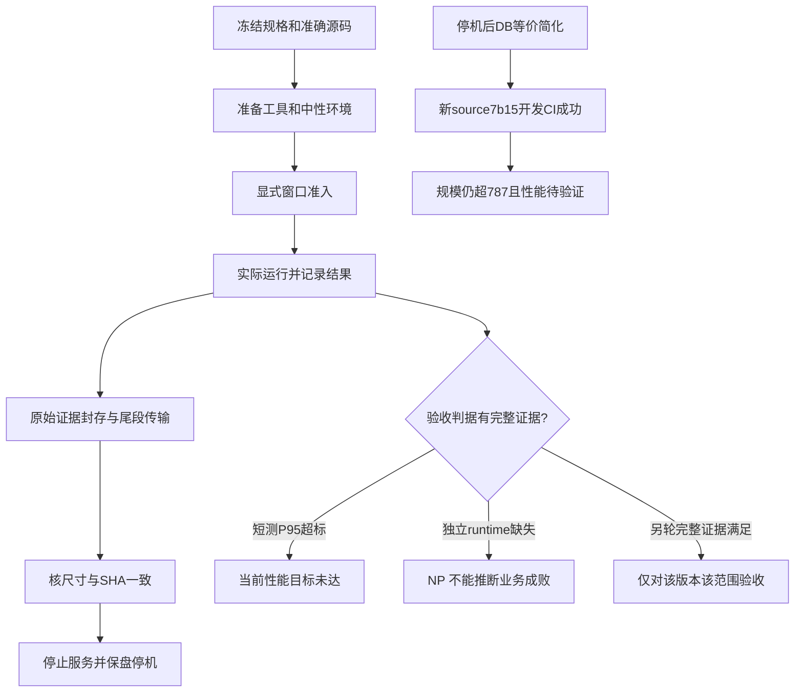

# R29 工程 checkpoint：公开事实、版本与未完成项

本页由文档岗 AI 整理，资料截止为协调提交 `6f91960bca1d59b9ac424c082de403241b5f9115`。它是工程审阅入口，不是最终验收证书或学生研究正文。原需求、冻结清单、旧报告和旧 Word 的历史截止不回写。来源和本岗核验见[证据记录](../../docs/reports/r29-documentation-evidence.md)，本人自写研究的选材见[事实素材索引](../../docs/reports/r29-student-fact-index.md)。

## R29B 后发区（新CI完成，整体仍未放行）

R29B源码为 `0bffe0c535e5897890aebf30879fdd3839dc52d6`，本轮资料起点为 `2530ee2edcda834da44274192af8da0ef67be0fb`；后发CI原件截止为 `4b4e792b2445a8e8aaa164c0fd3202db962bd8ee`，本地QA公开NP截止为 `70b24c9082e47130c4a58af8ecdccabc3691c8fe`。下方原R29正文的5887/超787与旧7b15 CI保留各自历史截止；**本轮当前严格规模为5880行/65文件，仍超5100上限780行**，见[已跟踪原计数](../../tmp/768_integration_r29/source-count-r29b.json)。

| 新事件 | 已发生且可核的范围 | 仍不能宣称 |
| --- | --- | --- |
| 后端同职责查询去重 | 产品`41a111f270e949326202b8af5770db8aa7102e82`，最终交接a13f74f1；[报告](../../agents/backend/dry-r29b/report.md)记两处查询共用helper、净减3，本地SQLite HTTP/差分152通过 | 未改变守卫、空列表行为、返回与查询时机；模块通过不等MySQL锁、消息或独立验收 |
| 数据库catalog注册去重 | 产品`8f29030756139061341e0a636c8774ca790964bd`，最终交接bc4d4616；[报告](../../agents/database/dry-r29b/report.md)记保序映射、净减4，联合133通过/43未选 | SQL/预期/比较和异常传播保留；原56与133重叠不加总，未选43不说通过 |
| 限定复审与准确集成 | [d470审核报告](../reviews/dry-r29b-20261029.md)，技术审核901a84e0；72自有检查、无新增P1/P2，两产品文件已在准确root0b集成且与owner字节相同 | 72不与owner测试相加；审核只是局部等价，不是规模/整体放行。5887→5880仅实减7 |
| 新原生产品CI | [40827655008](https://github.com/HJY147/t44-dev-trace/actions/runs/40827655008)，source准确0b；四job success，coverage于06:18:37Z结束；[新原件摘要](../../records/ci/r29b-0bffe0c5-40827655008/summary.PUBLIC.json) | 真实MySQL/RabbitMQ开发验证；原后端796/0失败错误跳过，前端89/89、类型构建通过。原CI发现目录不含tmp765/766，152/133本地项不算进796；旧7b结果保留历史 |
| 测试器本地修复 | [正式PUBLIC v2.3结果](../../records/qa-tool/r29b/LOCAL_V2_3_SELFTEST_RESULT.json)：05:58:57—06:10:13Z为本地模拟HTTPS；400客户60+600秒运行段有PASS记录，但后置仅114/400快照、100审计，286未在预算内观察；整体NP | 实际输入5秒request/15秒post，要求15/40，夹具误配且原结果保留。正确预算有限后置回归及授权后全新完整链仍待，不拼接片段。SUT/cloud调用0仅指该本地模拟；Darwin未执行Linux正式cgroup守卫，拟免费4CPU子集不当8CPU正式环境 |

新源行覆盖2502/2773=90.2271908%，分支713/848=84.0801887%；组合88.7876277%不是行覆盖率。契约183/集成102/故障19与796重叠不相加。本岗核新95个成员5,845,889字节的尺寸/SHA/Git blob及原XML/JSON，未重核旧97件。原CI build.log第12行ANSI警告尾空格保留；[归档格式回执](../../records/ci/r29b-0bffe0c5-40827655008/diff-check-scope.PUBLIC.json)记全量cached diff-check exit2、限定其他源码/metadata exit0，不能说整包clean。

原两机04:59保盘节省停机、自动释放“-”，旧f7短测P95失败与旧云NP均不变；root在06:18:12Z只读列表再次看到STOP/节省，两行列表不支持“本次重查自动释放”，auto仍只引用04:59详情。本轮未新启云。本页封存当前代码/CI与未放行状态，不等待未知绿、不预测后续QA结果；有后发公开结果再另记准确截止。学生本人研究正文和人工材料继续由本人完成。

> 以下第1—6节及状态图保持原R29（6f91960b）截止；其中“当前5887/超787”、旧CI7b15和QA pending均是该旧时点。后发R29B以本页上方独立区域为准。

## 1 本轮可以确认的结论

| 对象 | 准确版本与已发生事实 | 结论边界 |
| --- | --- | --- |
| 云上被测产品 | `f7cdb5fa3b19f84d8ab0d0b042bf51a5b8484e8f`；APP 64vCPU/128GiB，LOAD 16vCPU/32GiB；64 API worker、每 worker 池5、MySQL上限384 | 以下云数据只属于旧 f7，不转挂新代码 |
| 开发短测 | 80/800/8000 请求全部完成；失败、主动中止客户均0；400并发段约5.26秒 | 三个正式目标的 P95 均高于270ms；短测不证明持续10分钟 |
| 独立性能轮次 | `r29qa772-01` 的唯一900秒 grant；公开结果 `NP_NO_RUNTIME_RESULT` | 只有76字节证据头，没有 runtime 结果；请求量、600秒稳态、业务成败均不可据此判定 |
| 云数据与停机 | APP/LOAD资源尾段19,661,075字节与SHA一致；两原VM已节省停机、自动释放为“-”、卷保留 | 传输闭合和保盘停机成立；不证明性能通过或全部费用结清 |
| 停机后的数据库产品改动 | 候选 `274e2e6bfa6dfb2d90926773002a1a62808ec060`，协调集成 `38d11a5e7be1b96f8ab956d2cef134013476ecde` | 固定hash下DDL适配的等价简化；净减11行，仍不满足规模上限 |
| 新源码开发 CI | source `7b15f8932b78e99a2b3daef2411f2cefeab98463`；[run 40821621806](https://github.com/HJY147/t44-dev-trace/actions/runs/40821621806) 四job成功，真实 MySQL/RabbitMQ、全后端796、前端89 | 属于开发验证，不是新云性能或整体独立验收 |
| 当前有效规模 | 65个应用文件、5887行，上限5100，超787；范围检查 exit1 | 规模门禁仍失败，不更改统计边界、阈值或将其降为建议 |

云结论来自[总协调公开报告](performance-r29-20261029.md)及[短测原摘要](../../records/cloud/f7-r29-window-20261029/short-summary.PUBLIC.json)。CI结论来自[准确源码摘要](../../records/ci/r29-7b15f893-40821621806/summary.PUBLIC.json)。文档岗另核协调截止与CI源码的 `backend/t44`、`frontend/src` 应用目录无差异；这不把两个提交号说成同一提交。

## 2 需求—设计—实现—验证—缺口追溯

当前规格以[v1.2冻结清单](../../records/spec-freezes/v1.2.json)及其v1/v1.1父链为准。15件当前输入hash全部匹配；部分文件保留冻结前“草稿”措辞，不能据此回写清单或当作尚未冻结。下表仅把当前职责与证据接起来，**不将一个全套绿色结果拆成每条需求已独立验收**。

| 要求 | 设计/契约入口 | 当前实现入口 | 本轮可审验证与仍缺部分 |
| --- | --- | --- | --- |
| FR-01 / AC-01 契约先行、统一输入输出错误 | [OpenAPI及语义](../../specs/contracts/README.md)、[冻结清单](../../records/spec-freezes/v1.2.json) | `backend/t44/api.py`、`contracts/`、`services/application.py` | 新源契约子套183通过，属全后端的重叠子集；不据此宣称所有独立错误矩阵零偏差 |
| FR-02 / AC-02 字段与建表 | [字段字典](../../specs/database/field-dictionary.md)、[DDL](../../specs/database/schema.sql)、[持久化契约](../../specs/database/persistence-contract.md) | `persistence/schema.py`、`rows.py`、`migrations.py` | DDL字节/hash不变、18表元数据等价；后续新源CI含真实MySQL。候选岗最初本地17跳过与后发CI分开保留 |
| FR-03 / AC-03 八段评审、十项证据 | [业务规则](../../specs/business-rules.md)、`resources/review-template.json` | `services/reviews.py`、`workflow.py` | 开发全套包含相关路径；本轮没有新完整独立功能52项通过结论，不能把API成功当证据评审通过 |
| FR-04 / AC-04 排期、依赖、人力生命周期 | [v1.1人力变更](../../specs/changes/capacity-lifecycle-v1.1.md)、v1.1冻结父链 | `services/tasks.py`、`projects.py`、`history.py`、持久化UoW | 新源集成子套102通过；子套与全套不累计。独立竞态/全矩阵以对应已发表版本为准，本轮未新增闭合 |
| FR-05 上线与回滚；D008错误优先级 | [v1.2限定变更](../../specs/changes/release-error-priority-rfc.md)、D008及冻结15件 | `services/reviews.py`、`workflow.py`、`domain/` | 更改限原批准引用失效分支；本轮DDL简化不改业务顺序。CI不代表实际人员完成上线/回滚决定 |
| FR-06 / AC-05/06 七状态、CAS、审计 | [后端设计](../../specs/backend-design.md)、持久化事务契约 | `domain/state_machine.py`、`services/runtime.py`、`common.py`、UoW | 新源故障子套19通过、全后端796通过；未将其扩写为全部物理故障和独立业务验收 |
| FR-07 / AC-07 延期升级与通知幂等 | [升级规则](../../backend/t44/resources/escalation-rules.json)、消息/调度门面 | `messaging/`、`scheduling/`、`persistence/delivery.py`、`scans.py` | 真RabbitMQ用于开发CI；短测2000个202只表示接受，不能证明消息已投递或20条超期全覆盖 |
| FR-08 工程门禁、SHA审核；覆盖率 | [协作与GitHub门禁](../../docs/collaboration/github-workflow.md)、`.github/workflows/product.yml` | `scripts/ci/`、workflow、责任岗阶段提交 | 新源static/contracts/coverage/frontend均success；行2500/2771=90.2201%，分支713/848=84.0802%；88.7814%是Coverage.py组合百分比，不能当行覆盖率 |
| AC-08 性能、规模和合成数据 | [原要求来源复核](../../docs/reports/requirements-source-audit-20261028.md)、[需求基线](../../specs/requirements.md) | f7双机短测；新源固定计数器 | 正式三目标短测P95未达；独立NP；新源5887超787。中性准备后实际40项目/6400任务/9000依赖/11400评审+3600决策，不写“仍精确6000任务” |
| AI过程与研究交付 | [AI规格说明](ai-spec-guide.md)、原始prompt及[学生提纲](student-study-template.md) | 各岗日志/报告/handoff/commit；本轮prompt单独登记 | AI产物可追溯；本人手写研究、人工12改码/3识别幻觉/5映射仍无完成凭据，不从AI工作量折算 |

既有[M6追溯表](../../docs/reports/M6-traceability.md)和[技术报告](test-results-report.md)保留其版本与历史结论，本页只追加R29状态，不抹去过去失败。

## 3 本轮阶段时间线和实际失败

时间统一为2026-10-29 UTC；北京时间加8小时。无精确公开时间的动作只列阶段，不猜时间。

| 时间/阶段 | 真实事件 | 结果与影响 |
| --- | --- | --- |
| 04:06:19.801 | 请求恢复原双机；原开机/停机预算另有明确截止 | 新购0；不能由准备成功推断测试已运行 |
| 短测前准备 | APP资源进程归属首次拒绝；编排误读GEN/resource schema；给host加`-I`导致790_budget导入失败 | 保留首次失败，后续精确PID等匹配另记recovered；按真实schema修正；root明确允许06b，未重写原日志 |
| 04:25:43—04:25:55 | 1/40/400客户的80/800/8000请求短诊断 | 队列均完成、0失败/中止客户，但400组P95失败；不是600秒验收 |
| 短测后准备 | 中性admin也因`-I`忽略既有PYTHONPATH，尚未有service/HTTP写入即失败 | root另准01b精确续步；失败输入保留，随后真实准备到6400任务。离线检查未覆盖整条Linux链 |
| 04:36:29—04:51:29 | 唯一独立grant `r29qa772-01` | 总协调公开报告记supervisor在899.786秒HARD_DEADLINE；unit退出241；公开结果NP，无runtime结果，未追加grant/重跑 |
| 约04:47—04:50 | 浏览器控制连续超时，后由用户恢复控制台 | 用户“已恢复”只证明浏览器恢复，不是业务、代码或验收批准；恢复后先封存与停机 |
| 04:52:54—04:54:42 | APP资源封存、LOAD核完整尾段、原GEN关闭；owned compose运行列表为空 | 19,661,075字节、SHA `0f973182e7674ab6a266fce27fb4c5b3fb1499fec98ba032f4faa260cdc09191` 两侧相同；数据/卷不删 |
| 04:59:31.712946观测 | 两原实例Stopped/StopCharging；自动释放均为“-” | 保盘节省停机完成；最终账单未结算核验，不称全账号零费用 |
| 05:06—05:07对应提交 | DB等价简化被协调集成38d11a5e，形成source7b15f893 | 5898→5887，仍超787；前端+4、缓存+26不集成 |
| 05:08:10—05:17:27 | source7b15f893的product40821621806四job结束 | 后端796/前端89、类型/构建/static绿；不改变旧f7云性能和NP |
| 本页截止 | QA v2为纯本地测试器修复，结果待完成 | 没有新SUT/云测试。本地模拟TLS结果不能写成项目性能达标；另有公开后发结论时另记版本 |

上述准备/压力/测试grant由AI总协调在用户既有授权内签发。工具设计、脚本修正、AI审核和执行不能记为学生亲自手写或逐行审码。

## 4 准备、运行、证据传输、验收和停机的区别

封存成功、传输完整、服务关闭和VM停止分别需要自己的回执；其中任一步成功都不补出缺失的业务验收结果。图中的“完整证据满足”是将来条件，本轮没有到达该性能出口。

## 5 四岗已发布结论和未集成候选

本轮没有重新访谈或唤醒开发岗；直接核其已发布报告与Git，未将报告内容写成问答原话。独立测试岗未联系，仅用冻结PUBLIC。

| 责任岗 | 实际发布的内容/准确提交 | 审阅时须保留的限制 |
| --- | --- | --- |
| 前端 | [R29报告@6aed8b24](https://github.com/HJY147/t44-dev-trace/blob/6aed8b2464aad903f43abac94ac3850e55f7bee0/agents/frontend/scale-r29/REPORT.md)；产品候选56e62caa | 原89及新增3回归绿、类型构建绿；初次新回归因loading按钮驱动有1失败并保留；净增4，未集成，无新浏览器/云性能 |
| 数据库 | [R29报告](../../agents/database/scale-r29/report.md)；产品274e2e6b，发布文档4223c9ca，协调集成38d11a5e | 原SQL/hash/测试不改；首个投影候选+3被否决；真实净减11，100—250目标未达。最初本地native未跑，后来准确sourceCI才补真MySQL |
| 后端 | [缓存与架构报告@753f1bff](https://github.com/HJY147/t44-dev-trace/blob/753f1bff71114dab6fb580936f1ed51f08e7c857/agents/backend/scale-20261029/report.md)；缓存候选7d101e02；[中性准备报告](../../agents/backend/neutral-fixture-20261029/report.md) | 缓存净增26、单调用CPU微基准约省0.020ms不能外推HTTP P95；未集成。误触发40812638415后取消，不称CI绿；中性准备本地验证与root云执行分开 |
| 部署 | 9e605204交付[有限收尾CLI](../../agents/deployment/opaque-relay-20261029/CLOSURE-CLI.md)，原工具本地验证与[cloud回执](../../records/cloud/f7-r29-window-20261029/APP-resource-sealed.original.PUBLIC.json)分开 | 不接触独立QA私件；资源流传输和服务停止有据，不能用部署工具自测充业务验收；实例最终状态由协调停机回执说明 |

提示词岗后发公开交付：[R29真实提示词与事实索引@f9d03110](https://github.com/HJY147/t44-dev-trace/blob/f9d031106ca1a585a218230ede526621cd3d82e7/docs/prompting/R29-process-evidence.md)。文档岗收到本人回SHA后另核Git对象与远端head，作为6f91960b资料截止后的单列登记入口；其U001/U002-O1及新模板均为proposed，不充作已执行演进或本人研究正文。

## 6 交接出口

当前应保留为开放项：规模787行差额；准确下一源码的完整独立功能/性能验收；独立测试器本地修复与复审；正式400并发/10分钟/三目标P95≤270ms/完整分钟吞吐及业务后置条件；最终账单；学生本人研究正文与真实人工材料。修复测试器本身不会补出旧轮runtime结果。

下一步先在本地形成有真实净减预算、语义保护和适当开发验证的可审改动，由总协调决定集成；另轮云测试需新的明确授权/窗口和准确版本记录。原双机与数据保持节省停机，不因本页或新CI自动重开、不自动重试或接续旧grant。没有新建Word/PDF/Pages、没有修改教师原件或既有需求冻结。
