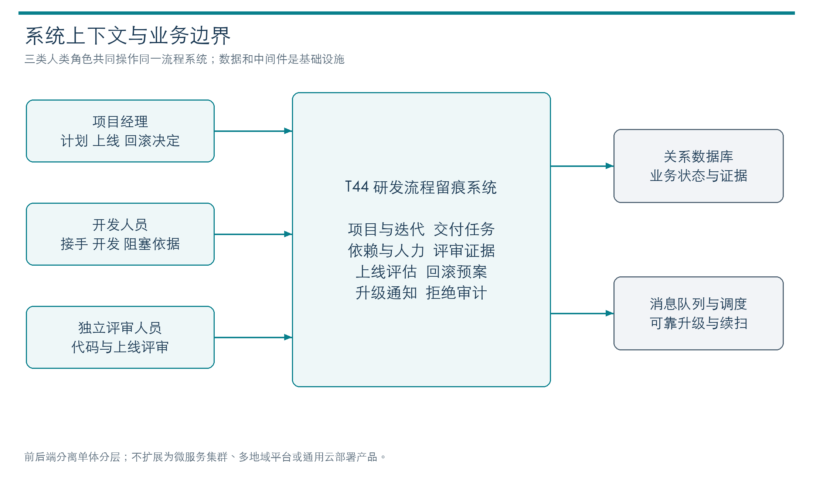
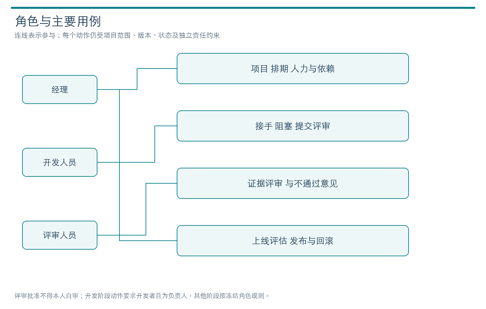
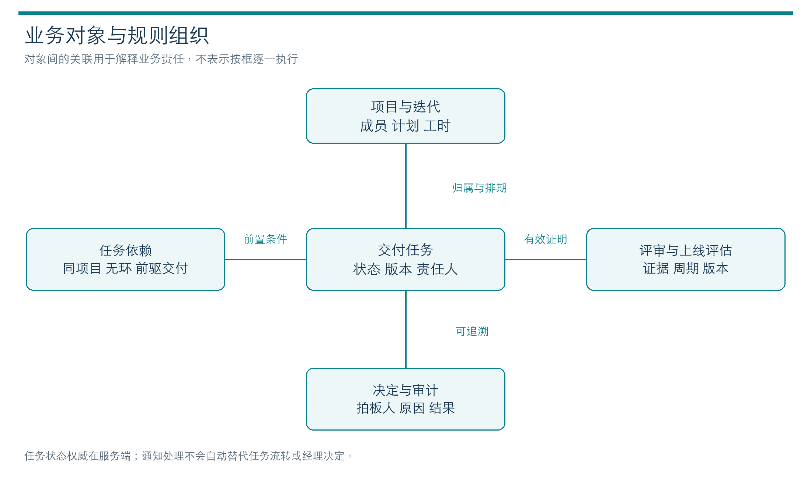
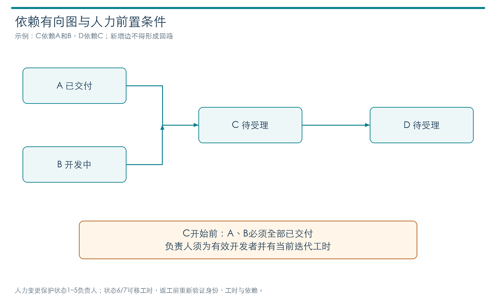
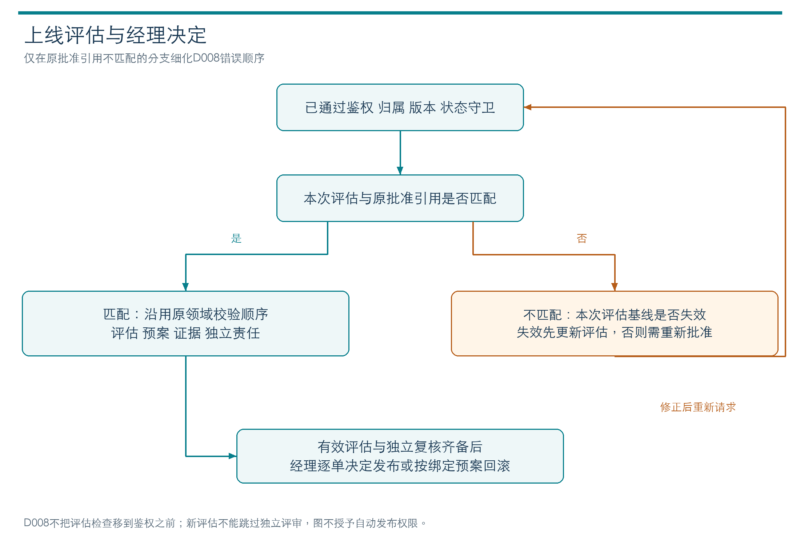
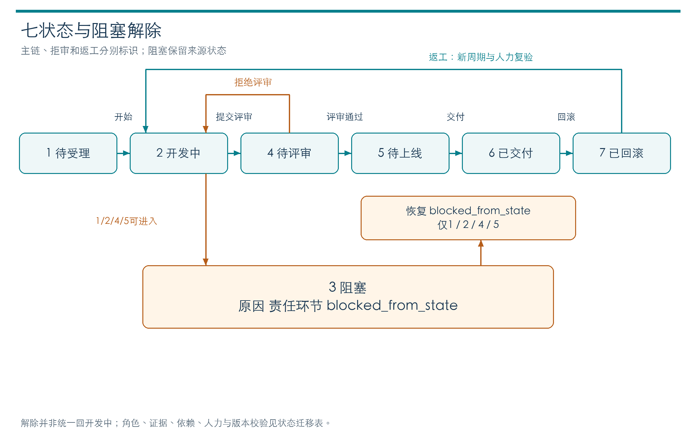
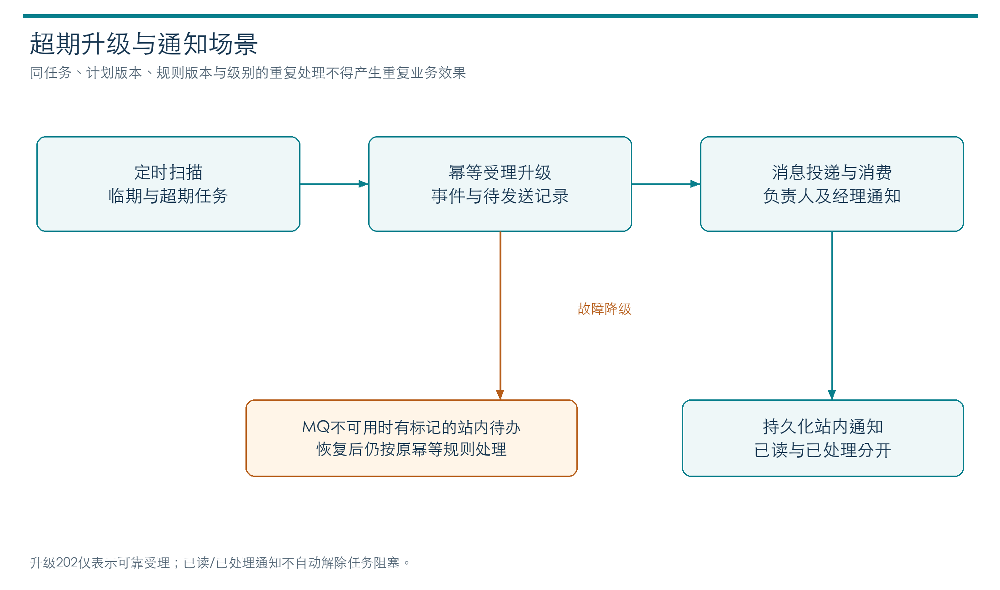
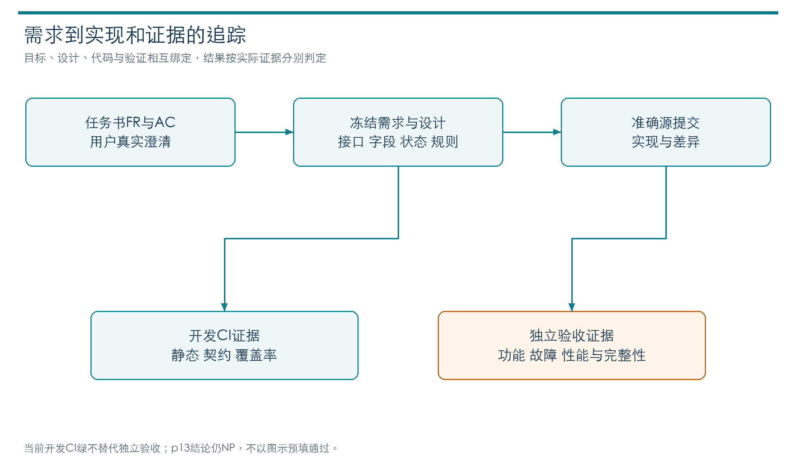

# T44 软件需求规格说明书

T44研发交付管理系统为中小外包团队提供项目、排期、任务、评审、发布与回滚决定及延期通知的完整记录。本规格说明系统必须完成的行为、数据和质量条件，并将每项要求对应到设计、实现和验证。当前产品源为90b734f65ce6ee9f5c217e885bc7ea4857e32b48，业务契约为v1.2.0。产品开发验证与正式验收分别评价；用户采用的主要核心口径为62文件5038行；辅助3文件780行（CLI147、迁移307、seed326）单列。原固定cloc全量65文件5818行，较5100超718，原require-range仍失败；用户采用核心口径不等老师批准全部文件排除。本轮独立F05已有部分黑盒证据，完整验收未成立，不能据已有开发结果宣布整体通过。

## 1 目的和依据

本文面向教师、需求审定者、开发和验收人员。任务书、作业要求及提交说明是上位依据；[需求基线](../../specs/requirements.md)、[业务规则](../../specs/business-rules.md)、[v1.2冻结](../../records/spec-freezes/v1.2.json)和[接口契约](../../specs/contracts/openapi.json)规定项目的可执行约束。[原始条件复核](../../docs/reports/requirements-source-audit-20261028.md)确认3500至5100行、400并发持续10分钟、P95不高于270ms及吞吐至少1000次每分钟，未把缺少明确定义的计数或采样算法冒充任务书原话。

API前缀保持/api/v1；v1.2.0指接口及成功Envelope的版本，候选契约对象内部schema_version仍为1.0.0。冻结包含31条路径、38操作、130 Schema及18业务表226列。原v1.0、v1.1和当前v1.2具有独立父链，旧结果不会因版本演进自动升级。

## 2 系统范围和参与者

系统管理交付过程中的责任、证据和人员决定，不是通用云发布工具。浏览器前端、Python业务API、MySQL、RabbitMQ及扫描器组成单机分层系统，不拆分业务微服务、不依赖在线大模型。产品中的发布、回滚指业务决定和依据记录，部署本系统则由独立运维工具承担。

| 参与者 | 主要职责 | 权限边界 |
| --- | --- | --- |
| 项目经理 | 制订迭代计划、分配任务、审核风险及作发布回滚返工决定 | 必须属于当前项目，不因经理身份跨项目读取或修改 |
| 开发人员 | 实现任务、提交代码和证据、说明阻塞及恢复依据 | 接手任务须有效开发身份及当前迭代工时，不能自审自己的任务 |
| 评审人员 | 按八段式和十项清单检查代码及风险预案 | 按责任主体限制自审，评审须绑定版本和证据 |
| 调度服务主体 | 扫描超期、生成升级及通知 | 只具有明确scope与项目白名单，不代替经理决定或用户处理通知 |
| 管理和运维人员 | 初始化账户、迁移、备份、隔离恢复及停止环境 | 显式选择本项目库，凭据不进入普通日志或公开报告 |

图1说明三类业务角色与产品边界。浏览器承载交互，API执行业务准入，数据库与消息设施不代替人的评审和发布决定；本系统记录业务交付，不直接部署客户软件。

图2的连线表示角色参与用例，不表示执行顺序或无条件授权。每次操作还要通过项目归属、当前版本、责任状态和独立主体检查，经理身份不能扩大跨项目权限。

## 3 功能需求

### 3.1 项目和排期

项目经理建立项目及经理成员记录，维护有效成员、角色、迭代与工时。项目须始终保留有效经理；移除成员或开发角色时，仍负责状态1至5或7任务者受保护。项目成员软撤销，历史记录不删除。

创建或在允许状态转派任务前，接手人必须是有效开发人员且已登记当前迭代工时；否则返回CAPACITY_REFERENCE_INVALID且不改变任务版本。修改迭代工时必须检查全部状态1至5任务的负责人，新安排不得遗漏；状态6、7允许移出工时。返工从7进入2前须恢复有效身份和工时，并继续满足原排期、依赖及经理决定条件。工时保护集合与成员保护集合不同，不提供自动分配或工时耗尽调度算法。

计划修改及返工须保留前后值、原文理由、操作者、时间和版本。合法修改与成功审计在同一事务，拒绝时不得留下半条计划或差异。创建、转派、返工与工时调整按项目锁序串行校验，不允许竞争后留下缺少人力的在途任务。

### 3.2 七状态和九动作

任务状态为待受理、开发、阻塞、待评审、待上线、已交付、已回滚。九个动作是开始、阻塞、解除阻塞、提交评审、批准评审、拒绝评审、交付、回滚和返工。后端统一验证状态、角色、版本和证据，前端按钮可见性不能代替业务准入。

依赖编辑仅在待受理或从待受理进入阻塞时允许；依赖须同项目、非自身且不成环。开始、解除到开发和返工时，所有前驱必须已交付。普通阻塞记录原因、来源状态和责任环节；解除须有依据，不自动推进交付周期。任务变更采用expected_version进行比较并交换，同版本竞争最多一次成功，原请求重放不再次推进版本。

| 流程 | 必要输入 | 成功结果 | 主要拒绝条件 |
| --- | --- | --- | --- |
| 接手和开始 | 任务版本、开发身份、工时、依赖证明 | 进入开发并留下审计 | 缺人力、前驱未交付、权限或版本冲突 |
| 阻塞和解除 | 版本、原因、责任环节或解除证据 | 保留来源状态或恢复原状态 | 无依据、非法来源或当前版本不符 |
| 代码评审 | artifact_revision、交付周期、评审周期、模板及证据 | 不可变评审和明确判定 | 自审、清单不完整、陈旧提交或缺证据 |
| 发布 | 当前评估、独立评审、经理决定、风险与回滚预案 | 状态6、不可变决定和审计 | 陈旧评估、批准引用失效、证据或权限不足 |
| 回滚和返工 | 决定、依据、原排期及恢复后人力 | 状态7或新周期开发，历史保留 | 非法状态、重复拍板、缺依赖或人力 |

### 3.3 评审和发布门禁

评审按模板的八个稳定section和十项清单记录判断及证据位置；缺证据不能通过。评审绑定当前代码、交付周期、评审周期和模板版本，旧批准不能用于新轮次。上线评估包含数据、权限、外部依赖和观测四视角，风险应对及回滚预案须可追溯。评估终态不可原地改写，新文档采用新ID和计划版本。

D008由用户选择先更新上线评估再重新批准。仅当发布已通过原前置校验且原批准引用与本次评估不匹配时，如果评估周期或排期版本也失效，先返回ASSESSMENT_BASELINE_MISMATCH；基线有效时仍返回RELEASE_APPROVAL_REQUIRED。原批准引用匹配时沿用领域顺序；鉴权、资源归属和版本等更早校验不后移。更新评估后仍需原有独立评审及经理发布决定，不取消任何门禁。旧F08结果保留，不以新规则倒改旧验收。

### 3.4 延期升级和通知

扫描器以固定cutoff与持久游标遍历超期任务，按规则生成升级事件，记录当时责任人及经理快照。重复扫描、进程重启和重复MQ投递不得重复产生业务效果。MQ不可用时降级为站内待办，通知已读与已处理分别记录；处理通知不自动解除阻塞或改变任务状态。升级202只表示可靠受理，不等于收件人已看到或消息端到端延迟达标。

### 3.5 查询和会话

38操作以冻结契约定义路径、分页、排序、过滤、输入、成功输出及错误。九集合共用分页入口，但保留各自项目/父任务归属及过滤规则。成员关联用户、依赖前驱状态可按本页批读，不能扩大读集、绕过权限或改变分页总数。历史理由仅对已授权当前页的唯一匹配旧记录做响应投影，不更新原审计；模糊或缺失记录不猜理由。

退出成功或当前401须清除身份、项目上下文、字典和通知并卸载工作区与浮层。旧会话异步成功或失败不得写入新会话，也不能触发旧表单刷新。退出失败保留当前身份，已经发出的写可能在服务端完成；客户端不能假设取消页面即撤销事务。

## 4 数据和接口要求

四核心对象为任务、依赖、评审和决定，支撑项目、成员、迭代、评估、审计、幂等、升级及通知等记录。18业务表226列及DDL字节保持；migration控制表另列，不混成业务表。主键、枚举、布尔、UTC时间与版本有明确范围，禁止散落魔法状态。

任务version记录每次成功关联写，schedule_version记录计划变化，delivery_cycle记录交付返工周期，review_cycle记录本轮代码评审，不能混用。系统使用参数化SQL、显式外键/唯一约束及UTC DATETIME(6)，不静默截断非法日期或精度。口令只保留合法Argon2id编码，Token只存摘要、过期和撤销信息。

接口采用统一Envelope、request_id、明确HTTP状态及错误码。结构校验成功不表示权限或业务准入成功，领域Decision不表示数据库已提交。完整[38操作及错误来源索引](../../docs/reports/FINAL-20261029-interfaces.md)与[字段规范](../../specs/database/field-dictionary.md)供逐项核对。

图3按业务责任组织任务、依赖、评审与决定，并列出评估、排期和审计支撑关系。对象关联不是顺序流程；评审和决定绑定各自适用的版本，历史证据不得被新提交覆盖。

## 5 非功能需求

| 编号 | 要求和验收线 | 当前状态 |
| --- | --- | --- |
| NFR01 负载 | 约40项目、6000任务、9000依赖、15000评审和决定 | 历史环境已建立；本轮云准备与独立结果须按准确源另记 |
| NFR02 性能 | 400并发持续600秒，P95≤270ms，吞吐≥1000次每分钟，无失败 | 当前p13独立NP，四P95约1011–1096ms且内部raw/后置完整性不足；未通过最终性能验收 |
| NFR03 一致性 | 幂等重放、同版本单成功、成功业务与审计同事务、已提交数据恢复 | 开发模块/真实依赖及历史故障证据分层记录，不宣称全切点完成 |
| NFR04 安全 | 撤销会话、项目隔离、参数化、敏感信息不明文落普通记录 | 接口与模块守卫可核；独立完整安全结论不预填 |
| NFR05 扩展 | 新评审项或升级规则至多一配置一模块且不超过1人日 | 扩展示例与测试不代替实际人工人日证明 |
| NFR06 测试 | 全量用例通过、全源覆盖率≥80%，静态和契约检查通过 | 准确90b开发797/89全绿，行90.23%/93.33%；不替独立验收 |
| NFR07 规模 | 有效源3500至5100行，口径公开且前端不遗漏 | 用户采用的主要核心口径为62文件5038行；辅助3文件780行（CLI147、迁移307、seed326）单列。原固定cloc全量65文件5818行，较5100超718，原require-range仍失败；用户采用核心口径不等老师批准全部文件排除。 |

任务书没有明确定义所有并发、P95样本、分钟桶及代码文件分类算法。项目采用的冻结测量和计数规则仍须遵守，未知细节明确说明，不能调整口径换取达标。当前[计数原件](../../records/metrics/final-candidate-20261029.PUBLIC.json)包含生产、测试、配置等分组，不相互冒充。

## 6 需求设计实现与验证追踪

| 需求 | 设计及实现责任 | 相关开发验证 | 验收对应 |
| --- | --- | --- | --- |
| FR01 契约 | API、contracts、Runtime与当前接口索引 | 结构差分188、原HTTP305及契约模块；计数有交集不累加 | AC01 全操作及错误分支 |
| FR02 存储 | Rows、UoW、migrations、schema和engine | DB239含新18、metadata双方言及CHECK等价关系 | AC02 字段/DDL逐表证据 |
| FR03 评审 | Reviews、模板及不可变证据记录 | HTTP/领域正负例、版本和自审拒绝 | AC03 缺证据不能通过 |
| FR04 排期 | Projects、Tasks、历史理由及项目锁 | capacity/依赖并发、计划理由和分页批读差分 | AC04 不能强行开始且差异可追溯 |
| FR05 发布 | Workflow、评估和D008限定顺序 | 发布前置顺序、版本、证据、拒绝零业务写 | AC05 发布回滚闭环 |
| FR06 状态 | domain.decide、Runtime、CAS/幂等 | 七态九动作、同版本竞争、拒绝事务 | AC05及AC06 |
| FR07 升级 | scanner、outbox、worker和notification | 扫描续扫、重复消费、fallback及DB批插回滚 | AC07 超期覆盖及故障降级 |
| FR08 工程 | 依赖注入、CI、精确SHA审核和岗位记录 | 开发检查、公开审查红绿、独立报告及源码计数 | AC08性能及AC09交付 |

反向查找由设计报告各模块I/O表和[机器可查追踪](../../docs/reports/FINAL-20261029-traceability.json)提供：模块必须说明服务哪些FR、由哪些测试证明及哪些边界尚未验证，不能只列测试总数。准确源的测试状态由[测试结果报告](test-results-report.md)统一解释。

## 7 需求变更和人工取舍

| 版本 | 人的选择及变更 | 当前效力和历史 |
| --- | --- | --- |
| 1.0 | D001业务出口、D004字段和错误取舍 | 原冻结ae60dc3保留，不倒填后续人力规则 |
| 1.1 | D005接手须工时、D006回滚可移工时但返工先恢复 | 原14文件父链保留，成员与工时保护集合分开 |
| 1.2 | U021及D008选择同时失效时先更新评估 | 当前15输入冻结；38API、130Schema和DDL范围不变 |
| 最终实现 | DB语法树/批写、前端重复声明合并、后端分页和校验器复用 | 不改变业务规则；开发自测不等整体验收 |

规格文件中的旧“草稿”说明按其历史阶段阅读；当前冻结状态以v1.2 manifest及其准确hash为准，不修改旧输入原字节。业务取舍归人，AI承担设计实现、检查和资料整理；学生最终研究与人工操作证据仍须真实完成。旧M6/M7 Word与历史档案入口见[提交导航](submission-map.md)。

## 8 可执行需求分解与业务场景

下列场景把原任务书FR编号恢复为统一索引，细化输入、可观察结果和拒绝边界；它们是对现行v1.2规格的解释，不新增权限或放宽门禁。

### 8.1 FR01 接口三要素与错误码

项目登记、任务流转和上线评估均使用冻结输入、输出和错误码。调用者先取得有效会话，在所参与项目内选择对象；请求结构验证通过后，服务端再依角色、归属、版本和状态判定业务准入。

正常流程：调用者发送request_id及冻结输入；服务端返回统一成功Envelope或带错误码的拒绝。任务和父项目ID必须来自同一授权范围，分页与过滤不得扩大项目读集。

异常与一致性：资源不存在、参数错误、状态冲突、未认证和越权须区分。错误分支本身也是契约的一部分；契约未冻结不进入联调。冻结结构变更必须先记录影响再更新对应测试。

验收观察：接口契约差分、38操作与错误路径追踪；不能以HTTP 2xx数量替代业务断言。

### 8.2 FR02 核心字段与建表评审

任务、依赖、评审和决定是四类核心对象；项目、成员、迭代、评估及审计等支撑对象共同构成18表。实现之前须明确最小类型、主键、枚举、布尔与约束含义。

正常流程：数据库岗逐表提供字段字典和DDL；审核岗位对主外键、唯一约束、CHECK和必要索引给出可定位证据。实际迁移绑定准确库名与版本。

异常与一致性：未经评审不能临时添魔法状态值。迁移中断保留partial与原件，不用重新seed掩盖不一致；未知目标库、缺失约束或不支持结构必须拒绝。

验收观察：按18表字段字典与真实SHOW CREATE核对，四核心表逐字段可追踪。

### 8.3 FR03 代码评审与证据清单

评审者具备当前项目权限且满足独立责任主体限制，评审绑定当前artifact_revision、交付周期和评审周期。固定八段式记录及十项清单不可只填结论。

正常流程：评审逐项定位变更与证据，给出判定依据；通过结果成为后续状态流转的引用。拒绝结果保留原证据，新的提交形成新轮次而非改写历史。

异常与一致性：缺证据、模板版本失效、自审、代码版本或周期陈旧均不能作为有效批准。前端隐藏按钮不替代后端检查。

验收观察：证据缺项/陈旧版本/自审拒绝与合法独立评审均须测试，结果绑定准确源码。

### 8.4 FR04 迭代排期和依赖人力

经理维护迭代、成员、工时及任务计划；接手者必须为有效开发人员并登记本迭代工时。依赖同项目、非自身且无环。系统不自动替人决定优先级或承诺人日。

正常流程：待受理任务登记计划和依赖，开始前验证所有前驱已交付；修改排期保存前后计划、理由、操作人、时间和版本。人力修改检查全体在途任务，不能仅检查被移出名单。

异常与一致性：缺依赖、跨项目依赖、循环依赖、缺工时或失效成员应拒绝且任务现状不变。6/7允许移出工时，成员撤销保护集1–5及7与工时保护集1–5不能混同。

验收观察：无依赖/多层依赖、并发人力变更、合法转派后移工时、返工前恢复人力均须覆盖。

图4把人力引用、依赖满足与计划差异列为不同约束。当前成员身份有效不代表当前迭代有工时，登记工时不代表前驱已交付；开始、解除到开发及返工都需满足其对应当前条件。

### 8.5 FR05 上线评估与回滚决策

上线评估按数据、权限、外部依赖和观测四视角列出风险及应对，回滚预案由相应主体评审。评估、评审与经理决定是不同证据，不能互相替代。

正常流程：发布使用当前评估、当前独立批准及经理决定；回滚保存理由、影响和拍板人，任务进入已回滚而非删除。返工产生新周期并重新满足计划、人力和依赖。

异常与一致性：v1.2仅在原批准引用不匹配且评估基线也失效时先提示ASSESSMENT_BASELINE_MISMATCH。基线有效仍为RELEASE_APPROVAL_REQUIRED，原更早鉴权/归属/版本错误不后移。

验收观察：用组合负例验证错误优先级，不能为通过旧测试回写冻结条件或把回滚变成数据删除。

图5中的回滚是由经理作出的业务决定，保留影响和依据，不是删除任务数据。返工进入新周期后，旧风险评估和评审不能直接作为新发布依据；更新基线仍需独立批准。

### 8.6 FR06 七状态闭环与并发拒绝

七状态为待受理、开发中、阻塞、待评审、待上线、已交付、已回滚。服务端状态机统一判定动作；客户端提交意图，不能直接指定一个任意最终状态。

正常流程：普通阻塞记录原因、来源状态和责任环节；解除须有依据并回到允许来源。提交、批准或拒绝评审、交付、回滚、返工均带版本和对应证据。

异常与一致性：开发中直接跳已交付必须拒绝；同版本并发更新最多一次生效，另一请求拒绝并记录。幂等重放不重复改变版本，同业务幂等scope不同参数不可当同请求。

验收观察：逐状态合法/非法边、阻塞恢复、版本竞争、成功审计原子性、拒绝零业务写入分别验证。

图6画出主交付链与拒审/返工出口。阻塞仅能来自1、2、4、5四种状态；blocked_from_state保存确切来源，解除时恢复该来源，而非一律回到开发中。行为权限还随原责任状态变化。

### 8.7 FR07 超期扫描与可靠通知

定时调度器扫描临期/超期任务，冻结规则与接收人快照；通知发送给责任人与经理，处理通知不等于解除阻塞或推进任务。

正常流程：持久scan固定cutoff和高水位，以游标续扫；升级事件经事务outbox发布到RabbitMQ，消费者持久化通知后确认，重复扫描和投递不得产生重复升级效果。

异常与一致性：MQ不可用时保留站内待办及降级标记；调度重启恢复已有游标。只有broker确认不代表消费者已落库；202只证明可靠受理，不能当端到端送达。

验收观察：20条超期全覆盖、重复扫描幂等、重复消费、重启续扫、MQ故障降级以及已读/处理独立状态须验证。

图7区分可靠受理、MQ投递、通知持久化与用户处理。重复投递可以发生，要求的是数据库业务效果幂等；用户点击已读不会替经理解除阻塞，也不自动推进任务状态。

### 8.8 FR08 模块解耦与工程合并门禁

业务跨模块调用经门面，依赖由组合根注入，不在内部随意构造连接和替代实现。静态、契约和覆盖率门禁须绑定准确源码。

正常流程：各岗按冻结输入输出开发并提交模块自测和交接；reviewer按具体SHA核证，协调者决定是否集成。独立测试保持需求上下文隔离，缺陷由协调者单向派发。

异常与一致性：任一合并门禁不通过不得进入主干；CI绿不等独立验收绿，准备成功不等压测运行，完整400核心窗不等所有后置和证据条件通过。

验收观察：保存真实命令、原始结果、来源SHA和未验证项；最终包必须有准确源码/文档/结果对应关系。

图8表明验收应反向追踪到需求和准确源码。开发CI、独立AC和最终提交材料分层核对，任一层的绿灯不能代替另一层；学生本人留痕和观点仍需真实证据。

## 9 接口目录和输入输出边界

下表来自当前冻结OpenAPI原字节的操作目录。字段级可空性、枚举范围、required、分页与Envelope定义以同一文件为准；本表不重新发明一套接口。认证失败、父资源归属与错误优先级须联合业务场景检查。

| 操作 | 方法与路径 | 用途 | 成功结果 |
|---|---|---|---|
| login | POST /auth/login | 凭部署初始化账号登录 | 200 登录结果 |
| logout | POST /auth/logout | 撤销当前会话 | 200 确认结果 |
| getMe | GET /auth/me | 查询当前身份 | 200 用户对象 |
| getDictionaries | GET /dictionaries | 查询统一枚举字典 | 200 字典对象 |
| createProject | POST /projects | 创建项目并成为经理 | 201 项目对象 |
| listProjects | GET /projects | 分页查询本人参与项目 | 200 项目分页 |
| getProject | GET /projects/{project_id} | 查询项目 | 200 项目对象 |
| listProjectMembers | GET /projects/{project_id}/members | 查询本项目成员 | 200 成员分页 |
| addProjectMember | POST /projects/{project_id}/members | 添加已初始化账号为成员 | 201 成员对象 |
| changeProjectMember | PATCH /projects/{project_id}/members/{user_id} | 修改成员角色 | 200 成员对象 |
| removeProjectMember | POST /projects/{project_id}/members/{user_id}/removal | 移除项目成员 | 200 确认结果 |
| createIteration | POST /projects/{project_id}/iterations | 登记迭代与人力产能 | 201 迭代对象 |
| listIterations | GET /projects/{project_id}/iterations | 查询迭代 | 200 迭代分页 |
| changeIteration | PATCH /projects/{project_id}/iterations/{iteration_id} | 修改迭代计划并留差异 | 200 迭代对象 |
| createTask | POST /projects/{project_id}/tasks | 研发流程登记（三类主接口之一） | 201 任务变更 |
| listTasks | GET /projects/{project_id}/tasks | 分页查询项目任务 | 200 任务分页 |
| getTask | GET /projects/{project_id}/tasks/{task_id} | 查询权威最新任务快照 | 200 任务对象 |
| changeTaskPlan | PATCH /projects/{project_id}/tasks/{task_id}/plan | 经理改期并保留前后差异 | 200 任务变更 |
| changeTaskAssignment | PATCH /projects/{project_id}/tasks/{task_id}/assignment | 经理调整负责人 | 200 任务变更 |
| listTaskDependencies | GET /projects/{project_id}/tasks/{task_id}/dependencies | 查询依赖与当前满足情况 | 200 依赖分页 |
| addTaskDependency | POST /projects/{project_id}/tasks/{task_id}/dependencies | 添加依赖并拒绝环/自依赖 | 201 依赖变更 |
| removeTaskDependency | POST /projects/{project_id}/tasks/{task_id}/dependencies/{dependency_id}/removal | 删除依赖关系并留依据 | 200 任务变更 |
| transitionTask | POST /projects/{project_id}/tasks/{task_id}/transitions | 服务端状态流转（三类主接口之一） | 200 状态变更 |
| getReviewTemplate | GET /projects/{project_id}/review-template | 查询带版本八段式与十项模板 | 200 评审模板 |
| createTaskReview | POST /projects/{project_id}/tasks/{task_id}/reviews | 发布带证据代码评审 | 201 评审变更 |
| listTaskReviews | GET /projects/{project_id}/tasks/{task_id}/reviews | 查询完整评审历史 | 200 评审分页 |
| createReleaseAssessment | POST /projects/{project_id}/tasks/{task_id}/release-assessments | 四视角上线评估（三类主接口之一） | 201 评估变更 |
| listReleaseAssessments | GET /projects/{project_id}/tasks/{task_id}/release-assessments | 查询评估及预案版本历史 | 200 评估分页 |
| reviewReleaseAssessment | POST /projects/{project_id}/tasks/{task_id}/release-assessments/{assessment_id}/reviews | 评审当前风险评估及回滚预案 | 200 评估变更 |
| listTaskDecisions | GET /projects/{project_id}/tasks/{task_id}/decisions | 查询经理交付/回滚/返工决定 | 200 决定分页 |
| validateContractPayload | POST /projects/{project_id}/contract-validations | 真实契约校验性能入口 | 200 校验结果 |
| getEscalationRules | GET /projects/{project_id}/escalation-rules | 查询当前或历史升级规则版本 | 200 规则对象 |
| listEscalations | GET /projects/{project_id}/escalations | 查询本项目升级记录及处理计数 | 200 升级分页 |
| createEscalation | POST /internal/projects/{project_id}/tasks/{task_id}/escalations | 服务身份升级通知性能入口 | 202 升级受理 |
| listMyNotifications | GET /me/notifications | 查询本人当前可访问通知 | 200 通知分页 |
| markNotificationRead | POST /projects/{project_id}/notifications/{notification_id}/read | 标记本人通知已读 | 200 通知对象 |
| handleNotification | POST /projects/{project_id}/notifications/{notification_id}/handling | 记录本人通知处理结果 | 200 通知对象 |
| listProjectAuditEvents | GET /projects/{project_id}/audit-events | 只读查询本项目审计和计划差异 | 200 审计分页 |

## 10 非功能条件的观察与判定

性能要求是400并发持续10分钟、目标接口P95不高于270ms、每分钟吞吐至少1000且无失败。演示数据为约40项目、6000任务、9000依赖及1.5万评审与决定。源代码有效规模3500–5100行、全量测试与覆盖率至少80%、同事务业务与审计、幂等和故障恢复均为独立条件，不能用高吞吐抵消安全或一致性失败。

测试需保留原始数据与复现命令，说明并发口径、预热/稳态边界、延迟起止、百分位算法、分钟桶与错误分类。项目当前工具增加60秒预热后另计600秒稳态；这属于测量方法，不能写成任务书原文，也不能改变原目标。CPU满载不是任务书验收指标，资源观测用于定位等待与容量问题，不用忙循环制造“利用率”。

数据恢复必须区分数据库持久化、消息卷恢复、应用配置与独立证据解密；一种备份的hash通过不替代另一种内部记录完整性。可维护性要求新增评审项或升级规则最多一配置一模块、1人日以内；代码结构支持与实际人工耗时证据分别记录。

## 11 验收组织和交付边界

AC01至AC09逐条核对契约零偏差、字段类型/枚举、八段评审十项证据、依赖与排期差异、七态闭环、并发单成功、20超期幂等与续扫、400并发性能和原始数据、全量测试覆盖及AI留痕。验收不是只检查首页可打开或若干HTTP成功。

最终交付包括最终代码、测试结果、需求、设计、AI可执行规格及说明和AI时代研究分析/个人总结内容。提示词演进至少6版、12条真实人工修改、3条人工识别纠正幻觉、5处上下文到最终代码及人工校正映射，均须真实可追踪。AI自动改码和AI reviewer发现不能冒充本人经历；本文不代写本人研究正文。

## 12 当前实施与验证反馈

当前产品仍为90b、v1.2冻结。开发CI后端797、前端89全绿，行覆盖90.23%和93.33%，这是开发证据。2026-10-31原p13实际运行并完成400/60/600核心窗，但独立最终NP，不接受通过：四类P95约1011–1096ms，后置snapshot281/400、audit265/400，内部原始prefix较footer声明短21条、337902字节。备份75文件hash完整不等原始流门禁完整。任务书270ms与其余条件保持不变，不为失败修改需求。

固定全量5818行仍较5100超718。用户采用核心5038和辅助780分列，不等老师批准排除。当前规范说明哪些已实现、哪些已验证以及哪些仍未通过；本人材料、代码规模和独立验收继续保留缺口。

## 13 真实版本与变更理由

原始任务书只读保留；v1.0、v1.1人力规则及v1.2 D008各有实际父链与用户选择。本文当前扩充是在已开发和收到验证反馈之后完成，属于现状规格整理，不倒造为事前设计。2026-10-31用户明确要求两份独立主文档、内容充实并配清晰图文，因此增加场景、接口目录、验收解释和最新事实；不改变冻结业务接口与实现。

变更时须记录原值、新值、生效点、决定主体、影响FR/接口/数据/代码和测试，再由责任岗执行。规格文字修订、实现变化、环境变化与测试方法变化分开记录，不能让新版文档自动把旧失败变成通过。

## 14 阶段验证与AI协作资料

本阶段先按真实需求整理WHAT，再按准确实现解释HOW，由技术审核检查状态、权限、事务和证据边界；首批图因箭头语义和图文重复未被接受，重新绘制为上下文、用例、实体关系、状态、事务及消息链路等不同视图。每阶段的检查作用于本阶段产物，不把图文检查或开发CI当独立性能通过。

真实角色提示词与本次变更理由见[文档岗过程记录](../../agents/documentation/current-req-design/PROMPT.md)和[DRAFT变更记录](../../agents/documentation/current-req-design/DRAFT_CHANGELOG.PUBLIC.json)；项目规格父链见[冻结清单](../../records/spec-freezes/)，十一岗职责见[岗位约定](../../docs/collaboration/team.md)。这些过程资料供学生本人研究分析取证，不能自动计为本人修改、本人识别幻觉或本人观点。

## 15 端到端场景与可观察结果

本节的项目P、任务A/B、人员甲乙是说明性占位对象，不是新增seed数据、已执行测试或用户真实经历。每个场景把业务前置条件、用户行为和可观察后置条件放在一起，供需求审定和演示准备；实际黑盒用例仍由独立测试岗冻结，本文不编造其内部步骤。

### 15.1 从排期到开始开发

前置条件是项目P存在有效经理，开发人员甲为当前项目有效开发成员，且本迭代已登记甲的工时。经理创建任务B、选择迭代和负责人，登记计划开始结束时间。若B依赖A，依赖录入必须确认A与B同项目、不是同一任务，并且新增边没有使现有图成环。

甲查看B时应能分辨计划、人力和依赖三项条件。即使甲仍在项目内，缺本迭代工时仍不能接手；即使工时已经登记，A尚未交付仍不能强行开始。合法开始之后B进入开发中，任务版本和成功审计对应同一次操作。失败时任务保持原状态和原版本，界面依据服务端错误解释当前缺项，不能用重复点击跳过门禁。

经理后来调整人力时，系统检查该迭代全部状态1至5任务的负责人，而不是只检查修改表单中出现的人。若要将甲移出工时，须先完成符合规则的任务转派或使任务不再属于该保护集合。状态7可移工时，但成员及开发角色撤销仍有不同保护；后续返工须重新满足身份与工时，不能拿“过去曾登记”替代当前有效引用。

### 15.2 阻塞与恢复原责任状态

假设B正在开发，甲记录阻塞原因及责任环节。成功后B进入阻塞并记住来源状态2。通知经理或收到延期升级只增加信息，不会自动解除阻塞。具备原阶段所需权限的主体补充解除依据并请求解除，系统重新检查必要条件后恢复开发中。

若阻塞来自待评审，则恢复目标为待评审，角色规则按评审阶段处理；若来自待受理或待上线，则分别恢复该原态。不能把所有解除统一写为2，也不能因经理看到了通知便允许其替任何开发负责人执行开发阶段动作。页面应显示来源状态，使用户理解恢复后责任环节；正文、状态字典和服务端保存值应保持一致。

### 15.3 提交评审与拒绝后重交

甲提交当前制品revision及证据，B由开发中进入待评审。独立评审人员乙按固定八段式与十项清单检查，并将判断和证据位置绑定本次制品、交付周期及评审周期。乙的账号与当前任务责任主体须满足独立性限制；不能让甲换一个页面入口批准自己的任务。

拒绝评审后B回到开发中并进入后续评审周期，旧记录保持可查询。甲修正后再次提交，乙需依据新的适用版本作出判断。旧批准存在于历史中不等于新提交已批准；缺证据、模板版本错误或周期失配都应有明确拒绝，不能仅因为数据库中找到一条approved记录就继续交付。

### 15.4 发布决定与回滚返工

上线风险评估需要说明数据、权限、外部依赖与观测，并给出回滚预案。独立复核与经理决定是两项责任，不能互相代填。经理请求交付时，系统按现有前置顺序检查身份、项目归属、版本和状态，再检查本次适用证据；D008只细化原批准引用失配槽，不改变更早拒绝。

已交付任务若发生回滚，经理记录原因、影响及依据，B进入已回滚。该操作保留评审、评估与决定历史，不执行客户系统的数据恢复，也不删除任务。返工时创建新交付周期并重新验证当前排期、人力与已交付前驱；旧风险评估或旧批准不得直接充当新周期证据。用户可通过审计看到为什么改期和谁作决定，而不是只看到最后一个状态数字。

### 15.5 超期升级与消息故障

扫描器发现满足冻结规则的超期候选，可靠受理升级后形成事件及待发送记录，责任人与经理的通知按当时接收人快照生成。重跑扫描、重新投递或消费者确认丢失可能导致重复输入，要求相同任务、计划版本、规则版本和级别不重复产生业务升级效果。

MQ不可用时，升级走带标记的站内待办；普通事件仍遵守其原重试策略。重启扫描从持久游标恢复，不能因为心跳增长就认定全部候选已覆盖。用户已读、用户记录处理结果、业务解除阻塞是三件不同事情，通知中心分别显示其状态，不把处理按钮作为自动状态流转入口。

### 15.6 并发修改与会话切换

甲和经理同时基于同一任务版本修改时，最多一个请求生效；另一请求须得到冲突并留下对应拒绝证据。界面重新读取当前状态后，用户再判断是否形成新的业务意图，不自动把旧输入套到新版本。网络超时无法证明服务器没有提交，调用方应保留原幂等scope查询或重放，不能直接换key执行第二次。

用户退出成功或当前会话401时，工作区应清理身份、项目上下文、字典与通知。退出前已发出的读取后来返回，应因会话代次失效而被丢弃，不刷新新登录用户的表单。客户端卸载页面不等于撤销服务器已经发出的事务；退出失败时仍保留当前身份并显示真实错误，不能在界面假装已注销。

## 16 异常与安全需求检查矩阵

下表是现行要求的观察边界，不重新规定新的HTTP优先级。错误的具体status、code和Envelope由同一冻结OpenAPI与错误索引确定；多个错误同时存在时按冻结顺序验证。F05非法page的400/422判据歧义继续保留，不以本文擅自决定其验收优先级。

| 异常场景 | 系统必须保持的结果 | 审定时需要观察的证据 |
| --- | --- | --- |
| 未认证或会话已撤销 | 不扩大读取或执行项目写入 | 当前会话与返回错误的对应关系 |
| 合法ID属于另一个项目 | 父子归属守卫拒绝，不能仅按子ID命中 | 原请求路径、项目范围与拒绝结果 |
| 字段缺失或枚举越界 | 结构错误明确，不隐式补魔法状态 | 冻结Schema、字段路径与错误码 |
| 同版本并发修改 | 最多一次有效更新，失败者无半写 | 修改前后版本及两请求关联审计 |
| 同幂等键异内容 | 拒绝冲突，不执行第二种意图 | 主体、操作、key作用域和请求摘要 |
| 提交结果未知 | 不保证未写，不换新key盲目重做 | 原scope、结果查询及不确定提交分类 |
| 无工时或前驱未交付 | 任务不进入开发，不推进版本 | 当前身份工时、前驱状态及拒绝证据 |
| 评审证据缺项或自审 | 不形成有效批准 | 当前制品/周期/评审主体和缺项 |
| MQ故障或重复投递 | 升级可降级，重复输入不重做业务效果 | outbox、事件、通知与降级标记 |
| 迁移中断或目标不明 | 不冒充成功、不操作未知项目库 | 明确目标、partial状态和原件 |
| 非法UTC或时间精度 | 明确拒绝，不静默截断改变计划 | 原输入、冻结时间域及存储边界 |
| 日志和公开资料输出 | 令牌口令私钥不进入普通留痕 | 脱敏范围、配置与公开材料检查 |

输入合法只是结构约束，不能替代权限、项目归属、状态、版本和证据准入。相反，身份合法也不能让错误数据落库。失败信息应能帮助用户定位需要修正的业务条件，同时避免暴露无权访问对象的敏感内容；具体错误优先级仍服从冻结契约，不能为了界面更顺手而改写服务端判定。

## 17 验收条件的逐项解释

AC编号来自原题。下表说明要回答的验收问题与材料形态；它不是独立测试岗内部用例，也不把尚未发布的测试内容纳入文档。当前证据状态以本文第12节与准确SHA的冻结PUBLIC结论为准。

| 原题条件 | 验收需要回答的问题 | 可复核材料形态 |
| --- | --- | --- |
| AC01 接口 | 路径、输入、输出和错误能否与契约逐项相符 | 冻结接口、操作目录、准确源运行结果 |
| AC02 字段 | 四核心表类型、主键、枚举、布尔及约束是否明确一致 | 字段字典、DDL与实际目录核查 |
| AC03 评审 | 八段式和十项清单是否有证据，缺证据是否拒绝通过 | 适用版本的评审记录及正负结果 |
| AC04 排期 | 依赖未满足能否强行开始，改期是否留下前后差异 | 任务状态、人力引用和计划变更审计 |
| AC05 状态 | 七态是否完整，开发直交付是否拒绝，阻塞是否有原因环节 | 状态/动作记录、拒绝证据和来源态 |
| AC06 并发 | 同任务同时修改是否仅一次生效且另一请求记录拒绝 | 同版本请求对、最终版本和审计 |
| AC07 扫描 | 20条超期是否全覆盖，是否不重复升级并能重启续扫 | 扫描游标、升级唯一关系、通知记录 |
| AC08 性能 | 400并发10分钟无失败、P95不高于270ms且原始数据可复现 | 原始样本、运行边界、百分位复算与后置核对 |
| AC09 质量及留痕 | 覆盖率至少80%、全量用例及6版提示/12人工对照/3幻觉是否真实 | 准确源覆盖报告、执行结果及原始过程材料 |

至少1000次每分钟是原非功能条件，应与AC08联合核验；代码3500至5100行和提交资料要求也须单列核对，不能因为它们未逐字集中在AC09中就遗漏。本人研究分析与个人总结内容均须覆盖，原材料未明确必须拆成两份独立文件，不人为制造文件数量门禁。

每个交付结论至少绑定产品源码、业务规格、文档版本及证据截止。文档扩充不改变原测试结果，开发全量通过不把p13 NP改成通过，正式400核心窗完成也不抵消P95或内部原始流完整性问题。缺口应说明是未实现、未运行、证据不足还是已测未达标，以便下一轮按真实影响继续工作。
