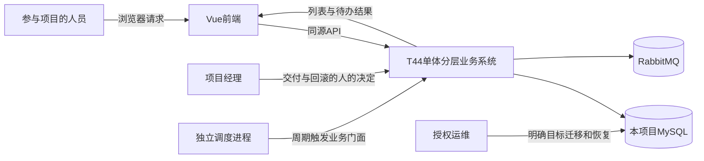
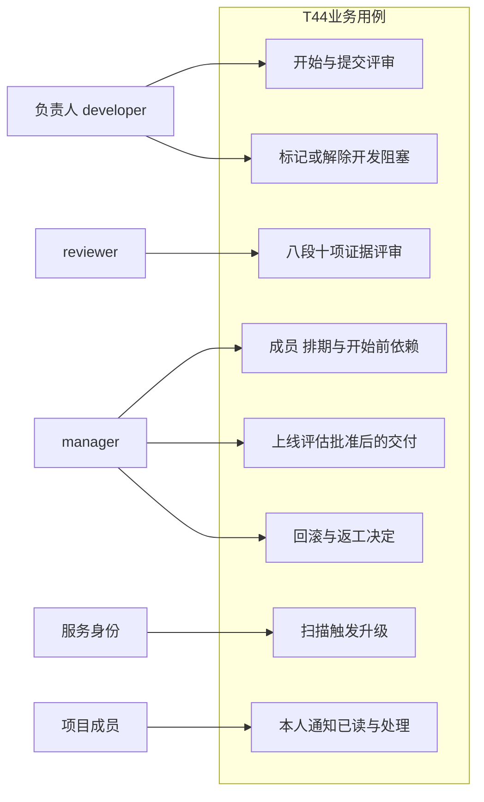
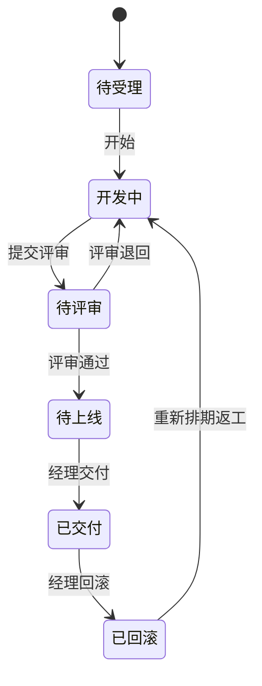
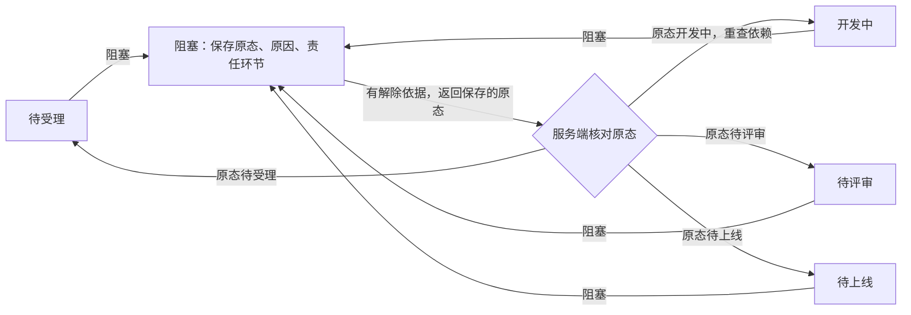

# T44软件需求规格说明书

版本：M4技术审阅工作稿 v0.4。**非最终验收报告。** 本文由AI文档岗整理、总协调依据实际审查补图修订；公开版本不包含已私密提供的姓名、学号等封面资料，报告日期留空。M2证据基线为冻结规格1.0.0及集成checkpoint `265d89bd004de626a025d7efe7102fe68b5b2dd3`；M3图示记录见[修订说明](../../docs/reports/M3-diagrams.md)。完整运行结果仍以各自准确版本的证据为准。

Agent-Role: documentation
Prompt-Ref: ROLE-documentation-M2-QUALITY-v1

M3 Editor: coordinator_agent；Prompt-Ref: ROOT-documentation-M3-DIAGRAMS-v1。

## 1 文档目的、读者与真实版本历史

本SRS使项目经理、开发/评审人员、实现岗位和验证人员能共同核对：系统必须做什么、何时拒绝、怎样判定满足要求，以及要求如何分配到设计、代码和各模块测试。原始T44任务书是验收依据，业务与技术取舍由用户决定记录、冻结版本和变更记录补充，不能由实现方便反向降低需求。

| 时点/版本 | 实际发生的工作 | 本文如何处理 |
| --- | --- | --- |
| M0团队初始化 | 责任岗、草案与实际问答归档，尚无产品实现 | 原始记录不改写为已开发完成 |
| 717cd65设计审查 | 已有OpenAPI/字典/DDL/事务设计，C1–C4不通过 | 失败报告原样保留 |
| bc0cd34及5d0c087 | 责任岗修复，准确SHA技术复审通过；Q002当时待人审 | 不倒填成当时字段方案已获用户采用 |
| M1报告提交8cf92cb/a2a68d0 | 三份报告及两份说明以阶段工作稿提交 | M1原commit保留，不宣称本文的图表在开发前已全部成稿 |
| 2026-10-23 15:15:12，ae60dc37 | 用户通过D004采用字段/错误码；总协调冻结1.0.0后派完整编码 | [冻结记录](../../records/spec-freezes/v1.json)及[D004](../../records/decisions/D004-field-errors-adopted.md)是当前准入基线 |
| M2集成迭代 | 完整模块合入、enum/seed等真实联调修复后补充图与追踪 | 本文是随开发演进的需求表达和核查稿，不是倒造的开发前全量设计 |
| M3图示与设计核对 | 依据产品审核修正说明，将主状态与阻塞路径拆图并实际渲染8图 | 成图检查与最终Word逐页检查分开，原M2的7图快照保留 |

原始提取文本在根specs/sources只读，原DOCX不上传；不移植T29或他人经历。正式组织方式参考IEEE官方公开摘要中“需求属性、信息项和生命周期内迭代”的说明，本文是项目自行组织的SRS，**不声称读完标准正文或符合未核对的条款**。[IEEE/ISO/IEC 29148-2018官方摘要](https://standards.ieee.org/ieee/29148/6937/)、[ISO官方范围说明](https://www.iso.org/standard/72089.html)。

## 2 产品范围与概念视图

### 2.1 产品定位和边界

系统服务中小软件外包团队，管理项目、交付任务、依赖排期、证据评审、上线风险、阻塞、延期升级和回滚决定。目标是让成功与拒绝都有可追溯依据，不是提供任意修改状态的CRUD面板。

浏览器、后端、数据库、消息和调度在单机拓扑内形成前后端分离的单体分层系统；不做业务微服务、集群、多地域或通用云发布平台。系统记录发布/回滚的风险与拍板事实，不替经理执行外部生产回滚。运维脚本自身的镜像/数据库恢复是另一条操作边界。

### 2.2 角色与主要用例

| 角色 | 业务职责 | 约束 |
| --- | --- | --- |
| 项目经理 | 本项目成员/开始前依赖、排期、上线与回滚决定 | 管理身份不自动获得未参与项目数据；不能代负责人开始/提交开发 |
| 负责人且developer | 开始、开发阻塞/解除、提交评审 | 必须属于本项目并负责该任务，不能跳级或自审 |
| reviewer/合格经理 | 发布带证据评审、通过/退回 | 代码评审者/批准者不能是task.owner；旧轮次证据不能复用 |
| 评估创建者与审核者 | 四视角风险/回滚预案及独立审定 | 创建者不得自审，交付仍需经理决定 |
| scope内服务主体 | 扫描按`escalation:write`创建升级 | HTTP service token不具有本人通知read/handle权限，不冒充人类经理或跨项目调用 |
| 授权运维 | 配置/迁移/备份和新隔离目标恢复 | 明确目标、凭据保密，操作成功不等于业务验收 |

消息消费者作为独立进程将事件持久化为收件人通知；通知已读/处理由已鉴权的人类收件人对本人记录操作。两者与只具`escalation:write`的HTTP服务主体分开。

图是业务职责分配，不代表每个角色拥有图中未连出的所有权限。最终动作守卫以冻结矩阵为准；页面禁用和提示不能替代服务端校验。

## 3 细化需求规格

### 3.1 功能要求

每项需求有稳定ID、触发主体/输入、必须行为、拒绝/后置条件和验收关联。这里的表述用于审需求；实现入口和模块测试另列于第7节，避免用“代码已存在”替代需求正确性。

| ID | 触发与输入 | 必须产生的结果 | 拒绝/后置条件 | 验收 |
| --- | --- | --- | --- | --- |
| FR-01 | 授权主体提交流程登记、流转或上线评估请求 | 使用冻结输入/输出/错误；实现变更同步契约及测试 | 资源/参数/权限/冲突逐码可触发；未冻结不联调，不制造虚假错误用例 | AC-01 |
| FR-02 | 责任岗定义任务/依赖/评审/决策数据 | 统一PK、最小整型/集中枚举，逐表评审后迁移 | 禁散落魔法值、字段漂移和启动时偷迁移；FK/CHECK不替代领域校验 | AC-02 |
| FR-03 | 合格人员发布当前对象/轮次评审 | 八段及有效十项逐项证据、判定、结论，保留对象SHA/模板版本 | 必需通过项缺证据不能通过；拒绝自审、旧轮次/对象不匹配 | AC-03 |
| FR-04 | 经理登记迭代/产能/计划、开始前依赖 | 保留缓冲、延期预案、前后差异；满足全部依赖后才可开始 | 同项目、自边/环、开始后依赖/转派冲突；不得悄改下游现状 | AC-04 |
| FR-05 | 编制四视角风险/回滚预案，经理决定交付/回滚 | 当前代码评审与当前排期/交付轮次的预案获审，决定人和理由留痕 | 未审/旧批准不能交付；回滚不删除历史；返工另立新计划和轮次 | 关联AC-03/05 |
| FR-06 | typed动作+expected_version+幂等键+证据 | 服务端统一状态机；成功任务/证据同事务；阻塞保存原态，解除有依据 | 非法边/越权/缺证据/并发旧版本拒绝且不改任务；拒绝独立审计 | AC-05/06 |
| FR-07 | 独立调度按版本化规则扫描未终结任务 | 最高匹配级别通知完整责任人/经理；同排期同级一次、次数与处理持久化 | MQ故障有标记待办；重复/晚到不二提醒；重启续扫；已读不等于处理 | AC-07 |
| FR-08 | 跨模块调用与PR集成 | 门面DI；静态/契约/覆盖率及准确SHA审核门禁留证据 | 缺应用、空/跳过占位测试、漏计生产源码或失败检查不得放行 | 关联AC-01/09 |

### 3.2 状态、成功与失败路径

图3表示主要交付路径。开始须满足全部前驱；评审通过须有当前有效证据；交付须由经理依据当前获审预案决定；返工须有新计划并更新轮次。阻塞路径另见图4，避免将全部往返边挤在一张图中。

Pending/Developing/Blocked/Review/Release/Delivered/RolledBack分别对应待受理、开发中、阻塞、待评审、待上线、已交付、已回滚。两图合列七状态与九类动作，图外跳转均拒绝；解除返回原态由服务端决定，不接收客户端通用target_state。阻塞不暂停延期计时，上游回滚不会自动改下游状态。

| 用例 | 成功前提与流程 | 必须验证的负向路径 |
| --- | --- | --- |
| UC-01 开始 | 负责人developer，锁前驱检查全交付，CAS任务并留痕 | 依赖不满足、他人代推、并发同版本；拒绝不能改现状 |
| UC-02 阻塞/解除 | 保存原因/责任环节/原态；合格原阶段角色提供解除依据 | 缺原因/依据、伪造返回态、回开发依赖失效 |
| UC-03 评审到交付 | 固定SHA/当前轮次评审，通过后当前风险预案另审，经理交付 | 自审、无证据、旧轮次/排期批准、开发中跳已交付 |
| UC-04 回滚返工 | 经理原因/影响/目标/预案；返工新计划、delivery_cycle递增 | 删除任务冒回滚、复用旧批准、未满足依赖返工 |
| UC-05 并发重试 | 同键同内容重放原结果，不同键同版本仅一成功 | 同键异内容、租约接管、提交确认丢失；503不能谎称审计成功 |
| UC-06 升级处理 | 每60秒UTC，三档24小时、最高档、完整收件人、稳定事件 | 20条全覆盖、重扫/重启/重复消费、MQ故障和晚到确认，通知处理不改任务状态 |

### 3.3 数据、接口与安全要求

冻结OpenAPI 1.0.0包含38操作，三类主接口及鉴权/成员/排期/通知/审计辅助入口统一由`/api/v1`访问。400/422、401/403、404、409、413/429、503及202可靠受理的具体触发见[契约说明](../../specs/contracts/README.md)。202只证明可靠事件受理，不等于通知送达；跨项目拒绝不能回显其他项目状态/版本。

数据采用18表226列，四核心表为tasks/task_dependencies/reviews/decisions；辅助表支持项目/身份、评估、计划变化、审计、幂等、outbox、升级、通知和扫描。task.version、schedule_version、delivery_cycle、review_cycle分开；普通改期不撤销同轮代码评审但撤销旧上线批准，返工/评审退回不得复用旧证据。时间为UTC Z、1000–9999年、最多6位微秒，页面北京时间显示。

会话仅存摘要且逐请求重核撤销/成员；口令安全摘要，不进入普通日志。查询参数化、表列/排序白名单；自由文本正常引号不按关键词误判。必要拒绝应留脱敏审计，审计不可用明确503/audit_id=null，不能宣称数据库宕机时仍已入库。

## 4 非功能要求与量化验收线

| 类别 | 不降低的目标 | 当前边界 |
| --- | --- | --- |
| 性能/吞吐 | 400并发稳态10分钟无失败；流转/契约校验/升级入口P95≤270ms，吞吐≥1000次/分钟 | 独立v1三批400VU/600秒已测，P95全超270；不改原阈值 |
| 演示规模 | 约40项目/6000任务/9000依赖/15000评审决定 | seed已实造11400评审+3600决定的synthetic基准数据；不是人类评审事实 |
| 原子/竞争/可靠性 | 同版本一次生效；成功与证据同事务；拒绝不改任务；重启不丢已提交数据 | 局部MySQL/CAS/故障已有证据，完整环境的系统边界另验 |
| 安全 | 所有业务入口鉴权、参与项目范围、参数化、口令/Token防泄露及撤销 | HTTP/DB局部验证不等于全部威胁模型最终验收 |
| 可维护性 | 新增一评审项/升级规则≤1配置+1模块，≤1人日 | 配置扩展有真实diff；人日/最终变更样例不无依据推算 |
| 工程质量 | 全量通过、覆盖率≥80%、有效生产代码3500–5100行 | 265d89b托管整套317通过/0跳过，Python行88.07%与前端92.21%分别记录；代码规模仍超限/压缩中，不能用测试配置凑数 |

## 5 需求审查与变更方法

需求审查分别核对来源/用户、角色、数据范围、前后置、失败分支、数据域、可测试性和跨需求冲突。例：全部经理收件人不能被100人Schema截断；重放的原请求ID必须有持久来源；API时间域与数据库一致；错误分支必须真实可触发。这些是已发生C1–C4审查，不是事后杜撰的审查表。

D001业务规则已采用，D004字段/错误码已采用，D002/D003仍标AI技术选择。冻结11文件不由文档岗修改；需求变化先记录来源/理由/影响/决定者，再同步契约、字典/DDL、调用方和测试，按准确新SHA复审。不因新代码可用就暗改v1语义。

## 6 AC验收追踪

| AC | 判定要求 | 当前证据与剩余项 |
| --- | --- | --- |
| AC-01 | 三类接口零偏差、所有错误分支逐条覆盖 | 设计/实际HTTP已有模块证据；全38操作错误矩阵继续补证 |
| AC-02 | 四核心表字段/最小类型/枚举逐表核对 | 已执行18表真实迁移与负向约束；最终集成版和恢复环境仍须绑定 |
| AC-03 | 八段十项逐项证据，缺证据不通过 | 产品评审/前端真实流程已有局部证据，不将synthetic seed当人类证据 |
| AC-04 | 未满足依赖不能开始，排期前后差异 | domain/HTTP/Rows/浏览器局部已测，完整矩阵按模块记录 |
| AC-05 | 全合法状态、非法跳级拒绝、阻塞必填 | 真实浏览器七态及后端守卫测试；独立v1已发布且整体未通过；修复后独立复测待安排 |
| AC-06 | 同任务同版本仅一成功，失败留痕 | 实际MySQL并发/CAS/拒绝审计局部验证，不能用SQLite代替 |
| AC-07 | 20超期全覆盖、重扫不重、重启可续 | scheduler模块含实际MySQL/CLI证据；完整MQ通知链另分范围 |
| AC-08 | 400并发10分钟/P95≤270ms且原始数据可复现 | 独立v1三批正式P95均失败，见M4测试报告 |
| AC-09 | ≥80%覆盖/全量通过及真实AI留痕 | 265d89b四job成功及Python/前端覆盖率已留证；准确新版审核、独立验收与人工留痕仍须分别核实 |

## 7 FR到设计、实现和本模块测试

完整映射在[M2追踪矩阵](../../docs/reports/M2-traceability.md)，为每个FR列概设模块、详设入口、实际代码、本模块用例/原始日志与剩余系统验收。root已用5e07887机械迁移至tmp/并按999_递减命名；当前路径见映射，旧日志命令保持历史，不将collect成功冒充全量执行。

本文只接收公开冻结的测试模块报告/交接，不联系独立测试或读取私有用例。学生研究报告成品由本人撰写；本仓库[AI证据材料](ai-development-report.md)和[自写模板](student-study-template.md)不能署为学生独立完成的最终研究报告。提交物与私密封面处理见[提交对照](submission-map.md)。

M2新CI证据：265d89bd004de626a025d7efe7102fe68b5b2dd3的[run39931640641](https://github.com/HJY147/t44-dev-trace/actions/runs/39931640641)四job static/contracts/coverage/frontend成功；归档[JUnit汇总](../../records/ci/39931640641/junit-summary.json)显示覆盖率整套317通过、0失败/0错误/0跳过，whole Python行2399/2724=88.07%，前端行308/334=92.21%，见[M2回执](../../docs/reports/M2-ci-snapshot.json)。这是准确SHA的托管MySQL/Rabbit证据，不代表独立验收、400并发性能、其他版本Docker或代码规模通过。

后续部署实收：准确应用SHA`31f4dff935973162544951fe0660ce208edb7007`的[Docker run39932723829](https://github.com/HJY147/t44-dev-trace/actions/runs/39932723829)成功；[公开原始结果](https://github.com/HJY147/t44-dev-trace/blob/cfeda743ec2118b0824313cf63c8526880bc79f1/agents/deployment/integration-validation/run-39932723829/result.json)显示真实构建/完整Compose、4个API worker、独立MQ/扫描、HTTP/SPA/双层JSON413、0600只读凭据/共享flock/轮换撤销、停写备份和新隔离库19表行数/checksum一致、18业务表226列复核、源重启HTTP200。旧run39932416571失败保留。这是托管Linux小规模synthetic联调，不是40项目正式压测、云部署、异机队列灾备或独立验收。

## M4当前测试截止状态

当前汇总截止集成2e0481f，完整结果见[测试结果技术报告](test-results-report.md)。指定0448fec开发CI335通过/零跳过，Python43文件2493/2818行88.47%、分支77.73%，前端24通过/307至333行92.19%；同SHA完整容器恢复通过。独立v1针对e8ceefe整体未通过，900结果340/183/328/49（183含歧义，非183bug），三个400VU/600秒P95为3035/1908/5506ms，均超270；吞吐和稳态零失败通过。C-P4仅在7c27限定关闭，5886超限786仍failure。IAT01开发修复已合，其他缺陷进行中，不是独立复测通过。

八图沿用M3已渲染资产，图源代码不改；M3 manifest的整篇源文件hash属于当时快照，本轮新增文字另存M4源hash，不能将当时hash误当当前整篇一致。当前Word为截止技术审阅稿，不是最终验收或学生研究成品。
