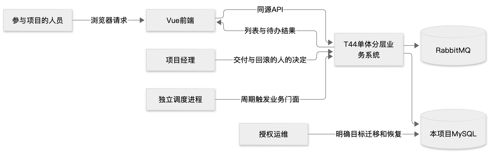
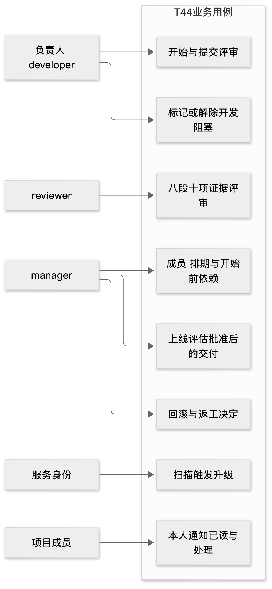
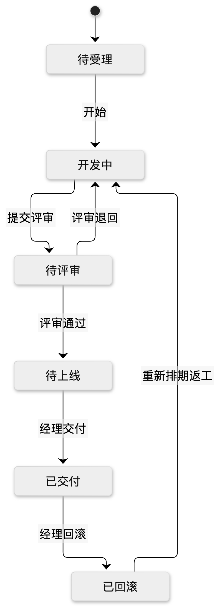
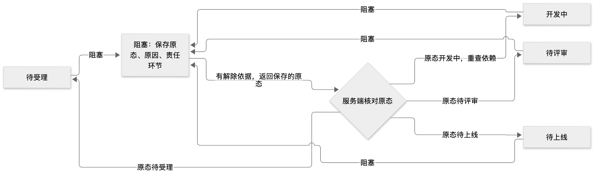

# T44软件需求规格说明书

> 本轮版本说明：历史M6需求正文及1.1版本说明保留；本轮云C的需求→设计→验证状态见第6节和[云复核839补记](cloud839-evidence-addendum.md)。旧正文“当前/无新正式结果”仅指原截止，不代表本轮环境或完整执行结论。

本说明书供教师、开发与审核人员核对T44研发交付管理系统的业务边界和验收条件。当前应用固定bc5aef9c62393134582affb7a690acb33ac2b833，规格为1.1.0；已实现流程有同源开发验证，但6307行规模超限、正式性能原三组P95失败，完整独立验收尚未通过。本文由AI文档岗据公开来源整理，不是学生个人研究正文。

## 1 依据和版本

任务书、作业要求和提交说明是原始依据；[需求基线](../../specs/requirements.md)、[业务规则](../../specs/business-rules.md)、[1.1冻结清单](../../records/spec-freezes/v1.1.json)将其转为可执行约束。1.0在ae60dc3冻结；D005/D006引入人力生命周期，1.1冻结189dc4a。当前38操作、130 Schema、18业务表226字段及14冻结文件保持。新增会话隔离和理由呈现遵守既有契约，不回写冻结文件。

本轮文档从ceed2d8起步；[来源清单](../../docs/reports/M6-source-manifest.json)和[64源索引](../../docs/reports/M6-function-sources.json)绑定准确版本。旧七稿原字节见[M5历史索引](../../docs/reports/M6-historical-report-index.json)，M4 Word和M5图记录保留；旧M5菜单图只代表当时75行为。

## 2 范围和参与者

系统面向中小软件外包团队，管理项目、迭代、任务、依赖、代码评审、上线风险、发布回滚决定、延期升级及通知。产品的发布/回滚是人员决定和证据记录，不是通用云发布平台。浏览器、API、MySQL、MQ和扫描器为单体分层的独立进程，运行时无在线大模型调用。

| 参与者 | 输入与权限边界 | 主要输出 |
| --- | --- | --- |
| 项目经理 | 本项目任务、迭代工时、计划及决定；不能越项目 | 计划、负责人、发布/回滚/返工决定与责任证据 |
| 开发人员 | 有效项目身份及当前迭代工时；提交实现和阻塞依据 | 任务进度、证据、阻塞/恢复记录 |
| 评审人员 | 依模板作八段十项判断；同一责任人的自审受限 | 有证据的评审或拒绝、评估审核 |
| 调度服务主体 | 明确服务scope和项目边界，只执行升级职责 | 持久升级事件与通知任务，不代替人的read/handle |
| 已登录人员 | 会话有效且在项目成员范围内读取 | 仅本人/项目授权记录；退出后清空界面上下文 |

## 3 功能要求与接口

| 编号 | 输入与必要行为 | 输出及拒绝路径 | 设计与开发验证 |
| --- | --- | --- | --- |
| FR01 接口契约 | 三类核心接口及38操作先定义路径、输入、错误；结构校验和业务守卫分层 | Envelope或冻结错误；validateContractPayload成功不代表业务已准入 | API/Runtime；986 HTTP与985 MySQL HTTP、同源CI |
| FR02 字段建表 | 任务、依赖、评审、决定四核心表及支撑表，稳定整数码、类型和FK | 显式迁移/检查结果；拒绝错库与结构不符 | Rows/UoW/migrations；956、988、989、993模块检查 |
| FR03 证据评审 | 八段式记录、十项清单及证据，评审轮次和版本一致 | 缺证据、自评或陈旧评估拒绝，不产生半写 | Reviews/Workflow；986/985负向与状态用例 |
| FR04 排期人力依赖 | 新建/允许转派目标须有效developer并有本迭代工时；计划/依赖有前后值和理由 | CAPACITY_REFERENCE_INVALID、依赖/版本错误；拒绝不改任务或计划版本 | Tasks/Projects；1.1并发、bounded reader及新理由HTTP |
| FR05 上线回滚 | 数据、权限、外部依赖、观测四视角风险和回滚预案，审核后人员决定 | 陈旧/未审/无权限拒绝；决定人、版本、证据持久化 | Workflow/Reviews；986/985与独立已发布子项 |
| FR06 七态闭环 | 统一九操作；阻塞有原因和环节，解除有依据；返工重验计划/依赖/人力 | 非法动作和同版本竞争拒绝；成功业务/审计同事务 | 994纯状态、986/985真实HTTP及CAS |
| FR07 延期升级 | cutoff/keyset扫描，责任人/经理快照，MQ和消费幂等、故障站内待办 | 升级202只是接受；通知已读/处理不等于MQ确认 | 973/974/990/991扫描、976至980消息与Docker |
| FR08 工程质量 | 模块门面/注入、静态/契约/全源覆盖率、准确SHA审核及真实失败记录 | 未过门禁不合main；开发绿不能替代独立验收 | bc5全源510/89、42243红与bc5窄关闭；规模仍失败 |

全部操作的路径、输入参数、输出Schema和HTTP错误见[M6接口表](../../docs/reports/M6-api-contracts.md)。函数的前后条件、事务和副作用见[M6函数I/O](../../docs/reports/M6-function-contracts.md)。不得把仅结构成功写成无条件可执行，也不自动重试产生新的业务意图。

### 3.1 状态和容量规则

状态1待受理、2开发、3阻塞、4待评审、5待上线、6已交付、7已回滚；允许动作依[状态机](../../backend/t44/domain/state_machine.py)和冻结规则。阻塞保留来源状态；解除需证明，不凭前端按钮判断准入。返工7→2推进交付周期，并重验有效身份、人力、原排期及依赖。

状态1至5任务的负责人必须保留在当前迭代capacity；6及7可移出capacity。成员/开发角色移除保护仍包括1至5及7，不能将这两个集合混为一谈。调整迭代工时须检查全部在途任务，不能只检查原工时表删掉的人；项目锁和CAS使创建/转派/返工与工时移除串行校验。没有自动分配或预算耗尽算法。

### 3.2 历史理由与会话边界

新任务/迭代计划修改及返工成功时，reason原文与schedule_changes、审计、幂等完成在同一业务事务提交。旧审计只有满足本页、同项目、task/to_version唯一对应、actor/时间/版本/完整Plan/证据一致时，才在本次响应投影理由；不改旧audit、分页顺序/总数或重放快照。模糊/不匹配/缺失历史应明确显示未提供可核对理由。数字和bool、数组顺序、字符串原文不能因宽松比较混同。

退出成功或当前会话失效须清项目、成员、字典等上下文并卸载表单/抽屉。A的旧成功/403等响应在B登录后不得写回B上下文或触发旧refresh；当前会话403/409仍保留原恢复流程。依据为新9560生命周期和c79理由组件，不能套用旧M5 inert shell结论。

这两项实现已由开发用例和准确SHA专项审核覆盖；独立v2发现UI001/002/003的原4c报告保留，新独立v3结果尚未发表。开发修复及窄审核不写成独立结案。

## 4 非功能目标和当前差距

| 要求 | 验收线 | 当前证据与边界 |
| --- | --- | --- |
| 代表数据 | 约40项目、6000任务、9000依赖、15000评审/决定 | Docker仅2项目40任务，不能替代正式数据 |
| 正式性能 | 400并发600秒、P95≤270ms、吞吐≥1000/分钟、稳态无业务失败 | 原v1三组P95 3035/1908/5506ms均失败；无新正式结果 |
| 幂等并发持久 | 同键重复不复做，同版本只一次；已提交数据可恢复 | 模块/HTTP/Docker及独立部分观察，完整故障矩阵未验完 |
| 安全 | 会话撤销、项目隔离、参数化、不明文存储/泄露密钥 | 开发及已发表独立子项；不宣称全站安全/无障碍通过 |
| 可维护扩展 | 新评审项/升级规则≤一配置加一模块、≤1人日且有实证 | 扩展示例与测试有记录，实际人工工时证据仍不足 |
| 测试与规模 | 全测通过、全源覆盖率≥80%、有效源3500至5100 | bc5开发510/89通过、行89.21%/93.33%；6307超1207仍失败 |

## 5 验收追踪与变更控制

| AC | 对应要求 | 本轮可确认 | 尚不能确认 |
| --- | --- | --- | --- |
| AC01 | FR01 | 38操作/开发契约和HTTP；独立4c阶段部分 | 全551错误条件/输入权限矩阵零偏差 |
| AC02 | FR02 | 18业务表226字段、19表恢复校验 | 全库任意DDL等价、所有独立白盒 |
| AC03 | FR03 | 八段十项的正负例 | 全模板/轮次/证据真实性完整独立验收 |
| AC04 | FR04 | 人力/依赖开发并发、理由窄审 | 新版独立UI完整复测 |
| AC05 | FR05/06 | 九动作与评估/决定开发验证 | 全状态角色组合独立结案 |
| AC06 | FR06 | CAS/幂等/成功拒绝事务模块证据 | 全租约/丢ACK/audit-only独立故障 |
| AC07 | FR07 | 真实MQ/Docker、v2四受限故障子集 | 原消息捕获、全部收件人/时钟/中批矩阵 |
| AC08 | 性能 | 原失败和吞吐/稳态结果分别保留 | 新正式P95通过 |
| AC09 | FR08及交付 | 准确CI、审核红绿、六条实际AI版本 | 规模、学生人工证据/正文及完整最终放行 |

所有业务变更先说明原需求、人的取舍和影响，再形成设计/接口/DDL/测试和新冻结。D005/D006属于已采用业务变更；会话/理由修复遵守既有契约。普通实现问题的自治授权不能替代人决定需求。详细证据见[M6追踪矩阵](../../docs/reports/M6-traceability.md)与[测试报告](test-results-report.md)。

## 6 云C后发需求与验收追踪

本轮C为0dfb55c2191200d947c5423fd9ee74bb0812cc5a，原400客户端、60秒预热、600秒稳态、P95≤270ms、每完整分钟≥1000、零错误门槛不改。实际400客户端发压，但0完整正式组；任务短窗稳态1次502、流转P95 3645.763385ms，校验预热2次502后中止、稳态NOT_RUN。计划1396条不等已执行通过，触及9个case而完整目录后置条件0可证。

[逐项FR/AC追踪](cloud839-evidence-addendum.md#2-需求设计验证的当前追踪)将接口响应、排期持久化、状态/评审、扫描消息、性能和交付缺口分别列明。两组枚举40项目/6000任务；9000依赖/15000评审决定仍只是中性fixture元数据，未由本轮API独立枚举。C6310行、超1210仍未解决。资源回收/释放和开发候选不替代产品验收，本补记不变更业务规则或冻结清单。
