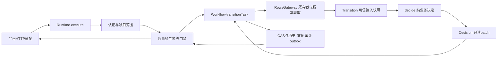
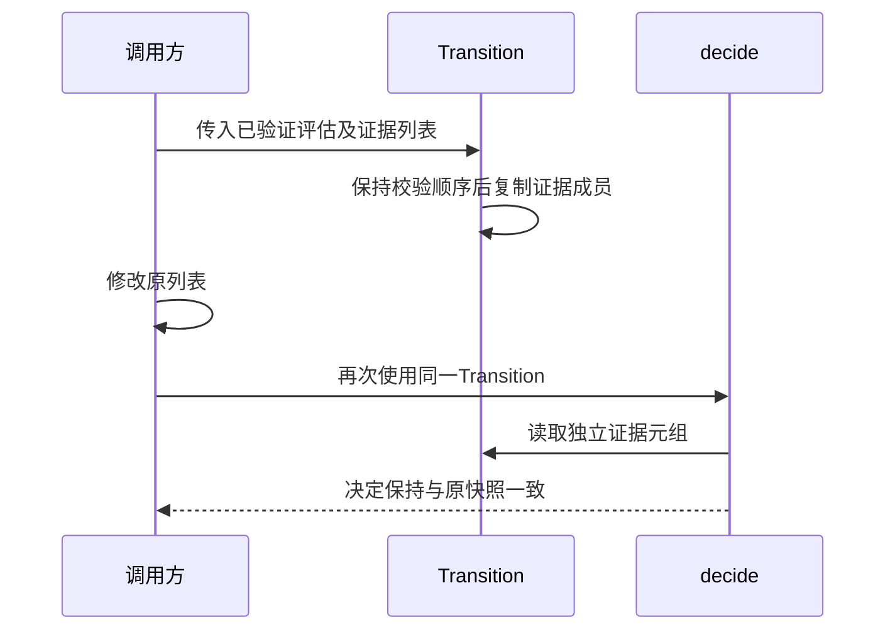

# 内部领域接口 V2：设计与实现后发同步

本补记对应生产变更d63fe18及数据库10766775，组合开发验证bbd0b3e1。它是2026-10-25内部设计更新，不回写原v1.2冻结清单，也不改变已冻结的REST、DDL或业务判断。总协调的事前边界见[执行决定](../../records/decisions/internal-size-and-cloud-reuse-20261025.md)，各岗先行设计在tmp/811_backend_size/domain-v2-design.md、数据库seed-v2-design.md保留。

## 1 输入、输出与责任

| 部分 | 输入 | 输出及边界 |
| --- | --- | --- |
| Runtime / Call | 已识别操作、原始认证信息、路径和校验回调 | 原鉴权、项目范围、幂等、事务和异常协议保持；不由领域对象建立数据库连接 |
| Workflow.transitionTask | 同一事务内加锁的任务、评审、评估、交付记录及请求 | 先按原次序检查版本、归属和原批准引用；构造可信Transition，应用决定及CAS、历史、审计/outbox |
| Transition | 可信持久映射及请求映射、冻结角色码、实际布尔门禁、证据元组和预验证返工排期 | 检查内部状态、计数、身份/状态码类型与输入容器；独立快照被消费的输入，不写库 |
| decide / Decision | Transition | 按原业务顺序拒绝，或返回顶层只读任务patch及决策类型；没有HTTP、SQL或审计副作用 |

成员→状态→阶段角色/负责人→详情→证据→评审/发布/回滚/依赖顺序不因去除旧Command/Gate/Cycle桥而移动。D008仅细化既有失败槽的优先级；缺失或跨任务评估、请求task/assessment版本和原门禁仍按冻结契约处理。

状态、动作、角色和责任阶段的数值取自冻结契约的显式字典；显示枚举重新排列不能改变存储码。错误码名称在契约加载时形成不可变快照并进行身份锁定，维持原1–41映射。

## 2 快照审核中的真实反馈

初版a07只对映射做浅复制。审核岗实际证明：修改调用方的assessment.review_evidence列表，会改变同一Transition的DELIVER判断。该反例说明顶层只读不足以保证所消费输入的稳定性。

d63在原输入校验之后，将实际消费的review_evidence序列成员保存成独立tuple。原列表append不再给既有context补证据，clear不再撤销其证据；两方向先红后绿，旧拒绝报告保留。此处证明的是被消费序列的快照边界，不宣称所有未使用嵌套对象都递归不可变，也不将纯域反例扩大为已复现REST越权或MySQL并发漏洞。

## 3 合成数据 V2 与验证追踪

新版种子允许调整算法和旧样本摘要，保留参数/返回形状、seed+anchor可重现、40项目/6000任务/9000依赖/15000评审与决策、七状态及独立角色、完整发布/回滚样本和关系/时间/容量/版本性质。DDL默认值的复用逐字段核对；旧V1 marker和不兼容版本须拒绝覆盖，V1历史摘要和原失败不删除。

| 设计责任 | 实际开发检查 | 结论限制 |
| --- | --- | --- |
| 纯域与快照 | 最终172域/边界目标及143原HTTP目标；包含57,120组合的一个差分目标 | 有15旧构造器检查，不算新域接口覆盖；不得与组合664重复累计 |
| 迁移/默认值/claim | 对精确935的迁移顺序、默认值、租约优先级及故障差分 | 这些新目标必须在浅克隆CI显式取得935对象；不能改成跳过 |
| 种子V2 | 旧975当前版本性质、批大小250/127重现、35外键与业务时间/身份/状态/指针性质 | 旧V1 golden不是新V2通过证据；开发SQLite性质不等于真实MySQL并发 |
| 组合开发与容器 | CI40193953158：664目标全过、全Python行2475/2761；Docker40195832268：4worker、V2种子40任务、19表恢复一致 | 原固定计数5875超775；独立验收、云端400/600性能和学生亲写研究仍另行完成 |

详细原件、精确提交与失败/修正见[组合验证](../../records/ci/combined-size-20261025.md)、[后端复审](../../reports/reviews/domain-v2-d63fe18-snapshot-closure.md)及[数据库复审](../../reports/reviews/database-size-1076677-seed-v2.md)。
