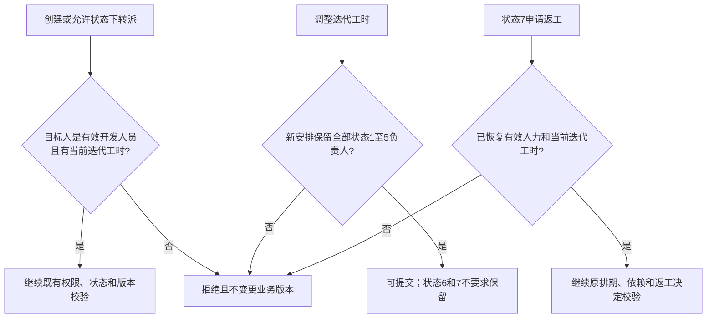

# T44 需求与验收基线

状态：v1.0.0原始冻结保留；本次为D005/D006驱动的v1.1需求变更，设计已获限定技术审查准入，等待新版独立冻结及实现验证。原始任务书约束已转写，业务规则D001及字段/错误取舍D004已获用户采用。不能把本文件当作已实现或已验收的结果。

## 目标和边界

服务中小软件外包团队，管理项目迭代、交付任务、依赖、评审、上线风险及回滚决策，使阻塞、延期、并发冲突和回滚均有责任人及证据。浏览器前端调用Python业务后端；数据库、消息队列、调度进程在单台应用服务器运行，采用单体分层，不做业务微服务或集群。

产品中的发布和回滚是交付流程、风险预案及拍板记录，不扩展为通用云部署平台；本项目自身的部署脚本由部署岗另行维护。运行时不因“AI留痕”额外引入在线大模型调用。

## 功能和验收映射

| 功能 | 必须实现的行为 | 验收与证据 |
| --- | --- | --- |
| FR-01 接口契约 | 流程登记、任务流转、上线评估三类接口先定义输入/输出/错误；冻结后联调，变更同步契约和测试 | AC-01，所有错误分支覆盖，实测与文档零偏差 |
| FR-02 字段与建表 | 任务、依赖、评审、决策为四张核心表；统一主键，最小可用类型，布尔/枚举最小整型；逐表评审后迁移 | AC-02，字段标准、DDL和评审证据，无散落魔法状态 |
| FR-03 证据评审 | 项目制定八段式记录与十项清单，每项有证据位置和判定；无证据不能通过 | AC-03，缺证据负向用例及记录 |
| FR-04 排期依赖 | 迭代、人力、计划、缓冲、延期预案；依赖不满足不能开始，计划变更保留前后值；创建/允许状态下转派的负责人须有当前迭代工时，状态1至5的负责人不能从该迭代工时安排移除 | AC-04，不能强行开始，差异可追溯；缺人力时拒绝且不改版本，竞争操作后不产生缺人力的在途任务 |
| FR-05 上线回滚 | 数据/权限/外部依赖/观测四视角风险，应对和回滚预案；未经评审不能发布 | 上线门禁、预案版本和决定人记录 |
| FR-06 状态闭环 | 后端统一校验七种状态，阻塞有原因/责任环节，解除有依据；非法及并发更新拒绝且留痕；已回滚可移出迭代工时，返工恢复开发前重新验证有效人力及原排期、依赖证明 | AC-05/06，成功流转及日志同事务，两请求同版本仅一次成功；返工缺人力时任务、周期、决定和差异不写入 |
| FR-07 延期升级 | 调度扫描，MQ投递给责任人/经理，扫描与消费幂等，次数及处理结果持久化 | AC-07，20条超期全覆盖，重扫/重启不重复，MQ故障降级站内待办 |
| FR-08 工程门禁 | 模块门面和依赖注入；静态、契约、覆盖率三项检查及审核绑定SHA | 失败的真实PR不能合入主干，保留失败及成功证据 |

## v1.1 人力生命周期的可验收细化

来源是用户明确采用的[D005](../records/decisions/D005-capacity-lifecycle-adopted.md)和[D006](../records/decisions/D006-rolled-back-capacity-adopted.md)，不是从测试结果推定业务选择。技术细化见[已审变更提案](changes/capacity-lifecycle-v1.1.md)。

- 创建任务或在原允许状态转派前，接手人须是本项目有效开发人员且已在当前迭代登记可用工时。未登记时返回该操作声明的`CAPACITY_REFERENCE_INVALID`，任务及版本不变。
- 修改迭代计划时，须检查该迭代全部状态1至5任务的负责人，不能只比对原工时表删去的人。新工时安排必须包含这些负责人；拒绝时计划、计划版本、排期差异均不写入。
- 状态6已交付及7已回滚的负责人可从迭代工时安排移除。7返工进入2前，必须恢复有效开发身份和当前迭代工时，并继续满足既有经理决定、排期和依赖条件。
- 工时安排与项目成员身份是两套保护：既有成员/开发角色移除保护仍包含状态1至5及7；D002的开发后不可转派边界不变。本次没有自动分配、工时预算耗尽或跨迭代调配算法。
- 计划调整与创建、转派、返工在同一项目锁规则下串行检查；若移除的是拟激活任务的负责人，不能双方成功后留下在途任务缺人力。合法转派后再移除原负责人可以依次成功。保留原鉴权、幂等重放、CAS、事务和拒绝审计规则。

图表示准入条件，不规定各既有错误分支的优先级；实现须沿用原操作的校验顺序。此图和新增验收点属于1.1需求，不倒填为1.0已验收行为。

## 非功能与实测

- 按约40项目、6000任务、9000依赖、15000评审/决策记录准备可复现的合成数据，解释生成、代表性和限制。
- 正式压力稳态400并发持续10分钟，无业务失败，任务流转、契约校验、升级通知接口的P95不高于270ms，吞吐至少1000次/分钟；记录并发口径、请求组成、机器和发压端资源、原始数据与复现命令，预热不挤占10分钟。
- 同一提交重试幂等；不同请求争抢同版本只允许一次生效；进程重启不丢失已提交数据，调度可续扫。
- 所有业务接口统一鉴权和项目成员范围；越权、注入尝试、明文存储和失效/被撤销Token有拒绝及安全记录，口令/Token不得进入普通日志。
- 新增评审项或升级规则不超过一个配置文件加一个模块，且工作量不超过1人日，给出真实变更差异和验证；不以口头保证替代。
- 覆盖率至少80%、全量用例通过。生产源代码有效规模3500～5100行，统计口径公开，测试/配置分列，排除依赖、生成物、纯注释与空行，不填充凑数。

## 正式交付

最终代码、测试结果、需求报告、设计报告、AI可执行规格及说明、AI时代软件开发研究分析报告。研究分析含各阶段技术和提示词、质量保证、协作与踩坑、任务书第12节、本人亮点、课程建议。个人观点和人工操作须有真实来源。

AI留痕须真实积累：提示词演进不少于6版、人工修改对照不少于12条、幻觉不少于3条、上下文与最终代码对应不少于5处。岗位分叉不等于提示词演进，AI改码不等于用户亲改，候选风险不等于发生过的幻觉。

## 人机边界

AI负责提出设计、编码、自测、审查和整理。最终状态出口/结项口径、字段及错误码取舍、实际回滚的决定须归属于明确的人；用户已采用的业务规则见business-rules.md；实际发布/回滚仍须运行时对应人员逐单决定。

必须交付超期扫描及幂等通知伪代码与复杂度分析，状态迁移表及拒绝条件、接口错误码表、四核心表字段规范和DDL逐表评审证据。
